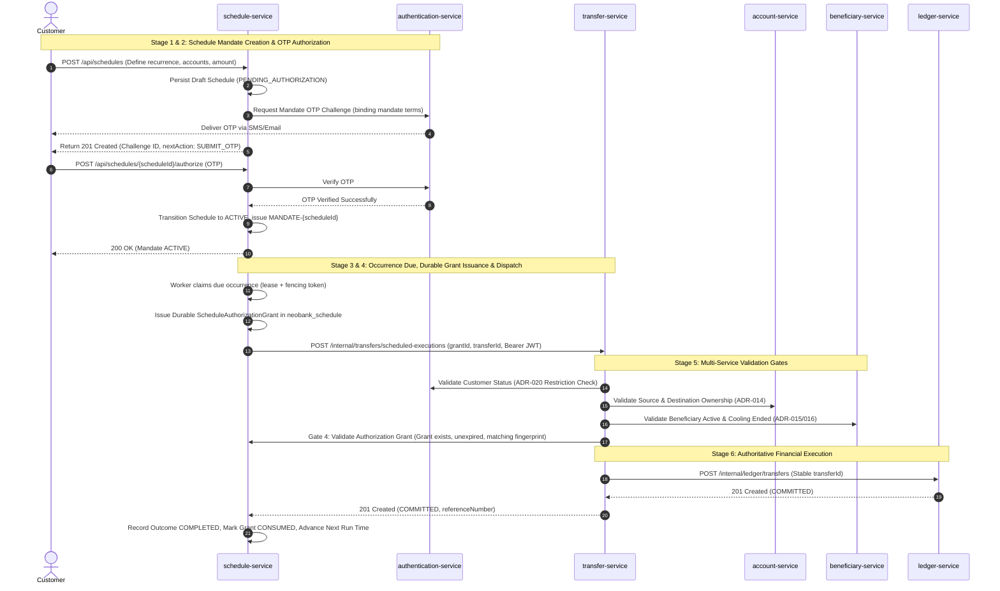
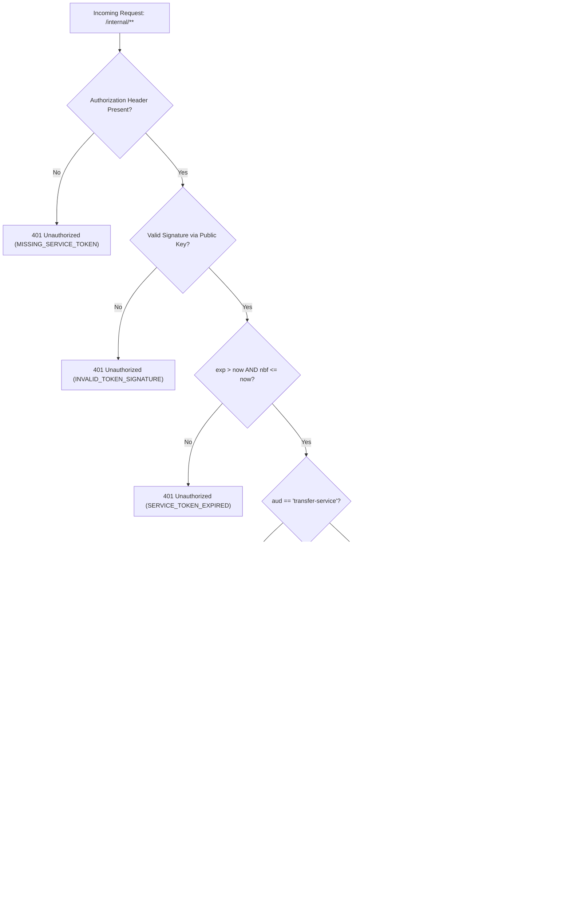
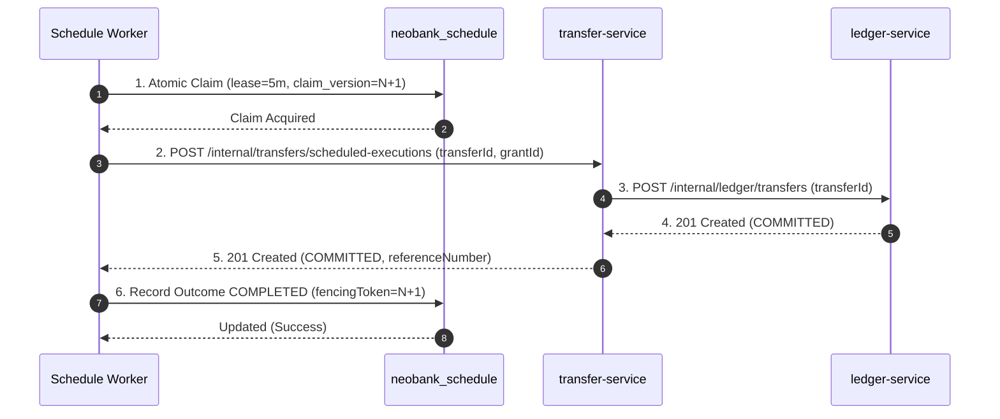
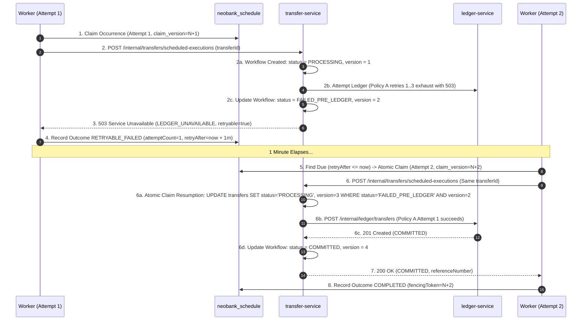
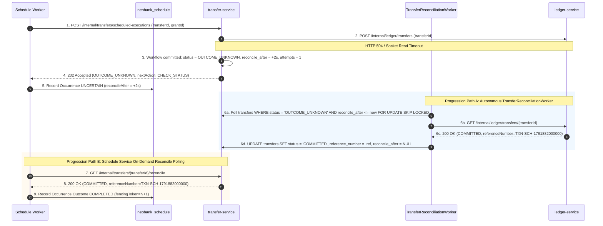
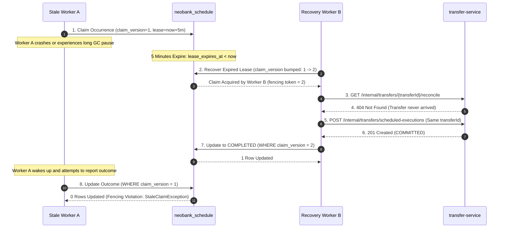
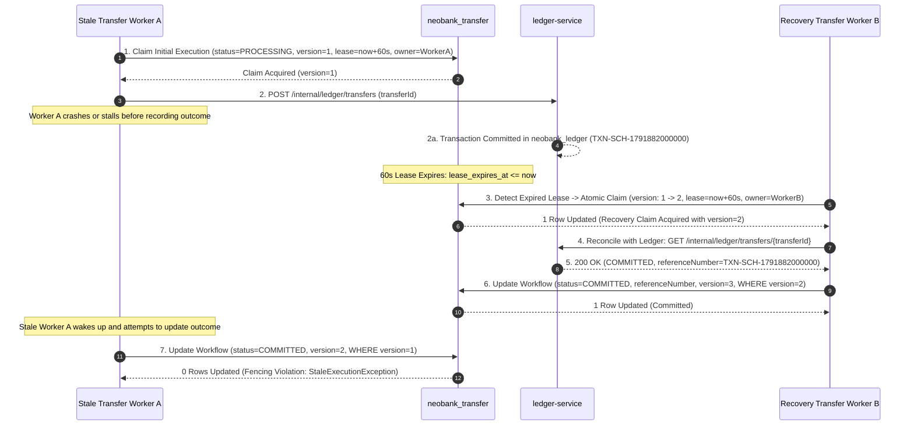

# NeoBank Core Services Architecture Specification

## 1. Architecture Overview
This document defines the formal architecture, boundaries, ownership, and design decisions for the NeoBank core backend microservices. The architecture is explicitly designed to separate concerns between account management, transfer orchestration, authoritative financial mutations, and scheduled execution. 

> **Important Architectural Principle:**
> The source of truth is the Ledger Service's authoritative financial state and transaction record. The Account Service balance and transaction history are synchronized read models. Kafka transports the `BalanceUpdatedEvent` and `TransactionCreatedEvent` asynchronously, and the Transactional Outbox Pattern guarantees reliable publication of the events after the financial database transaction commits.

## 2. Current Project Scope
The current implementation scope covers the following four microservices:
1. `account-service`
2. `transfer-service`
3. `ledger-service`
4. `schedule-service`

The current approved technical baseline across these services is:
- Java 17 LTS
- Spring Boot 4.1.1
- Maven
- Spring MVC (`spring-boot-starter-webmvc`)
- `spring-boot-starter-test`
- PostgreSQL 17 (local installation hosting four service databases under ADR-018)
- Flyway (database schema migration management under ADR-018)

Currently, JPA/database entities, Spring Security filter chains, event buses (Kafka), or service discovery layers are not yet implemented.

## 3. Service Boundary Principles
- **Rule 1:** Each service owns its own domain data.
- **Rule 2:** No cross-service database foreign keys.
- **Rule 3:** Do not share JPA entities between services.
- **Rule 4:** Services communicate through APIs/events, not direct database access.
- **Rule 5:** `transfer-service` does not directly mutate financial balances.
- **Rule 6:** `schedule-service` does not directly mutate financial balances.
- **Rule 7:** `ledger-service` is the authoritative financial mutation boundary.
- **Rule 8:** `customer-service` owns customer identity/profile.
- **Rule 9:** `account-service` stores `customerId` as the logical reference to `customer-service`.
- **Rule 10:** Do not introduce additional microservices unless explicitly approved.
- **Rule 11:** `account-service` balance and transaction history are explicitly READ MODELS / SYNCHRONIZED COPIES and NOT the financial source of truth.

## 4. Customer-Service / Account-Service Relationship
`customer-service` and `account-service` represent separate business concepts. 
- A Customer has a 1-to-N relationship with Accounts (`Customer 1 : N Accounts`).
- `customer-service` is the logical owner of customer identity, profile information, and the canonical customer record. It remains an external logical dependency in the current project (not scaffolded or implemented).
- `account-service` owns account records, operational account data, and the logical association between an account and its customer (`Account.customerId`).
- There must NOT be a cross-microservice database foreign key between `customer-service` and `account-service`. 
- `account-service` logically stores `customerId` (e.g., `C1001`) to map accounts to their owner. 
- No direct cross-service database access and no sharing of JPA entities.
- Account ownership validation occurs strictly through a trusted service boundary under ADR-014.

## 5. Account-Service Responsibility
**Purpose:** Answers *"What banking accounts belong to this person?"*

**Owns:**
- Account domain
- Account metadata
- Customer → Account logical relationship (`customerId`)
- Account ownership validation capability (authoritative internal verification that a specified account belongs to a specified `customerId` for authorized internal service callers under ADR-014)
- Account type
- Account status
- Account information/query APIs
- Customer-facing balance read model (synchronized via Kafka events)
- Customer-facing transaction-history read model (synchronized via Kafka events)

**Explicitly Does NOT Own / Must NOT:**
- Customer profile or canonical customer record (owned by `customer-service`).
- Inferring account ownership from login credentials alone or trusting unvalidated client claims.
- Perform authoritative financial debit
- Perform authoritative financial credit
- Independently mutate financial state
- Own the authoritative transaction record
- Transfer workflow/orchestration
- OTP
- Scheduling
- Ledger execution / authoritative financial state mutation

## 6. Transfer-Service Responsibility
**Purpose:** Answers *"Should this transfer happen, and what stage is the transfer currently in?"*

**Owns:**
- Transfer workflow
- Transfer lifecycle and transfer state machine
- Validation
- Confirmation
- Deriving authenticated caller identity from trusted authentication context and resolving customer identity through approved mapping under ADR-014
- Validating source account ownership (and internal destination account ownership for `OWN_ACCOUNT`) through Account Service prior to transfer workflow creation and before financial execution under ADR-014
- Determining whether OTP authorization is required
- Requesting OTP challenge creation and delivery coordination through Authentication Service
- Requesting verification and interpreting the verification result
- Allowing the transfer workflow to continue only after successful verification when OTP is required
- Database-backed request/workflow idempotency (Idempotency-Key, request fingerprinting, workflow state & outcome recovery)
- Execution orchestration

**Explicitly Does NOT Own / Must NOT:**
- Direct mutation of the authoritative account financial balance. It must request execution from `ledger-service`.
- Independently implementing a competing OTP lifecycle or maintaining a separate authoritative OTP verification state.
- Fraud assessment or risk evaluation (deferred from current scope).
- Trusting client-supplied `customerId`, `userId`, or account ownership assertions in request bodies or query parameters.
- Direct database access to Customer Service or Account Service.

### 6.1 Create Transfer API — FINALIZED CONTRACT

**Owning service:** Transfer Service  
**HTTP method:** `POST`  
**Endpoint:** `/api/transfers`  
**Purpose:** Validate a customer transfer request, create one transfer workflow, assign its stable identifiers, and return the current workflow state.

This endpoint creates a transfer workflow. It does not itself confirm the transfer or execute the financial transaction. A successful creation response does not mean that money has been transferred.

#### 1. Request DTO — CreateTransferRequest

The request body contains exactly these seven fields:

| Field | Required | Contract |
|---|---|---|
| `sourceAccountId` | Yes | Source account selected by the customer. Transfer Service must validate that the authenticated caller is authorized to use it. |
| `transferType` | Yes | Enum: `OWN_ACCOUNT`, `OTHER_BANK`, `MOCK_UPI`. |
| `destinationAccountId` | Conditional | Required for `OWN_ACCOUNT`; must be `null` or omitted for `OTHER_BANK` and `MOCK_UPI`. |
| `beneficiaryId` | Conditional | Required for `OTHER_BANK` and `MOCK_UPI`; must be `null` or omitted for `OWN_ACCOUNT`. |
| `amount` | Yes | Positive monetary amount represented using appropriate decimal precision. |
| `currency` | Yes | Uppercase ISO currency code, such as `INR`. |
| `remarks` | No | Optional customer remarks. |

The request must contain exactly the seven defined body fields. Do not add identifiers, workflow state, transaction results, or destination display fields to this DTO.

**Destination validation rules:**
- For `OWN_ACCOUNT`:
  - `destinationAccountId` is required.
  - `beneficiaryId` is not required and should be `null` or omitted.
- For `OTHER_BANK` and `MOCK_UPI`:
  - `beneficiaryId` is required.
  - `destinationAccountId` must be `null` or omitted.
  - Transfer Service must resolve the registered beneficiary through the existing Beneficiary Service capability and use validated server-side destination details.
  - Transfer Service must not blindly trust client-supplied bank account numbers, UPI identifiers, destination names, or display references.
- Do not invent additional beneficiary eligibility rules or cooling periods that have not been separately finalized.

**Client-owned fields (Must NOT be in request body):**
The request body must not contain:
- `transferId` — generated and owned by Transfer Service.
- `referenceNumber` — generated and owned by Transfer Service.
- `transactionId` — owned by Ledger Service.
- `status` — determined and maintained by Transfer Service.
- `customerId` or `userId` — derived from the authenticated caller context, not trusted from the request body.
- `createdAt` — generated by the server.
- `nextAction` — determined by the transfer workflow.
- `destinationName` or `destinationReference` — resolved and controlled by the server.

The client-provided `Idempotency-Key` must be provided in the HTTP request header, not in the request body.

#### 2. Illustrative Own-Account Request

```json
{
  "sourceAccountId": "ACC-1001",
  "transferType": "OWN_ACCOUNT",
  "destinationAccountId": "ACC-1002",
  "beneficiaryId": null,
  "amount": 10000.00,
  "currency": "INR",
  "remarks": "Transfer to savings account"
}
```

The example illustrates the contract and does not require these literal values. For external transfers (`OTHER_BANK` or `MOCK_UPI`), `destinationAccountId` is `null`, and `beneficiaryId` identifies the registered beneficiary.

#### 3. Required Idempotency-Key Header and Duplicate Request Handling

Require the client to supply the `Idempotency-Key` HTTP header for `POST /api/transfers`.

Illustrative request:
```http
POST /api/transfers
Idempotency-Key: 7c9b1f5a-8d42-4e63-b127-123456789abc
```

Transfer Service owns request/workflow idempotency and must maintain a database-backed request idempotency record in its own database. The request identity is conceptually scoped by:
- Authenticated caller identity.
- API operation.
- Client-provided `Idempotency-Key`.

The exact database uniqueness constraint and schema remain implementation decisions.

**Request Fingerprint:**
Transfer Service must associate the key with an immutable request fingerprint so it can distinguish a retry from conflicting reuse of the same key. The fingerprint must represent the normalized immutable request details, including:
- `sourceAccountId`
- `transferType`
- `destinationAccountId` or `beneficiaryId`, as applicable
- `amount`
- `currency`
- `remarks`

The precise fingerprint algorithm and canonicalization rules remain implementation decisions. A request with the same idempotency identity and different immutable request details must be rejected.

**First Valid Request:**
For the initial valid request:
1. Establish the authenticated caller context.
2. Validate the request and destination rules.
3. Register the request idempotency identity and immutable request fingerprint safely against concurrent submissions.
4. Generate one stable `transferId`.
5. Generate one customer-facing `referenceNumber`.
6. Create and associate the transfer workflow with the request idempotency record.
7. Return the initial workflow response (`201 Created` with `CreateTransferResponse`).

Request registration and transfer-workflow creation must be coordinated so concurrent identical submissions cannot establish independent workflows for the same request identity. A simple application-level lookup followed by an unprotected insert is insufficient. The implementation must provide database-enforced uniqueness for the selected request identity. The exact database schema and transaction-boundary implementation remain open.

**Same Key and Same Request — Workflow Still Processing:**
**Finalized response: HTTP `202 Accepted`.**
If a repeated request uses the same request idempotency identity and matching immutable request details while the original workflow is still processing:
- Return `202 Accepted`.
- Return the original `transferId`.
- Return the current workflow status.
- Do not create another transfer workflow.
- Do not generate a new `referenceNumber`.
- Do not initiate duplicate financial execution.

The response indicates that the existing workflow is being processed. It does not indicate that the financial transfer has successfully completed.

**Same Key and Same Request — Terminal Outcome Recorded:**
When a repeated request matches an existing request whose workflow has a recorded terminal outcome:
- Return the previously recorded outcome.
- Reuse the original `transferId` and `referenceNumber`.
- Do not execute the transfer again.
- Do not create another workflow.

The exact HTTP status mapping for each terminal outcome remains an API implementation decision unless already independently finalized elsewhere. Do not invent a status mapping in this task.

**Same Key but Different Request Details:**
**Finalized response: HTTP `409 Conflict`.**
Use this conceptual error code:
`IDEMPOTENCY_KEY_REUSED_WITH_DIFFERENT_REQUEST`

When the same request idempotency identity is presented with different immutable request details:
- Reject the request.
- Preserve the original request idempotency record and transfer workflow.
- Do not assign a new `transferId` to the conflicting request.
- Do not execute another transfer.

This request-level conflict is separate from Ledger Service's finalized `TRANSFER_ID_REUSED_WITH_DIFFERENT_DETAILS` conflict.

**Missing or Malformed Idempotency-Key:**
Use `400 Bad Request` with the conceptual error code `INVALID_IDEMPOTENCY_KEY` when the mandatory header is missing, empty, malformed, or otherwise invalid according to the finalized validation contract. The detailed key format and length restrictions remain implementation details.

**Unknown Ledger Outcome:**
If Transfer Service loses a Ledger response or encounters a timeout:
- Preserve the same request idempotency record and `transferId`.
- Reconcile the financial outcome using the finalized Ledger outcome lookup operation where appropriate.
- If safe, retry the same execution request with the same `transferId` under ADR-008 and ADR-009.
- Do not generate a new transfer identity merely because an earlier response was lost.
- Do not mark an uncertain financial outcome as a confirmed failure without sufficient evidence.

Ledger Service remains the authority for the financial outcome.

#### 4. Response DTO — CreateTransferResponse

The response body contains exactly these 14 fields:

| Field | Contract |
|---|---|
| `transferId` | Stable logical transfer identity generated by Transfer Service. |
| `referenceNumber` | Customer-facing transfer reference generated by Transfer Service. |
| `status` | Initial value: `PENDING_CONFIRMATION`. |
| `transferType` | Validated transfer type. |
| `sourceAccountId` | Validated internal source account. |
| `destinationAccountId` | Internal destination account, or `null` for an external transfer. |
| `beneficiaryId` | External beneficiary identifier, or `null` for an own-account transfer. |
| `destinationName` | Optional display name resolved from validated server-side destination data. |
| `destinationReference` | Optional safe display reference resolved from validated server-side destination data. |
| `amount` | Validated monetary amount. |
| `currency` | Validated currency code. |
| `remarks` | Optional remarks. |
| `createdAt` | Workflow creation timestamp in UTC ISO 8601. |
| `nextAction` | Initial value: `CONFIRM_TRANSFER`. |

The exact response field set is finalized. Do not add `transactionId`, ledger balance fields, event identifiers, or other unapproved fields to this response.

For the initial state:
- `status` must be `PENDING_CONFIRMATION`.
- `nextAction` must be `CONFIRM_TRANSFER`.
- `createdAt` is generated by the server.
- The response must not imply that OTP has already been verified.
- The response must not imply that Ledger Service has been called or that money has been transferred.

#### 5. Illustrative Response

```json
{
  "transferId": "TRF-10001",
  "referenceNumber": "TXN-SIM-2026-10001",
  "status": "PENDING_CONFIRMATION",
  "transferType": "OWN_ACCOUNT",
  "sourceAccountId": "ACC-1001",
  "destinationAccountId": "ACC-1002",
  "beneficiaryId": null,
  "destinationName": "Rohan",
  "destinationReference": "XXXXXX1002",
  "amount": 10000.00,
  "currency": "INR",
  "remarks": "Transfer to savings account",
  "createdAt": "2026-10-12T10:30:00Z",
  "nextAction": "CONFIRM_TRANSFER"
}
```

The example is illustrative. Destination display fields must contain safe, server-resolved values.

#### 6. Finalized HTTP Contract

| HTTP status | Meaning |
|---|---|
| `201 Created` | A new transfer workflow has been created successfully. Return `CreateTransferResponse`. This is not financial execution success. |
| `202 Accepted` | A matching request already exists and its workflow remains nonterminal. Return the existing `transferId` and current workflow status. |
| `400 Bad Request` | Missing/invalid `Idempotency-Key` or malformed/invalid request; use the corresponding stable error code (`INVALID_IDEMPOTENCY_KEY`). |
| `401 Unauthorized` | Caller is not authenticated. |
| `403 Forbidden` | Authenticated caller is not authorized to access the source account or requested operation. |
| `404 Not Found` | A required source account or beneficiary cannot be found within the applicable validation contract. |
| `409 Conflict` | The same request idempotency identity is reused with different immutable request details (`IDEMPOTENCY_KEY_REUSED_WITH_DIFFERENT_REQUEST`). |
| `422 Unprocessable Content` | The request is syntactically valid but fails applicable business validation that does not qualify as a missing-resource or conflict condition. |
| `500 Internal Server Error` | Unexpected internal failure. |
| `503 Service Unavailable` | Service temporarily unavailable. |

Preserve the distinction between HTTP response status and transfer workflow status. A `201 Created` response with `status = PENDING_CONFIRMATION` means the workflow resource was created. It does not mean the underlying transfer has been executed.

Do not automatically retry permanent validation or business failures as transient infrastructure failures. The exact mapping of every business error to an HTTP status remains implementation-specific where not finalized by this contract.

#### 7. Relationship to Authentication Service, Ledger Service, and Existing Transfer Workflow

The Create Transfer API performs these responsibilities:
1. Authenticate the caller and establish the trusted user context.
2. Validate request structure and conditional destination fields.
3. Verify source account access and resolve the registered beneficiary where required.
4. Check/register request idempotency.
5. Generate `transferId` and `referenceNumber`.
6. Create the transfer workflow with `PENDING_CONFIRMATION`.
7. Return the initial workflow response (`nextAction: CONFIRM_TRANSFER`).

The Create Transfer API must not call Ledger Service to execute the financial operation.

The subsequent confirmation, OTP verification, transfer status lookup, and execution steps will be specified in their respective API contracts:
- Transfer Service retains ownership of the transfer state machine and workflow orchestration.
- Authentication Service retains OTP ownership under ADR-011.
- Ledger Service retains authoritative financial execution and financial idempotency under ADR-008.
- Fraud/risk evaluation is excluded from current scope by ADR-012.
- Transfer reversal functionality is excluded from project scope by ADR-013.

### 6.2 Transfer Status API — FINALIZED CONTRACT

**Owning service:** Transfer Service  
**HTTP method:** `GET`  
**Endpoint:** `/api/transfers/{transferId}`  
**Purpose:** Retrieve the current customer-facing workflow status and summary of an existing transfer.

Transfer Service owns this endpoint. It returns the status of its own transfer workflow, not an independently invented Ledger Service state.

The endpoint must not itself initiate a financial execution. It may report that reconciliation is required when the Ledger outcome is uncertain. Any reconciliation or execution recovery must respect ADR-008 and ADR-009.

**Authorization and Resource Privacy Requirements:**
- The authenticated caller must be authorized to access the requested transfer.
- To avoid exposing another user's transfer existence, Transfer Service must return HTTP `404 Not Found` both when the transfer does not exist and when the authenticated caller is not permitted to view it.

#### 1. Response DTO — TransferStatusResponse

The response body contains exactly these 17 fields:

| Field | Contract |
|---|---|
| `transferId` | Stable logical transfer identity generated by Transfer Service. |
| `referenceNumber` | Customer-facing transfer reference generated and owned by Transfer Service. |
| `status` | One of the eight finalized workflow statuses in Section 6.2.3. |
| `transferType` | Enum: `OWN_ACCOUNT`, `OTHER_BANK`, or `MOCK_UPI`. |
| `sourceAccountId` | Internal source account associated with the transfer. |
| `destinationAccountId` | Internal destination account for `OWN_ACCOUNT`; `null` for external transfers. |
| `beneficiaryId` | External registered beneficiary identifier; `null` for own-account transfers. |
| `destinationName` | Optional server-resolved destination display name. |
| `destinationReference` | Optional safe or masked destination reference. |
| `amount` | Positive monetary amount represented with appropriate decimal precision. |
| `currency` | Uppercase currency code, such as `INR`. |
| `remarks` | Optional transfer remarks. |
| `createdAt` | Transfer workflow creation timestamp in UTC ISO 8601. |
| `updatedAt` | Timestamp of the latest persisted workflow-state or outcome update in UTC ISO 8601. |
| `completedAt` | UTC ISO 8601 timestamp when successful financial execution was confirmed; `null` otherwise. |
| `nextAction` | Client-facing hint describing the next appropriate action. |
| `statusReasonCode` | Optional stable, client-safe reason code for a rejection, confirmed failure, or unresolved outcome; `null` when not applicable. |

**DTO Constraints and Privacy Rules:**
- The response must not expose internal stack traces, credentials, OTP values, raw database errors, or unmasked sensitive destination information.
- Do not add `transactionId`, Ledger internal error details, event identifiers, or unapproved fields to this DTO. Ledger's authoritative transaction identifier remains part of its internal response contract unless a separate explicit decision approves customer-facing exposure.
- For the final `SUCCESS` state, `completedAt` must be populated only after successful financial execution has been confirmed from the authoritative Ledger outcome.
- For `OUTCOME_UNKNOWN` and other non-successful states, `completedAt` must remain `null`.

#### 2. Illustrative Response

Illustrative response representing a transfer whose execution outcome is still uncertain:

```json
{
  "transferId": "TRF-10001",
  "referenceNumber": "TXN-SIM-2026-10001",
  "status": "OUTCOME_UNKNOWN",
  "transferType": "OWN_ACCOUNT",
  "sourceAccountId": "ACC-1001",
  "destinationAccountId": "ACC-1002",
  "beneficiaryId": null,
  "destinationName": "Rohan",
  "destinationReference": "XXXXXX1002",
  "amount": 10000.00,
  "currency": "INR",
  "remarks": "Transfer to savings account",
  "createdAt": "2026-10-12T10:30:00Z",
  "updatedAt": "2026-10-12T10:30:04Z",
  "completedAt": null,
  "nextAction": "CHECK_STATUS",
  "statusReasonCode": "FINANCIAL_OUTCOME_PENDING_RECONCILIATION"
}
```

The example is illustrative, not a requirement to use literal identifiers or timestamps.

#### 3. Finalized Workflow Status Values

The Transfer Service transfer workflow defines exactly these eight statuses:

1. **`PENDING_CONFIRMATION`**
   - The transfer workflow has been created, and customer confirmation is required.
   - This is the initial workflow status returned by the finalized Create Transfer API (`POST /api/transfers`).
   - Suggested `nextAction`: `CONFIRM_TRANSFER`.
   - Creating a transfer in this state does not mean that OTP has been verified or that financial execution has occurred.

2. **`AWAITING_OTP`**
   - Required customer confirmation has been received, and OTP authorization is required or pending.
   - Authentication Service owns the OTP challenge lifecycle. Transfer Service owns the transfer state and determines the next workflow transition based on the authoritative verification result.
   - Suggested `nextAction`: `COMPLETE_OTP_VERIFICATION`.
   - OTP expiry or lockout must not be mistaken for successful authorization. The precise post-lockout workflow remains governed by ADR-011 and its open implementation decisions.
   - Do not add an `OTP_EXPIRED` transfer state merely because an individual Authentication Service challenge has expired. The transfer remains in the appropriate workflow state until its allowed OTP flow determines the next transition.

3. **`READY_FOR_EXECUTION`**
   - All required confirmation and OTP authorization steps have completed successfully, and Transfer Service is ready to proceed with the financial execution command.
   - Suggested `nextAction`: `WAIT`.
   - This status is a Transfer Service workflow state. It is not a Ledger Service transaction status and does not mean that a financial transaction has committed.

4. **`PROCESSING`**
   - Transfer Service has initiated financial execution or is performing an eligible retry under ADR-009.
   - Suggested `nextAction`: `WAIT`.
   - This status must not be used to assert that Ledger Service has already committed the transaction.

5. **`OUTCOME_UNKNOWN`**
   - Transfer Service cannot yet establish the financial outcome, for example because a Ledger execution call timed out and its response was lost.
   - Suggested `nextAction`: `CHECK_STATUS`.
   - This status is not a permanent failure and is not a successful transfer.
   - Transfer Service must preserve the original `transferId` and immutable financial request details. It must reconcile or safely retry the same logical operation using the established Ledger execution and outcome lookup contract.
   - The client must not be instructed to submit a new transfer merely because the outcome is unknown.
   - An outcome lookup that returns no committed record does not prove that an earlier database transaction failed or cannot subsequently commit.

6. **`SUCCESS`**
   - Ledger Service has confirmed that the financial transaction committed successfully.
   - Suggested `nextAction`: `NONE`.
   - Transfer Service must not publish this customer-facing status solely because it sent a request to Ledger Service or received an ambiguous response.
   - The successful outcome must agree with Ledger Service's authoritative committed transaction record.
   - `completedAt` must be populated consistently with the confirmed successful completion.

7. **`REJECTED`**
   - The transfer was rejected for a definitive business reason, such as insufficient funds or a permanent business-validation failure, and no successful financial execution committed for that operation.
   - Suggested `nextAction`: `NONE`.
   - A business rejection is not a transient infrastructure failure and must not be automatically retried as though it were one.
   - `statusReasonCode` may contain an approved, client-safe rejection code, such as `INSUFFICIENT_FUNDS` or `TRANSFER_NOT_EXECUTABLE`, where applicable. Internal error details must not be exposed.

8. **`FAILED`**
   - The transfer has reached a terminal technical-failure outcome, and the system has established that no financial transaction committed.
   - Suggested `nextAction`: `NONE`.
   - This status must not be used when the Ledger outcome is uncertain.
   - If safe recovery attempts are exhausted but the financial outcome cannot be established, the workflow must remain `OUTCOME_UNKNOWN` until reconciliation resolves the outcome. It must not incorrectly transition to `FAILED`.
   - Any terminal-failure transition must preserve ADR-008 financial idempotency and ADR-009 retry requirements.

#### 4. State Transition Rules

```text
PENDING_CONFIRMATION
       |
       +---- OTP required ------> AWAITING_OTP
       |                              |
       |                              | OTP verified
       |                              v
       +---- OTP not required --> READY_FOR_EXECUTION
                                      |
                                      v
                                  PROCESSING
                                      |
                       +--------------+--------------+
                       |              |              |
                       v              v              v
                    SUCCESS        REJECTED     OUTCOME_UNKNOWN
                       ^                             |
                       |                             |
                       +---- Reconciliation --------+
                                      |
                                      v
                         PROCESSING / FAILED
                         where outcome permits
```

**Transition Semantics:**
- Transition from `PENDING_CONFIRMATION` to `READY_FOR_EXECUTION` is allowed only when the workflow determines that OTP is not required.
- If OTP is required, transfer execution cannot proceed until Authentication Service confirms successful verification (`AWAITING_OTP` → `READY_FOR_EXECUTION`).
- A timeout or lost Ledger response may lead to `OUTCOME_UNKNOWN`, not an automatic `FAILED`.
- Reconciliation can establish `SUCCESS`, `REJECTED`, or a safely recoverable processing state (`PROCESSING` or `FAILED` where outcome permits).
- `FAILED` is allowed only when the system has established that no financial transaction committed.
- Permanent business rejections transition to `REJECTED`.
- Do not invent cancellation or overall transfer-expiry behavior; these have not been finalized as transfer workflow capabilities.
- The exact internal transition implementation, persistence mechanisms, and recovery workers remain implementation decisions.

#### 5. Finalized nextAction Values

| Workflow status | `nextAction` |
|---|---|
| `PENDING_CONFIRMATION` | `CONFIRM_TRANSFER` |
| `AWAITING_OTP` | `COMPLETE_OTP_VERIFICATION` |
| `READY_FOR_EXECUTION` | `WAIT` |
| `PROCESSING` | `WAIT` |
| `OUTCOME_UNKNOWN` | `CHECK_STATUS` |
| `SUCCESS` | `NONE` |
| `REJECTED` | `NONE` |
| `FAILED` | `NONE` |

`nextAction` is customer-facing guidance. It must not independently authorize financial execution or bypass the transfer state machine. The exact OTP endpoint, submission payload, and post-lockout action remain open API/implementation decisions.

#### 6. Finalized HTTP Contract

| HTTP status | Meaning |
|---|---|
| `200 OK` | Transfer exists and the authenticated caller is authorized to view it. Return `TransferStatusResponse`. |
| `400 Bad Request` | Malformed transfer identifier; conceptual code `INVALID_TRANSFER_ID`. |
| `401 Unauthorized` | Caller is not authenticated. |
| `404 Not Found` | Transfer does not exist or the caller is not authorized to view it. Use the same external behavior to avoid revealing transfer existence. |
| `500 Internal Server Error` | Unexpected internal failure; return a safe structured error. |
| `503 Service Unavailable` | Service is temporarily unavailable; return a safe structured error. |

**Read-only Behavior:**
- The GET endpoint retrieves and returns workflow state. It must not independently create a new transfer or initiate an additional financial execution.
- Transfer Service may rely on its established reconciliation mechanism to update the workflow state. It must not treat a client status request as authorization to repeat a transfer with a new identity.
- The exact authentication configuration and error-response DTO remain implementation decisions where not already established.

#### 7. Relationship with Existing APIs and ADRs

- **Create Transfer API (`POST /api/transfers`):** Remains finalized under Section 6.1 with initial response `201 Created`, status `PENDING_CONFIRMATION`, and `nextAction: CONFIRM_TRANSFER`.
- **Request Idempotency:** Transfer Service maintains database-backed request idempotency under ADR-008. Replaying matching in-progress requests returns `202 Accepted` with current workflow status; conflicting requests return `409 Conflict`.
- **Separation of APIs:** `GET /api/transfers/{transferId}` is a customer-facing read-only workflow query. It is distinct from Ledger Service's internal `GET /internal/ledger/transfers/{transferId}` outcome lookup and does not expose Ledger's internal identifiers.
- **Preservation of ADR-001 through ADR-013:**
  - ADR-003 Transactional Outbox Pattern.
  - ADR-004 `BalanceUpdatedEvent`.
  - ADR-005 Transaction Record Ownership.
  - ADR-006 Simple Atomic Debit/Credit Ledger.
  - ADR-007 `TransactionCreatedEvent`.
  - ADR-008 Financial and Request Idempotency, and internal Ledger APIs.
  - ADR-009 Retry Strategy and counts.
  - ADR-010 Scheduler Locking, Leases, and Occurrence Claiming.
  - ADR-011 OTP Ownership and Security Policy.
  - ADR-012 Fraud/AI Excluded from current scope.
  - ADR-013 Reversals Excluded from project scope.
- Ledger Service remains authoritative for successful financial execution. Transfer Service must not claim `SUCCESS` until the committed Ledger outcome has been established.

### 6.3 Confirm Transfer API — FINALIZED CONTRACT

**Owning service:** Transfer Service  
**HTTP method:** `POST`  
**Endpoint:** `/api/transfers/{transferId}/confirm`  
**Request body:** None.

The `transferId` is supplied in the URL path. The authenticated caller is derived from the trusted authentication context, not from client-supplied identity fields in a request body.

#### 1. Purpose

This operation confirms an existing transfer workflow and allows Transfer Service to determine the next permitted workflow transition. It does not necessarily execute the financial transaction immediately.

#### 2. Required Behavior

When the authenticated caller is authorized to access the transfer:
1. Verify that the transfer exists and belongs to the authenticated caller.
2. Check that the current workflow state permits confirmation (`PENDING_CONFIRMATION`).
3. If OTP is required, request the appropriate OTP challenge through Authentication Service.
4. Associate the challenge with the existing user and transfer.
5. Persist the appropriate workflow state.
6. Return the current confirmation outcome.

- **If OTP is required:** The transfer transitions to `AWAITING_OTP`.
- **If OTP is not required:** The transfer transitions toward `READY_FOR_EXECUTION` and allows Transfer Service to continue the approved financial execution workflow according to the existing state machine.

Transfer Service must invoke Ledger Service only when the workflow permits financial execution.

#### 3. Idempotent Confirmation Behavior

- A repeated confirmation request must not create a second transfer workflow, generate another `transferId`, or automatically resend an OTP.
- If confirmation has already advanced the workflow, return the existing workflow state and identifiers.
- If an OTP challenge already exists for the current confirmation flow, reuse the existing challenge where appropriate instead of creating duplicate challenges.
- Do not execute the financial operation again merely because the confirmation request was repeated.

#### 4. Response DTO — ConfirmTransferResponse

The response body contains exactly these six fields:

| Field | Contract |
|---|---|
| `transferId` | The existing logical transfer identifier generated by Transfer Service. |
| `referenceNumber` | The existing customer-facing reference generated by Transfer Service. |
| `status` | The current Transfer Service workflow status. |
| `nextAction` | The next permitted client action. |
| `challengeId` | The associated OTP challenge ID from Authentication Service, or `null` when OTP is not applicable. |
| `otpExpiresAt` | OTP expiry timestamp in UTC ISO 8601, or `null` when OTP is not applicable. |

The endpoint returns the current state; it does not imply that OTP verification has succeeded or that financial execution has committed.

**Illustrative Response (OTP Required):**
```json
{
  "transferId": "TRF-10001",
  "referenceNumber": "TXN-SIM-2026-10001",
  "status": "AWAITING_OTP",
  "nextAction": "COMPLETE_OTP_VERIFICATION",
  "challengeId": "OTP-50001",
  "otpExpiresAt": "2026-10-12T10:35:00Z"
}
```

When OTP is not required, `challengeId` and `otpExpiresAt` must be `null`. The `status` and `nextAction` must reflect the actual persisted workflow state (such as `status = READY_FOR_EXECUTION` and `nextAction = WAIT`).

#### 5. Finalized HTTP Contract

| HTTP status | Meaning |
|---|---|
| `200 OK` | Confirmation was accepted, or the existing confirmation state is returned. Return `ConfirmTransferResponse`. |
| `400 Bad Request` | Malformed transfer identifier or invalid request. |
| `401 Unauthorized` | Caller is unauthenticated. |
| `404 Not Found` | Transfer does not exist or caller is not permitted to access it (avoids revealing transfer existence). |
| `409 Conflict` | Transfer state does not permit confirmation (e.g. transfer is not in `PENDING_CONFIRMATION`). |
| `500 Internal Server Error` | Unexpected internal failure. |
| `503 Service Unavailable` | Required service temporarily unavailable. |

Do not create a new transfer when the client retries this endpoint.

---

### 6.4 Submit OTP Verification API — FINALIZED CONTRACT

**Owning service:** Transfer Service  
**OTP verification authority:** Authentication Service  
**HTTP method:** `POST`  
**Endpoint:** `/api/transfers/{transferId}/otp-verification`

#### 1. Request DTO — VerifyTransferOtpRequest

The request body contains exactly these two fields:

| Field | Required | Contract |
|---|---|---|
| `challengeId` | Yes | Identifies the OTP challenge created for this transfer. |
| `otpCode` | Yes | The customer-provided OTP. |

**Illustrative Request:**
```json
{
  "challengeId": "OTP-50001",
  "otpCode": "123456"
}
```

The OTP shown is illustrative only. Do not include `transferId` in the body because it already appears in the path. Do not include `userId`, `customerId`, transfer amount, account information, or a client-controlled verification result in this request DTO.

#### 2. Verification Responsibilities

Transfer Service must:
1. Authenticate the caller and authorize access to the transfer.
2. Verify that the transfer is currently in `AWAITING_OTP`.
3. Verify that the challenge is associated with the same authenticated user and `transferId`.
4. Forward the verification request to Authentication Service.
5. Use Authentication Service's authoritative verification result.
6. Advance the transfer workflow only after successful verification.
7. Continue the approved financial execution workflow using the existing `transferId`.

- Authentication Service owns OTP verification, expiry, incorrect-attempt tracking, resend, and lockout.
- Transfer Service owns the transfer workflow and determines the next permitted transition.
- OTP verification alone must not bypass Transfer Service's business workflow or directly execute the transfer.

#### 3. Verification and Duplicate-Request Behavior

- **Security & Authorization Rules:**
  - An invalid or expired OTP must not authorize the transfer.
  - A locked or rate-limited challenge must not authorize the transfer.
  - A challenge cannot authorize a different user or transfer.
  - A successfully verified challenge cannot be reused to authorize a second transfer.
- **Duplicate & Recovery Handling:**
  - Repeated verification requests must reconcile an existing successful verification result instead of consuming authorization or executing a transfer twice.
  - If a verification response is lost, do not assume verification failed or succeeded without establishing the authoritative challenge outcome from Authentication Service.
  - If financial execution has already been initiated, preserve the same `transferId` and apply ADR-008 and ADR-009.
  - An Authentication Service outage must fail closed. Transfer Service must not proceed to financial execution without confirmed authorization.
  - Transfer Service must never create a new `transferId` to recover from an uncertain verification or execution response.

#### 4. Response DTO

Reuses the existing, finalized `TransferStatusResponse` with exactly 17 fields (defined in Section 6.2.1). Do not create a second transfer-status response representation.

The response must show the current workflow state after processing the verification request:
- If verification is successful and execution completes, it reflects the confirmed outcome.
- If the transfer remains in progress or the financial outcome is uncertain, the response must return `202 Accepted` and must not claim `SUCCESS`.

#### 5. Finalized HTTP Contract

| HTTP status | Meaning |
|---|---|
| `200 OK` | OTP verification was processed and a determinate current workflow state can be returned. Return `TransferStatusResponse`. |
| `202 Accepted` | Financial execution remains in progress or its outcome is uncertain. Return current `TransferStatusResponse`. |
| `400 Bad Request` | Malformed request or missing required challenge/OTP fields. |
| `401 Unauthorized` | Caller is unauthenticated. |
| `404 Not Found` | Transfer or challenge is unavailable to the caller (avoids revealing existence). |
| `409 Conflict` | Transfer is not in an eligible workflow state for OTP verification (not in `AWAITING_OTP`). |
| `422 Unprocessable Content` | OTP is invalid or expired. |
| `429 Too Many Requests` | Challenge is locked or a verification rate limit has been reached. |
| `500 Internal Server Error` | Unexpected internal failure. |
| `503 Service Unavailable` | Authentication Service or another required dependency is unavailable. |

The `200 OK` response reports OTP-processing and workflow status. It must not claim financial success unless Ledger Service's authoritative committed outcome has been established. A response with `202 Accepted` represents an ongoing or unresolved workflow, not successful financial execution.

---

### 6.5 Resend OTP API — FINALIZED CONTRACT

**Owning service:** Transfer Service  
**OTP lifecycle and resend authority:** Authentication Service  
**HTTP method:** `POST`  
**Endpoint:** `/api/transfers/{transferId}/otp/resend`

#### 1. Request DTO — ResendTransferOtpRequest

The request body contains exactly one field:

| Field | Required | Contract |
|---|---|---|
| `challengeId` | Yes | Identifies the existing OTP challenge associated with this transfer. |

**Illustrative Request:**
```json
{
  "challengeId": "OTP-50001"
}
```

Do not include `otpCode`, transfer amount, `transferId` in the body, or client-controlled user/customer identifiers.

#### 2. Resend Behavior and Policy Enforcement

Transfer Service must authenticate the caller, authorize the transfer, verify that the workflow is awaiting OTP, and coordinate the resend through Authentication Service.

Authentication Service remains responsible for enforcing the finalized ADR-011 limits:
- Retain the existing `transferId`.
- Retain the existing `referenceNumber`.
- Retain the existing `challengeId`.
- Immediately invalidate the previously issued OTP.
- Issue a replacement OTP for the existing challenge.
- Return the new OTP expiry timestamp.
- Preserve the failed-attempt count (resending does not reset incorrect attempts).
- Increment the challenge's resend count according to ADR-011.
- Respect the per-challenge resend limit (max 3 resends), cooldown (30 seconds), and per-user issuance limits (max 5 sends in 15 minutes).

A resend must not create a new transfer workflow or automatically trigger financial execution.

**Response DTO:** Reuses `ConfirmTransferResponse` with exactly six fields:
- `status`: `AWAITING_OTP`
- `nextAction`: `COMPLETE_OTP_VERIFICATION`
- `transferId`, `referenceNumber`, and `challengeId` remain unchanged.
- `otpExpiresAt` reflects the new OTP expiry timestamp.

#### 3. Finalized HTTP Contract

| HTTP status | Meaning |
|---|---|
| `200 OK` | OTP was successfully resent; return `ConfirmTransferResponse`. |
| `400 Bad Request` | Malformed request or missing `challengeId`. |
| `401 Unauthorized` | Caller is unauthenticated. |
| `404 Not Found` | Transfer or challenge is unavailable to the caller. |
| `409 Conflict` | Transfer is not awaiting OTP or the resend is not permitted in its current state. |
| `429 Too Many Requests` | Resend cooldown, resend limit, or user-level OTP issuance limit has been reached. |
| `500 Internal Server Error` | Unexpected internal failure. |
| `503 Service Unavailable` | Authentication Service or another required dependency is unavailable. |

Authentication Service's OTP policy remains authoritative. A client request cannot override or reset OTP limits.

## 7. Ledger-Service Responsibility
**Purpose:** Answers *"How do we safely record the debit, credit and resulting financial state?"*

**Owns:**
- Authoritative financial state
- Authoritative transaction record
- Financial idempotency enforcement
- Debit
- Credit
- Ledger entries
- Atomic financial execution
- Pessimistic locking
- Concurrency control
- Transactional consistency
- Outbox event creation for financial and transaction events

**Accounting Model:**
NeoBank uses a **Simple Atomic Debit/Credit Ledger**. It is not a full double-entry accounting architecture.

**Important Concept:**
Transfer execution must be atomic (Lock source → Lock destination → Check balance → Debit → Credit → Create authoritative transaction record → Insert outbox events → Commit). 

## 8. Schedule-Service Responsibility
**Purpose:** Answers *"When should a transfer happen?"*

**Owns:**
- Scheduled transfer instructions
- Recurring rules
- Next execution
- Schedule lifecycle
- Execution history
- Scheduler worker
- Database-backed atomic occurrence claiming
- Occurrence leases and recovery

**Explicitly Does NOT Own / Must NOT:**
- Directly perform financial debit/credit (never calls Ledger Service directly).
- Directly perform Beneficiary Service eligibility validation as part of the financial execution path.
- Beneficiary activation or cooling-period management (Schedule Service must not be responsible for beneficiary activation under ADR-016; owned exclusively by Beneficiary Service).
- It must trigger `transfer-service` to orchestrate the actual transfer.

## 8.1 Authentication-Service Responsibility
**Purpose:** Answers *"Who is this user and have they authorized this action?"*

**Owns:**
- User authentication and credential verification, consistent with its established responsibilities
- Existing JWT/token-related responsibilities
- OTP generation
- OTP challenge creation and lifecycle management
- Secure OTP storage and verification state
- OTP expiry
- Incorrect-attempt tracking
- OTP resend and invalidation
- OTP issuance rate limiting
- Verification-attempt rate limiting and temporary restrictions
- OTP delivery coordination
- Reporting and maintaining the authoritative OTP challenge verification outcome
- Ensuring challenges are bound to the correct user and transfer

**Explicitly Does NOT Own / Must NOT:**
- Determining whether a transfer is legitimate
- Approving the transfer's business outcome
- Executing the financial operation

## 8.2 Beneficiary-Service Responsibility
**Purpose:** Answers *"Who are the validated external destination parties (beneficiaries) that this customer can transfer money to?"*

**Owns:**
- Beneficiary domain records and customer association (`customerId`)
- Beneficiary lifecycle states (`PENDING`, `ACTIVE`, `FAILED`)
- Beneficiary 24-hour cooling period tracking and persisted deadline calculation
- Database-backed automatic background activation process for eligible beneficiaries after the 24-hour cooling period (ADR-016)
- Soft deletion of beneficiaries
- Customer-scoped duplicate detection (`IFSC + account number`, or `UPI ID`)
- Bank IFSC lookup capability
- Internal beneficiary validation for transfer workflows (`POST /internal/beneficiaries/validate-for-transfer`)

**Explicitly Does NOT Own / Must NOT:**
- Transfer orchestration or transfer state machine (owned by `transfer-service`)
- Direct financial execution or debit/credit mutations (owned by `ledger-service`)
- Customer identity/profile ownership (owned by `customer-service`)
- User credentials or OTP authorization (owned by `auth-service`)
- Trusting client-supplied `customerId` or `userId`
- Direct cross-service database access or sharing JPA entities

## 9. Service Ownership Matrix

| Domain/Capability | Owner |
|---|---|
| Customer identity & canonical customer profile | `customer-service` (External logical dependency) |
| User authentication & credentials | `auth-service` |
| OTP generation, lifecycle & state | `auth-service` |
| Account domain & metadata | `account-service` |
| Customer-account association (`Account.customerId`) | `account-service` |
| Account ownership validation | `account-service` |
| Balance read model | `account-service` |
| Transaction read model | `account-service` |
| Transfer workflow & orchestration | `transfer-service` |
| Transfer state | `transfer-service` |
| Request / workflow idempotency (database-backed) | `transfer-service` |
| Authoritative financial mutation | `ledger-service` |
| Authoritative transaction record | `ledger-service` |
| Financial idempotency enforcement | `ledger-service` |
| Debit | `ledger-service` |
| Credit | `ledger-service` |
| Ledger entries | `ledger-service` |
| Account locking for transfer execution | `ledger-service` |
| Outbox event creation | `ledger-service` |
| Scheduled transfer | `schedule-service` |
| Recurrence rules & next execution | `schedule-service` |
| Schedule execution history | `schedule-service` |
| Atomic occurrence claiming & leases | `schedule-service` |
| Beneficiary domain records & lifecycle | `beneficiary-service` |
| Beneficiary cooling period & activation | `beneficiary-service` |
| Beneficiary transfer validation capability | `beneficiary-service` |
| Customer access JWT issuance (`sub`, `customerId`) | Authentication component (ADR-014) |
| Calling-service identity & credential configuration | Secured runtime config / secret management (ADR-017) |
| Internal service authentication & endpoint authorization | Receiving microservice (ADR-017) |
| Database platform & database-per-service isolation | PostgreSQL 17 on local installation (ADR-018) |
| Database `neobank_ledger` & Flyway migration lifecycle | `ledger-service` (ADR-018) |
| Database `neobank_account` & Flyway migration lifecycle | `account-service` (ADR-018) |
| Database `neobank_transfer` & Flyway migration lifecycle | `transfer-service` (ADR-018) |
| Database `neobank_schedule` & Flyway migration lifecycle | `schedule-service` (ADR-018) |

## 10. Service-to-Service Dependency Matrix

| Service | Depends On | Reason / Information Required | Sync/Async | Fallback if Unavailable |
|---|---|---|---|---|
| `account-service` | `customer-service` | Validate customer existence / fetch profile | *OPEN* | *OPEN* |
| `transfer-service` | `account-service` | Validate account exists, metadata, validate account ownership under ADR-014 | **REST (Sync, HTTPS + Service Credential under ADR-017)** | Fail closed |
| `transfer-service` | `customer-service` / Auth Context | Extract `userId` and `customerId` from validated access JWT context; mapping established during token issuance under ADR-014 | **In-Process Security Context** | Fail closed |
| `transfer-service` | `beneficiary-service` | Validate beneficiary eligibility, status, and destination details for external transfers (`POST /internal/beneficiaries/validate-for-transfer` under ADR-015) | **REST (Sync, HTTPS + Service Credential under ADR-017)** | Fail closed |
| `transfer-service` | `auth-service` | Validate session, security context, OTP challenge/verification | **REST (Sync, HTTPS + Service Credential under ADR-017)** | Fail closed |
| `transfer-service` | `ledger-service` | Execute authoritative financial mutations & reconcile outcomes | **REST (Sync, HTTPS + Service Credential under ADR-017)** | *OPEN* (ADR-008/009) |
| `ledger-service` | `account-service` | *(Only if required for metadata)* Account validation may happen prior to ledger execution | *OPEN* | *OPEN* |
| `ledger-service` | `Kafka` | Publish `BalanceUpdatedEvent` and `TransactionCreatedEvent` | **Async** | N/A (Outbox Pattern) |
| `Kafka` | `account-service` | Synchronize balance and transaction read models | **Async** | N/A |
| `schedule-service` | `account-service` | Validate account status for scheduled tasks | *OPEN* | *OPEN* |
| `schedule-service` | `transfer-service` | Trigger scheduled transfer occurrence when due; Transfer Service performs all beneficiary validation and financial orchestration (Schedule Service never calls Beneficiary Service directly for execution eligibility and never calls Ledger Service directly) | **REST (Sync, HTTPS + Service Credential under ADR-017)** | Fail closed / retry under ADR-010 |

## 11. Communication Matrix

| Source | Destination | Purpose | Mechanism |
|---|---|---|---|
| Customer | Transfer Service | Initiate transfer workflow (`POST /api/transfers` with `Idempotency-Key`) | REST (HTTPS, Bearer access JWT containing `sub` and `customerId` under ADR-014) |
| Customer | Transfer Service | Retrieve transfer workflow status (`GET /api/transfers/{transferId}`) | REST (HTTPS, Bearer access JWT containing `sub` and `customerId` under ADR-014) |
| Customer | Transfer Service | Confirm transfer workflow (`POST /api/transfers/{transferId}/confirm`) | REST (HTTPS, Bearer access JWT containing `sub` and `customerId` under ADR-014) |
| Customer | Transfer Service | Submit OTP verification (`POST /api/transfers/{transferId}/otp-verification`) | REST (HTTPS, Bearer access JWT containing `sub` and `customerId` under ADR-014) |
| Customer | Transfer Service | Resend OTP challenge (`POST /api/transfers/{transferId}/otp/resend`) | REST (HTTPS, Bearer access JWT containing `sub` and `customerId` under ADR-014) |
| Customer | Beneficiary Service | Manage beneficiaries (`POST`, `GET`, `PATCH`, `DELETE` under ADR-015) | REST (HTTPS, Bearer access JWT containing `sub` and `customerId` under ADR-014) |
| Customer | Beneficiary Service | Bank IFSC lookup (`GET /api/beneficiaries/ifsc-lookup`) | REST (HTTPS, Bearer access JWT containing `sub` and `customerId` under ADR-014) |
| Transfer Service | Account Service | Account validation / Account ownership verification (ADR-014) | REST (HTTPS, Transfer Service credential under ADR-017) |
| Transfer Service | Customer Service / Auth Provider | Extract `userId` and `customerId` from validated JWT security context (ADR-014); user-to-customer mapping established during token issuance | In-process JWT validation (OPEN mapping API) |
| Transfer Service | Beneficiary Service | Validate beneficiary for transfer (`POST /internal/beneficiaries/validate-for-transfer` under ADR-015) | REST (HTTPS, Transfer Service credential under ADR-017) |
| Transfer Service | Authentication Service | Request OTP challenge creation / Verification (ADR-011) | REST (HTTPS, Transfer Service credential under ADR-017) |
| Transfer Service | Ledger Service | Execute financial transaction & reconcile transaction outcome (ADR-008) | REST (HTTPS, Transfer Service credential under ADR-017) |
| Ledger Service | Kafka | Publish `BalanceUpdatedEvent`, `TransactionCreatedEvent` | Async |
| Kafka | Account Service | Synchronize balance and transaction read models | Async |
| Schedule Service | Transfer Service | Trigger scheduled transfer occurrence (Transfer Service revalidates beneficiary eligibility and orchestrates financial execution; Schedule Service never calls Beneficiary Service directly for execution eligibility and never calls Ledger Service directly) | REST (HTTPS, Schedule Service credential under ADR-017) |

## 12. API Responsibility Matrix
**transfer-service APIs:**
- Public: `POST /api/transfers` (create transfer workflow; PENDING_CONFIRMATION), `GET /api/transfers/{transferId}` (retrieve transfer workflow status), `POST /api/transfers/{transferId}/confirm` (confirm transfer workflow), `POST /api/transfers/{transferId}/otp-verification` (submit OTP verification), `POST /api/transfers/{transferId}/otp/resend` (resend OTP challenge), `POST /api/v1/transfers/{transferId}/additional-confirmation`, `POST /api/v1/transfers/{transferId}/cancel`, `GET /api/v1/transfers`
- Internal: `POST /internal/transfers/validate`, `POST /internal/transfers/{transferId}/execute`

**beneficiary-service APIs:**
- Public: `POST /api/beneficiaries` (create beneficiary; PENDING), `GET /api/beneficiaries` (list customer beneficiaries), `GET /api/beneficiaries/{beneficiaryId}` (retrieve beneficiary), `PATCH /api/beneficiaries/{beneficiaryId}` (update metadata or pending destination), `DELETE /api/beneficiaries/{beneficiaryId}` (soft-delete beneficiary; 204 No Content), `GET /api/beneficiaries/ifsc-lookup` (bank IFSC lookup)
- Internal: `POST /internal/beneficiaries/validate-for-transfer` (validate beneficiary eligibility for external transfer; called by Transfer Service)

**ledger-service APIs:**
- Internal: `POST /internal/ledger/transfers` (execute transfer), `GET /internal/ledger/transfers/{transferId}` (retrieve transaction outcome), `GET /internal/ledger/accounts/{accountId}/balance`, `GET /internal/ledger/transfers/{transferId}/entries`

**schedule-service APIs:**
- Public: `POST /api/v1/schedules`, `GET /api/v1/schedules`, `GET /api/v1/schedules/{id}`, `GET /api/v1/schedules/{id}/status`, `POST /api/v1/schedules/{id}/confirm`, `POST /api/v1/schedules/{id}/pause`, `POST /api/v1/schedules/{id}/resume`, `POST /api/v1/schedules/{id}/cancel`, `PATCH /api/v1/schedules/{id}`, `GET /api/v1/schedules/{id}/next-execution`, `GET /api/v1/schedules/{id}/executions`
- Internal: `GET /internal/schedules/due`, `POST /internal/schedules/{id}/execute`, `POST /internal/schedules/{id}/calculate-next-run`

## 13. EPIC-to-Service Mapping
**EPIC-02: Customer Account Management & Transaction Ingestion**
- Primary: `account-service`
- Dependency: `customer-service`
- Potential Support: `ledger-service` (for authoritative financial data)

**EPIC-06: Simulated Fund Transfers**
- Primary: `transfer-service`, `ledger-service`
- Dependencies: `account-service`, `beneficiary-service`, `auth-service`

**EPIC-07: Scheduled & Recurring Transfer Engine**
- Primary: `schedule-service`
- Dependencies: `transfer-service`, `account-service`, `beneficiary-service`

## 14. Data Ownership Principles
Each microservice is the sole owner of its underlying datastore and schema. Other services must not read or write directly to another service's database. Redundant data must be handled through eventual consistency or read-models where appropriate, synchronized via events or APIs.

## 15. Financial Mutation Boundary
`ledger-service` acts as the strict and only authoritative financial mutation boundary. No other service (`transfer-service`, `schedule-service`, `account-service`) may directly alter financial balances. Any debit or credit must be routed as a request to the `ledger-service`.

## 16. Consistency Model
**Financial mutation: SYNCHRONOUS + ATOMIC + STRONG CONSISTENCY**
Ledger Service performs:
- lock
- balance validation
- debit
- credit
- create authoritative transaction record
- outbox event insertion (`BalanceUpdatedEvent`, `TransactionCreatedEvent`)
- commit

**Read-model synchronization: ASYNCHRONOUS + EVENTUAL CONSISTENCY**
Account Service may briefly lag behind Ledger Service while the events are waiting to be published or consumed. However, the Ledger Service remains authoritative.

## 17. Architecture Conceptual Ownership Model
```text
TRANSFER SERVICE
    |
    | Orchestrates transfer workflow
    v
LEDGER SERVICE
    |
    | Owns authoritative financial state
    | Owns authoritative transaction record
    | Applies atomic debit/credit mutations
    | Persists outbox records in the same DB transaction
    |
    +---- TransactionCreatedEvent
    |
    +---- BalanceUpdatedEvent per changed internal account
                 |
                 v
          TRANSACTIONAL OUTBOX
                 |
                 v
               KAFKA
                 |
                 +------------------------------+
                 |                              |
                 v                              v
          ACCOUNT SERVICE                ACCOUNT SERVICE
                 |                              |
                 v                              v
       Balance Read Model             Transaction Read Model
```

Execution Path:
1. Customer
2. ↓ API Gateway (forwards caller context and `Idempotency-Key` header)
3. ↓ Transfer Service: Validate request & destination, register request idempotency, create workflow (`PENDING_CONFIRMATION`), return `201 Created` / `CreateTransferResponse`
4. ↓ Customer Confirmation (`POST /api/transfers/{transferId}/confirm`) & OTP Verification (`POST /api/transfers/{transferId}/otp-verification` coordinated with Authentication Service under ADR-011)
5. ↓ Transfer Service calls Ledger Service (`POST /internal/ledger/transfers` under ADR-008)
6. ↓ Ledger Service: Atomic financial mutation & Authoritative transaction creation
7. ↓ Commit
8. ↓ `TransactionCreatedEvent` & `BalanceUpdatedEvent` in Outbox
9. ↓ Outbox Publisher
10. ↓ Kafka
11. ↓ Account Service
12. ↓ Update Balance Read Model & Transaction Read Model

## 18. Scheduled Transfer Flow
```text
SCHEDULE SERVICE
       |
       | Generate / manage occurrence
       v
DATABASE-BACKED OCCURRENCE CLAIM
       |
       | Atomic claim + lease + claim version
       v
SCHEDULE SERVICE WORKER
       |
       | Execute through
       v
TRANSFER SERVICE
       |
       | Financial execution request
       v
LEDGER SERVICE
       |
       | Financial idempotency using transferId
       v
ATOMIC FINANCIAL TRANSACTION
       |
       v
TRANSACTIONAL OUTBOX
       |
       v
KAFKA
       |
       v
ACCOUNT SERVICE READ MODELS
```
Schedule Service must not bypass Transfer Service by calling Ledger Service directly.

Execution Path:
1. Customer
2. ↓ Schedule Service (Create/Validate/Store)
3. ↓ Wait until due
4. ↓ Scheduler Worker detects due
5. ↓ Call Transfer Service
6. ↓ Transfer orchestrates Ledger
7. ↓ Update execution result & Calculate next occurrence

## 19. Transactional Outbox Pattern
Ledger Service MUST use the Transactional Outbox Pattern for publishing financial and transaction Kafka events reliably.

Flow:
1. Ledger Service
2. ↓ BEGIN LOCAL DB TRANSACTION
   - Debit source account
   - Credit destination account (if internal)
   - Create authoritative transaction record
   - Insert one `TransactionCreatedEvent` outbox record
   - Insert one `BalanceUpdatedEvent` outbox record per changed internal account
3. ↓ COMMIT
4. ↓ Outbox Publisher
5. ↓ Kafka
6. ↓ Account Service Consumer
7. ↓ Update balance and transaction read models

The financial database update and insertion of the outbox events happen within the SAME local database transaction.
- If the financial DB transaction rolls back: debit/credit rollback, transaction record rolls back, outbox events also roll back.
- If the DB transaction commits: financial state, transaction record, and outbox events are persisted.

Kafka publishing occurs after commit and is not part of the database transaction.

## 20. Event Contracts

### 20.1 `BalanceUpdatedEvent`
The event MUST contain exactly these agreed fields:
- `eventId`
- `eventType`
- `transferId`
- `accountId`
- `transactionId`
- `oldBalance`
- `newBalance`
- `amount`
- `currency`
- `timestamp`

### 20.2 `TransactionCreatedEvent`
The event MUST contain exactly these 15 fields:
| # | Field | Required | Meaning |
|---|---|---|---|
| 1 | `eventId` | Yes | Unique event identifier, distinct from `transactionId`; supports deduplication. |
| 2 | `eventType` | Yes | Event type; value is `TRANSACTION_CREATED`. |
| 3 | `transactionId` | Yes | Identifier of Ledger Service's authoritative transaction record. |
| 4 | `transferId` | Yes | Transfer workflow identifier owned by Transfer Service and shared with related events. |
| 5 | `sourceAccountId` | Yes | Internal NeoBank source account identifier. |
| 6 | `destinationAccountId` | Conditional | Internal destination account identifier; `null` for an external destination. |
| 7 | `transferType` | Yes | One of `OWN_ACCOUNT`, `OTHER_BANK`, or `MOCK_UPI`. |
| 8 | `amount` | Yes | Positive absolute monetary amount; never encode debit/credit direction using a negative amount. |
| 9 | `currency` | Yes | Currency code, such as `INR`. |
| 10 | `status` | Yes | Status from the authoritative Ledger transaction record; expected to be `SUCCESS` for this event. |
| 11 | `referenceNumber` | Yes | Customer-facing transfer reference generated and owned by Transfer Service and persisted into the Ledger transaction record. |
| 12 | `remarks` | No | Optional transfer remarks. |
| 13 | `destinationName` | No | Optional destination display name, where available. |
| 14 | `destinationReference` | No | Optional display-safe or masked destination identifier, such as `XXXXXX1002` or a mock UPI ID. |
| 15 | `timestamp` | Yes | Transaction/record creation timestamp in UTC ISO 8601, not the Kafka publication time. |

## 21. Important Event Semantics

### Internal own-account transfer
For a successful internal transfer:
- One `TransactionCreatedEvent` describes the authoritative transaction record.
- Two `BalanceUpdatedEvent` records describe the two changed internal account balances.
- Both balance events use the same `transactionId`, `transferId`, amount, currency, and transaction timestamp as the associated transaction event.
- Each balance event has a different `eventId` and its own `accountId`, `oldBalance`, and `newBalance`.

Account Service consumes `TransactionCreatedEvent` and derives a `DEBIT` row for source and a `CREDIT` row for destination.

### External other-bank or mock UPI transfer
For a successful external transfer:
- One `TransactionCreatedEvent` describes the authoritative transaction record.
- One `BalanceUpdatedEvent` describes the changed internal source-account balance.
- No internal destination balance update is emitted for a destination outside NeoBank.

## 22. Failure Handling
**Scenario A: Ledger DB transaction fails**
Result:
- debit rolls back
- credit rolls back
- transaction record rolls back
- outbox events roll back
- no Kafka events are produced from that transaction

**Scenario B: Ledger DB commits successfully, but Kafka is temporarily unavailable**
Result:
- financial transaction remains committed
- outbox events remain persisted
- outbox publisher retries later
- Account Service eventually receives the events

**Scenario C: Kafka publishes successfully, but Account Service is temporarily unavailable**
Result:
- Kafka retains the events according to configured Kafka retention
- Account Service can consume the events when available
- balance and transaction read models catch up

## 23. Idempotency / Duplicate Event Handling
Because events are delivered asynchronously, the Account Service consumer must be designed to safely handle duplicate event delivery.
- Account Service must not apply the same event twice.
- `eventId` can be used for duplicate-event detection.
- Exact persistence/storage mechanism for processed event IDs remains an implementation/design decision.
- This event deduplication is a separate concern from Ledger Service's authoritative financial idempotency.

## 24. Account → Customer Mapping
Handled purely via application-level logical relationships. The `account-service` stores a `customerId` identifier. It does not enforce a database-level foreign key constraint to the `customer-service`.

## 25. Authentication/Authorization Dependency
Authentication and security contexts are treated as an upstream/external dependency that `transfer-service` and other services must validate against before processing protected operations.

## 26. Beneficiary Dependency
`transfer-service` and `schedule-service` rely on `beneficiary-service` to validate the existence and integrity of external or saved beneficiaries before initiating a transfer workflow.

## 27. Fraud/AI Dependency (Deferred)
Fraud/AI Service integration and fraud assessments are explicitly deferred from the current NeoBank implementation scope (see ADR-012). No fraud/risk evaluation will be performed as part of the current active transfer workflow. This capability will be reconsidered post-project.

## 28. Future Infrastructure Dependencies
While currently omitted from the scaffolding, future phases will introduce:
- Relational Databases (PostgreSQL/MySQL) via Spring Data JPA / Hibernate
- Database Migrations (Flyway/Liquibase)
- Message Brokers (Kafka) for async communication
- Caching/Locking (Redis)
- Service Discovery/Routing (Eureka, Consul, API Gateway)
- Resilience Patterns (Resilience4j, OpenFeign)
- Security (Spring Security, JWT, OAuth2)

## 29. Explicit Non-Responsibilities
- `transfer-service` does NOT mutate balances or own the transaction record.
- `schedule-service` does NOT mutate balances.
- `account-service` does NOT execute transfer workflows and does NOT own authoritative balances or transaction records.
- Core services do NOT directly query each other's databases.

## 30. Architecture Decisions
- Segregation of workflow (`transfer-service`) and financial state (`ledger-service`).
- Separation of `customer-service` and `account-service`.
- Enforcement of strict atomic financial execution inside `ledger-service`.

## 31. Architecture Decision Records (ADRs)

**ADR-001 — Balance Ownership**
Status: FINALIZED
Decision: Ledger Service owns authoritative financial state. Account Service owns balance read model.

**ADR-002 — Balance Read-Model Synchronization**
Status: FINALIZED
Decision: Ledger → Kafka → Account Service.

**ADR-003 — Reliable Financial Event Publishing**
Status: FINALIZED
Decision: Ledger Service uses Transactional Outbox Pattern.

**ADR-004 — Financial Event Contract**
Status: FINALIZED
Decision: Use `BalanceUpdatedEvent` with the agreed fields: `eventId`, `eventType`, `transferId`, `accountId`, `transactionId`, `oldBalance`, `newBalance`, `amount`, `currency`, `timestamp`.

**ADR-005 — Transaction Record Ownership**
Status: FINALIZED
Decision: Ledger Service owns the authoritative transaction record. Account Service owns the customer-facing transaction-history read model.

**ADR-006 — Ledger Accounting Model**
Status: FINALIZED
Decision: NeoBank uses a Simple Atomic Debit/Credit Ledger, not a full double-entry accounting architecture.

**ADR-007 — TransactionCreatedEvent Contract**
Status: FINALIZED
Decision: Use `TransactionCreatedEvent` with exactly the 15 agreed fields to publish the authoritative transaction record to Kafka.

**ADR-008 — Idempotency Identifier Responsibilities**
Status: FINALIZED
Decision:
1. **Transfer Service (Request/workflow idempotency):** The client provides an `Idempotency-Key` which Transfer Service uses to identify retries of the same request and associate them with the same logical transfer workflow. Reusing the key with a different request must be rejected. Transfer Service remains responsible for transfer workflow and orchestration.
2. **Ledger Service (Financial idempotency):** The stable `transferId` identifies the logical financial operation presented to Ledger Service. Ledger Service is the authoritative enforcement boundary and must prevent duplicate financial executions for the same `transferId`. It must return or identify the existing outcome without repeating financial mutations or generating duplicate outbox events. Ledger Service maintains a durable execution outcome store (`ledger_executions`) in `neobank_ledger` that durably records both `COMMITTED` and `REJECTED` outcomes (e.g. `INSUFFICIENT_FUNDS`), guaranteeing that reconciliation recovers terminal rejections even if the initial HTTP response was lost.
3. **Account Service (Event deduplication):** Account Service uses `eventId` to identify duplicate event deliveries, which is independent of request-level and financial-operation idempotency.

**Transfer Service Request Idempotency — FINALIZED**

Transfer Service will maintain a database-backed request idempotency record in its own database.
Transfer Service owns request/workflow idempotency. Ledger Service independently enforces financial idempotency at the financial mutation boundary.
A separate idempotency microservice will not be introduced.

### 1. Purpose and Ownership
Transfer Service's request idempotency mechanism must prevent repeated client requests from creating multiple logical transfer workflows for the same request.
It must associate a client request with one stable `transferId`, preserve the request's workflow state and outcome, and allow safe recovery after retries or uncertain downstream results.
Ledger Service's unique `transferId` constraint remains the final database-enforced protection against duplicate financial execution.
These are complementary protections with distinct responsibilities.

### 2. Conceptual Request Idempotency Record
The conceptual information associated with a Transfer Service request idempotency record comprises:

| Information | Purpose |
|---|---|
| Authenticated user/customer identity | Scopes the request to the appropriate caller |
| Operation identifier or operation type | Distinguishes the relevant API operation |
| Client-provided `Idempotency-Key` | Identifies repeated submissions of the same client request |
| Immutable request fingerprint | Identifies whether a repeated key represents the same request details |
| `transferId` | Associates the request with its stable logical transfer |
| Workflow status | Represents the current processing or terminal outcome |
| Stored outcome or response information | Supports consistent responses to repeated requests |
| Creation and update timestamps | Supports request tracking and recovery |

*Scope Note:* This is a conceptual architecture contract, not an approved database schema. Do not prescribe exact column names, data types, indexes, fingerprint algorithms, or database migration details. The exact uniqueness scope and constraint must be resolved during database/API design. However, the implementation must provide a database-enforced uniqueness guarantee for the chosen request identity. An application-level lookup followed by an unprotected insert is insufficient for concurrent requests.

### 3. First Request
When Transfer Service receives a valid initial request with an `Idempotency-Key`:
1. Establish the authenticated caller context and identify the applicable operation.
2. Register the request idempotency record safely against concurrent requests.
3. Record the immutable request identity or fingerprint.
4. Associate the request with one stable `transferId`.
5. Create and manage the corresponding transfer workflow.

The request registration and uniqueness enforcement must ensure that concurrent submissions of the same logical request cannot independently create multiple transfer workflows.
*Scope Note:* Do not prescribe an exact transaction boundary or database schema in this task.

### 4. Same Key and Same Request — Previously Completed
When a request arrives with the same idempotency identity and matching immutable request details, and the original workflow has reached a recorded outcome:
- Return the previously recorded outcome.
- Reuse the existing `transferId`.
- Do not create a second logical transfer workflow.
- Do not repeat a successfully committed financial operation.
- Do not generate a new financial identity merely because the client has retried.
- Preserve the original request-to-transfer association.

The returned outcome must be consistent with the recorded workflow result and the authoritative Ledger Service outcome.
*Scope Note:* Exact response DTOs and API schemas remain open implementation decisions.

### 5. Same Key and Same Request — Original Workflow Still Processing
**Finalized response behavior: HTTP 202 Accepted.**
When a repeated request has the same idempotency identity and matching immutable request details, but the original workflow is still processing:
- Return `202 Accepted`.
- Return or identify the existing `transferId`.
- Include the current workflow status in the conceptual response.
- Do not create another logical transfer workflow.
- Do not independently initiate a second financial execution simply because the client repeated the request.

A transfer-status retrieval mechanism allows the client to obtain the latest state of its existing transfer via the finalized Transfer Status API (`GET /api/transfers/{transferId}`).
The `202 Accepted` response does not mean that the transfer has successfully completed; it indicates that the existing request is still being processed.
If the original workflow's financial outcome is uncertain, Transfer Service must reconcile or safely retry through Ledger Service under the existing ADR-008 and ADR-009 rules, using the same `transferId`.

### 6. Same Idempotency Key and Different Request Details
If the same request idempotency identity is presented with different immutable request details, Transfer Service must reject the conflicting request.
**Finalized classification: HTTP 409 Conflict.**
- Error code: `IDEMPOTENCY_KEY_REUSED_WITH_DIFFERENT_REQUEST`.
- The original request record, workflow, and `transferId` must remain unchanged.
- Do not create a second transfer or reinterpret the same key as a new logical operation.
- The request fingerprint or immutable request comparison must cover all request attributes that materially affect the logical transfer, such as source account, destination identity, transfer type, amount, currency, and other applicable financial attributes.
- The exact fingerprinting or comparison algorithm remains an implementation decision.
- This request-level conflict rule is separate from Ledger Service's existing `TRANSFER_ID_REUSED_WITH_DIFFERENT_DETAILS` conflict rule. Both must be preserved.

### 7. Unknown or Uncertain Downstream Outcome and Idempotent Recovery Resubmission
If Transfer Service times out or loses the response from Ledger Service:
- Do not assume that the financial transfer failed.
- Preserve the original request idempotency record and `transferId`.
- Reconcile the existing financial outcome via status lookup (`GET /internal/ledger/transfers/{transferId}`).
- If the status lookup returns `404 Not Found` (meaning no execution record has committed in Ledger's `ledger_executions` store), Transfer Service safely resubmits the original execution command (`POST /internal/ledger/transfers`) originating from the existing workflow using the exact same `transferId`, immutable financial fingerprint, and financial parameters.
- If the original request was dropped in transport, this resubmission executes and establishes the authoritative outcome.
- If the original request arrives concurrently or was delayed, Ledger Service's database primary key constraint (`PRIMARY KEY (transfer_id)` on `ledger_executions` and `uq_ledger_transactions_transfer_id`) strictly serializes the commands; the duplicate encounters SQLSTATE `23505`, rolls back all duplicate mutations, and returns the existing authoritative outcome without double debiting or crediting.
- Matching duplicates return the existing outcome (`COMMITTED`, `REJECTED`, or `PROCESSING`). Reusing the same `transferId` with conflicting financial intent returns `409 Conflict` (`TRANSFER_ID_REUSED_WITH_DIFFERENT_DETAILS`) without mutating the original outcome.
- Return or record the resulting authoritative outcome in the existing Transfer Service workflow.
- Never generate another `transferId` or create a new transfer workflow just because an outcome was uncertain or lookup returned 404.

If Ledger Service has already committed the operation, it must identify and return the existing outcome rather than execute the financial operation again.
If Ledger Service previously rejected the operation (e.g. `INSUFFICIENT_FUNDS`), it durably records and returns that rejection rather than treating it as an absent or unknown transaction.
If the previous attempt definitively rolled back prior to execution, a retry is permitted only when the failure qualifies under the existing retry policy.
The request idempotency mechanism must support recovery after interrupted processing without creating another logical transfer.

### 8. Request Idempotency and Terminal Outcomes
Transfer Service must preserve the outcome needed to respond consistently to retries, including relevant terminal workflow outcomes.
- Do not assume that every terminal outcome represents a successful financial transaction.
- A rejected or failed workflow must not be misrepresented as a successful transfer.
*Scope Note:* The exact persistence format, outcome-retention policy, expiration of idempotency records, and handling of a later new client request remain open implementation decisions. Do not silently finalize them.

### 9. Concurrent Request Handling
If two requests with the same request idempotency identity arrive concurrently:
- A database-enforced uniqueness guarantee must ensure that only one request establishes the authoritative request-to-transfer association.
- The losing request must retrieve and use the existing request record where applicable.
- If its immutable request details match and the original workflow is processing, it follows the `202 Accepted` behavior.
- If its immutable request details conflict, it follows the HTTP 409 Conflict behavior.
- Concurrent submission must not create multiple independent transfer workflows for the same request identity.
- Do not use a lookup followed by an unprotected insert as the sole concurrency-control mechanism.
*Scope Note:* The exact database constraint, transaction boundaries, and concurrency implementation remain open implementation decisions.

### 10. Identifier Responsibility Summary
Preserve the strict separation and distinct responsibilities across all system identifiers:

| Identifier | Owner / enforcement point | Purpose |
|---|---|---|
| `Idempotency-Key` | Transfer Service | Identifies a repeated client request at the workflow level |
| `transferId` | Ledger Service | Identifies a logical financial operation and prevents duplicate financial execution |
| `eventId` | Account Service event-consumption path | Identifies event deliveries for consumer deduplication |
| `occurrenceId` | Schedule Service | Identifies one scheduled-transfer occurrence |
| `challengeId` | Authentication Service | Identifies an OTP challenge |

Do not treat these identifiers as interchangeable. The same transfer request must retain its existing `transferId` through retries and recovery.

**Financial Idempotency Storage Strategy — FINALIZED**
Ledger Service will enforce financial idempotency through a database-enforced unique constraint on `transferId` in its authoritative transaction record. For the initial NeoBank design, do not introduce a separate idempotency table.

*Rationale:*
- Each successfully committed logical transfer has one authoritative transaction record in Ledger Service.
- `transferId` identifies the logical financial operation.
- The database uniqueness constraint prevents multiple authoritative transaction records from being committed for the same `transferId`.
- The uniqueness constraint works together with the local database transaction to prevent duplicate financial execution.
- This approach fits the existing ownership model in ADR-005 and the Simple Atomic Debit/Credit Ledger in ADR-006.

*Required Financial Safety Behavior:*
1. Ledger Service must use the same stable `transferId` when processing retries of the same logical financial operation.
2. Financial balance mutations, the authoritative transaction record, and corresponding outbox records must participate in the same local Ledger Service database transaction.
3. If a repeated or concurrent request attempts to create another authoritative transaction record with an already-committed `transferId`, the uniqueness constraint must prevent the duplicate record from being committed.
4. If the uniqueness constraint is violated during financial execution, the entire local database transaction for that attempt must roll back, including any debit, credit, balance mutation, transaction-record insertion, and outbox insertion performed by that attempt.
5. After detecting a duplicate, Ledger Service must identify the existing authoritative transaction outcome and must not execute the financial operation again.
6. Retries of an already-committed transfer must not produce another set of outbox events for the same financial execution.
7. This protection must remain effective when duplicate calls reach Ledger Service concurrently. Do not rely solely on Transfer Service detecting duplicates.

*Note: Retrieving the existing outcome after a failed transaction may require a fresh database transaction or query after the failed transaction has rolled back. The specific framework or exception-handling implementation is not prescribed here.*

**Duplicate Transfer Response and Recovery Contract — FINALIZED**

The following behaviors are finalized architectural decisions for Ledger Service duplicate-response and recovery processing:

### 1. New, Valid Transfer
When Ledger Service receives a new, valid logical transfer:
1. Validate the financial request and relevant account conditions.
2. Protect the operation using the finalized `transferId` uniqueness guarantee.
3. Perform the required financial mutations.
4. Persist the authoritative transaction record.
5. Insert the corresponding Transactional Outbox records (one `TransactionCreatedEvent` outbox record and one `BalanceUpdatedEvent` outbox record per changed internal account).
6. Commit the local database transaction atomically.
7. Return the successful result after the commit succeeds.

The result must identify the logical `transferId`, authoritative `transactionId`, committed status, and existing customer-facing reference number.

This is a conceptual result contract. Exact response DTO fields and API endpoints remain open implementation decisions.
Preserve ADR-003, ADR-005, ADR-006, and ADR-007.

### 2. Same transferId and Matching Financial Details
When Ledger Service receives a request with a `transferId` that already has a committed authoritative transaction record, and the incoming request matches the immutable financial details of that transaction:
- Return the existing committed transaction outcome.
- Do not repeat any financial mutation.
- Do not create another authoritative transaction record.
- Do not insert another set of outbox events for the same successful financial execution.
- Do not generate a new `transactionId` or customer-facing reference for the same logical operation.

The existing transaction remains authoritative.
The uniqueness constraint in ADR-008 remains the final database-enforced protection against duplicate committed financial execution.

### 3. Same transferId and Conflicting Financial Details
If a `transferId` already identifies a committed financial operation and a subsequent request uses the same identifier with conflicting immutable financial details, reject the request.

**Recommended response classification: HTTP 409 Conflict.**

The architecture identifies the conceptual error as:
`TRANSFER_ID_REUSED_WITH_DIFFERENT_DETAILS`

Compare the relevant immutable financial details, including:
- Source account.
- Destination account or external destination identity.
- Transfer type.
- Amount.
- Currency.
- Any other immutable request attributes that affect financial execution.

The same `transferId` must not authorize a different financial operation.
A conflicting request must not cause additional debit/credit mutations, another authoritative transaction record, or additional outbox events.

The exact comparison implementation, error-response DTO, and API endpoint remain open implementation decisions.

### 4. Concurrent Requests with the Same transferId
When concurrent requests attempt to process the same logical financial operation:
- At most one financial execution may commit for that `transferId`.
- The unique constraint on the authoritative transaction record must prevent a second committed transaction record for the same `transferId`.
- A losing transaction attempt must roll back all financial mutations, transaction-record insertion, and outbox insertions performed by that attempt.
- After the failed transaction has rolled back, Ledger Service must identify the existing committed outcome where applicable.
- If the existing request has conflicting financial details, apply the conflict behavior defined in Section 3 (HTTP 409 Conflict / `TRANSFER_ID_REUSED_WITH_DIFFERENT_DETAILS`).

Do not assume that an initial lookup returning no transaction record proves that another in-flight transaction has failed. The database transaction and uniqueness guarantee must protect concurrent execution.
Preserve appropriate account-level concurrency control and pessimistic locking requirements.
A uniqueness conflict is a duplicate-handling case, not an ordinary transient database failure to retry blindly.

### 5. Timeout and Unknown Financial Outcome
If Transfer Service times out while calling Ledger Service, the outcome may be unknown.
Transfer Service must not immediately assume that the transfer failed.

The required behavior is:
1. Preserve the original logical transfer identity and immutable financial request.
2. Reconcile the existing outcome where possible.
3. Alternatively, retry the same logical command using the same `transferId` under the finalized idempotency contract.
4. If Ledger Service identifies an already-committed matching transaction, return its existing outcome.
5. If the original transaction has definitively rolled back, allow a retry only when the failure qualifies under ADR-009.
6. Never generate a new `transferId` merely because a request timed out or its response was lost.

An outcome lookup returning no record does not necessarily prove the original attempt has finished; a transaction might still be in progress. The implementation must safely account for that possibility.

Preserve ADR-009 service-call retry settings: three total attempts (one initial attempt and two retries), with retry delays of 250 milliseconds and 750 milliseconds, subject to the established timeout, deadline, and eligible-failure rules.
Do not reset retry counts or create a new financial operation to recover an uncertain outcome.

### 6. Previously Rolled-Back Transaction
If a previous financial transaction attempt has definitively rolled back and no authoritative transaction record was committed:
- Retry only when the failure is classified as eligible for retry under ADR-009.
- Reuse the same `transferId`.
- Execute the full eligible financial transaction again, not isolated debit or credit statements.
- Include the authoritative transaction record and corresponding outbox records in the same local database transaction.
- Do not presume a retry is safe until an uncertain commit outcome has been reconciled.

A confirmed rollback does not justify creating a new logical transfer.
The persistence and response handling for requests that fail before an authoritative transaction record is committed remain separate implementation considerations where not already specified.

### 7. Permanent Business Rejection
For permanent business rejections, such as insufficient available balance or invalid financial request details:
- Return an appropriate business rejection.
- Do not automatically retry the rejection as though it were a transient infrastructure failure.
- Transfer Service remains responsible for the transfer workflow result and customer-facing outcome.
- Do not create a successful authoritative transaction record or successful financial execution events for a rejected transaction.
- Do not introduce a new financial mutation or reversal to handle a rejected request.

The exact business-error response DTO, request-level outcome persistence, and API error mapping remain implementation decisions unless independently finalized elsewhere.

### 8. Transactional Outbox and Event Contract Consistency
For a successful new financial execution, the following must commit atomically in Ledger Service's local database transaction:
- Required financial mutations.
- One authoritative transaction record.
- One `TransactionCreatedEvent` outbox record (preserving the exact 15-field contract in ADR-007).
- One `BalanceUpdatedEvent` outbox record per changed internal account (preserving the exact 10-field contract in ADR-004).

If the financial transaction rolls back, all participating changes must roll back together.
For a retry of an already-committed matching operation, Ledger Service must return the existing outcome without generating another transaction record or another set of outbox events for the same logical financial execution.

Preserve:
- The exact 15-field `TransactionCreatedEvent` contract in ADR-007.
- The exact `BalanceUpdatedEvent` contract in ADR-004.
- Existing internal versus external transfer event-count rules.
- Event deduplication by `eventId` in Account Service.
- Financial idempotency using `transferId` in Ledger Service.
- Request/workflow idempotency using the client-provided `Idempotency-Key` in Transfer Service.

Do not treat `Idempotency-Key`, `transferId`, and `eventId` as interchangeable.
Do not imply a distributed transaction spanning Ledger Service, Kafka, and Account Service.

**Ledger Execution and Outcome Reconciliation API Contract — FINALIZED**

**Status: FINALIZED — Internal API Contract, DTO Schemas, HTTP Statuses, and Recovery Contract**

The internal API contract between Transfer Service and Ledger Service is finalized around two synchronous operations: an authoritative execution operation and an authoritative outcome/status lookup operation.

### 1. Finalized Endpoint Paths

#### Operation A — Execute a Transfer
`POST /internal/ledger/transfers`
- **Purpose:** Synchronously and idempotently execute a logical financial operation, or return the existing authoritative outcome for a matching already-committed `transferId`.

#### Operation B — Retrieve a Transaction Outcome
`GET /internal/ledger/transfers/{transferId}`
- **Purpose:** Retrieve an authoritative committed transaction outcome to help Transfer Service reconcile uncertain or lost execution results.

These paths are finalized architectural API contracts.

### 2. Request DTO: LedgerTransferExecutionRequest
Transfer Service invokes `POST /internal/ledger/transfers` with the `LedgerTransferExecutionRequest` payload containing exactly these 10 fields:

| # | Field | Type | Required | Description / Constraints |
|---|---|---|---|---|
| 1 | `transferId` | String | Yes | Unique logical transfer workflow identifier generated and owned by Transfer Service; stable across retries. |
| 2 | `sourceAccountId` | String | Yes | Internal NeoBank source account identifier. |
| 3 | `destinationAccountId` | String | Conditional | Internal NeoBank destination account identifier. Required for `OWN_ACCOUNT`; must be `null` for `OTHER_BANK` and `MOCK_UPI`. |
| 4 | `transferType` | String / Enum | Yes | Transfer classification; one of `OWN_ACCOUNT`, `OTHER_BANK`, or `MOCK_UPI`. |
| 5 | `amount` | BigDecimal | Yes | Positive decimal monetary amount (never negative or zero). |
| 6 | `currency` | String | Yes | Uppercase ISO 4217 currency code (e.g., `INR`). |
| 7 | `referenceNumber` | String | Yes | Customer-facing transfer reference generated and owned by Transfer Service; stable across retries (preserves ADR-007). |
| 8 | `remarks` | String | No | Optional transfer remarks. |
| 9 | `destinationName` | String | No | Optional destination display name. |
| 10 | `destinationReference` | String | Conditional | Destination routing identifier. Required for external `OTHER_BANK` (account/IFSC) and `MOCK_UPI` (UPI ID); optional display metadata for internal transfers. |

*Execution Request Constraints:*
- For external transfers (`OTHER_BANK`, `MOCK_UPI`), `destinationAccountId` must be `null` and `destinationReference` must be supplied.
- Fields such as `transactionId`, `eventId`, `status`, `timestamp`, `oldBalance`, or `newBalance` must NOT be included in the request; these are not client-owned execution-command fields.
- The client-provided `Idempotency-Key` is owned by Transfer Service and must NOT replace `transferId` in this Ledger contract.
- The customer-facing `referenceNumber` must remain stable across retries of the same transfer.

### 3. Shared Success DTO: LedgerTransactionOutcomeResponse
Both the execution endpoint (`POST /internal/ledger/transfers`) and the lookup endpoint (`GET /internal/ledger/transfers/{transferId}`) use the same conceptual success response DTO with exactly these 13 fields:

| # | Field | Type | Description |
|---|---|---|---|
| 1 | `transferId` | String | Logical transfer workflow identifier. |
| 2 | `transactionId` | String | Authoritative Ledger transaction record identifier. |
| 3 | `status` | String | Authoritative transaction status; for a committed transaction, value is `SUCCESS`. |
| 4 | `sourceAccountId` | String | Internal source account identifier. |
| 5 | `destinationAccountId` | String | Internal destination account identifier; `null` for external transfers. |
| 6 | `transferType` | String | One of `OWN_ACCOUNT`, `OTHER_BANK`, or `MOCK_UPI`. |
| 7 | `amount` | BigDecimal | Positive monetary transfer amount. |
| 8 | `currency` | String | Uppercase ISO currency code (e.g., `INR`). |
| 9 | `referenceNumber` | String | Customer-facing transfer reference number. |
| 10 | `remarks` | String | Transfer remarks (or `null` if omitted). |
| 11 | `destinationName` | String | Destination display name (or `null` if omitted). |
| 12 | `destinationReference` | String | Destination reference identifier (or `null` if omitted). |
| 13 | `timestamp` | String / Instant | Authoritative transaction record creation timestamp in UTC ISO 8601 format. |

*Outcome Semantics:*
- For any committed transaction, `status` is `SUCCESS`.
- `destinationAccountId` is `null` for external `OTHER_BANK` and `MOCK_UPI` transfers. Optional metadata fields may be `null` when not applicable.
- The `transactionId`, reference number, financial details, destination metadata, and transaction timestamp are consistent with the authoritative transaction record and ADR-007's `TransactionCreatedEvent` contract.
- Related events for the same operation retain the shared identifier and timestamp semantics.
- Ledger Service manages financial idempotency and terminal outcome durability via its dedicated execution outcome store (`ledger_executions` in `neobank_ledger`). This guarantees that both `COMMITTED` transactions and terminal business rejections (such as `INSUFFICIENT_FUNDS`) are durably recorded and discoverable during subsequent reconciliation, without creating successful financial transactions or mutating balances when rejected.

### 4. Finalized HTTP Contract — Execution Endpoint (`POST /internal/ledger/transfers`)

| HTTP Status | Meaning & Response Body |
|---|---|
| `201 Created` | New valid financial transaction successfully committed atomically. Returns `LedgerTransactionOutcomeResponse`. |
| `200 OK` | Matching `transferId` has an existing committed transaction. Returns the existing committed `LedgerTransactionOutcomeResponse`. |
| `400 Bad Request` | Invalid request payload or missing required fields. Returns `LedgerApiErrorResponse` with code `INVALID_REQUEST`. |
| `401 Unauthorized` | Missing or invalid internal caller authentication. |
| `403 Forbidden` | Caller is not authorized to invoke Ledger execution. |
| `404 Not Found` | Required internal financial account not found. Returns `LedgerApiErrorResponse` with code `ACCOUNT_NOT_FOUND`. |
| `409 Conflict` | Conflicting committed `transferId` reuse with different immutable details. Returns `LedgerApiErrorResponse` with code `TRANSFER_ID_REUSED_WITH_DIFFERENT_DETAILS`. |
| `422 Unprocessable Content` | Permanent business rejection, including insufficient funds or non-executable account state. Returns `LedgerApiErrorResponse` with code `INSUFFICIENT_FUNDS` or `TRANSFER_NOT_EXECUTABLE`. |
| `500 Internal Server Error` | Unexpected internal Ledger Service error. Returns `LedgerApiErrorResponse`. |
| `503 Service Unavailable` | Ledger Service temporarily unavailable. |

*Execution Notes:*
- `409 Conflict` for conflicting committed `transferId` reuse is finalized under ADR-008.
- Preserves ADR-009's retry principles: permanent business rejections (`422`, `404`, `400`) are not retried automatically as transient infrastructure errors.

### 5. Finalized HTTP Contract — Lookup Endpoint (`GET /internal/ledger/transfers/{transferId}`)

| HTTP Status | Meaning & Response Body |
|---|---|
| `200 OK` | Committed authoritative transaction found (`status = SUCCESS` / `COMMITTED`). Returns `LedgerTransactionOutcomeResponse`. |
| `200 OK` / `422 Unprocessable Content` | Terminal business rejection found in `ledger_executions` (e.g. `INSUFFICIENT_FUNDS`, `ACCOUNT_NOT_ACTIVE`). Returns `LedgerApiErrorResponse` (or outcome DTO) with `status: REJECTED` and `code: INSUFFICIENT_FUNDS`. Authoritatively resolves reconciliation. |
| `202 Accepted` | Transfer execution is currently in `PROCESSING` state within Ledger Service's transactional boundary. Caller must wait. |
| `400 Bad Request` | Invalid `transferId` path value. Returns `LedgerApiErrorResponse` with code `INVALID_REQUEST`. |
| `401 Unauthorized` | Missing or invalid internal caller authentication. |
| `403 Forbidden` | Caller is not authorized. |
| `404 Not Found` | No execution record (neither `COMMITTED` nor `REJECTED`) is currently visible in `ledger_executions`. Returns `LedgerApiErrorResponse` with code `TRANSACTION_NOT_FOUND`. |
| `500 Internal Server Error` | Unexpected internal failure. Returns `LedgerApiErrorResponse`. |
| `503 Service Unavailable` | Ledger Service temporarily unavailable. |

*Critical Lookup Semantics:*
- `TRANSACTION_NOT_FOUND` (404) means strictly and only that no execution record (neither committed nor rejected) was visible in `ledger_executions` at the moment of lookup.
- It does **NOT** prove that an earlier execution attempt failed or that an in-flight database transaction cannot still commit.
- Terminal business rejections are **never** returned as 404; they are durably persisted in `ledger_executions` and returned as `REJECTED` (with the authoritative rejection code), allowing callers to immediately resolve out of `OUTCOME_UNKNOWN`.
- Transfer Service must treat the outcome as uncertain (`OUTCOME_UNKNOWN`) when receiving 404 and continue scheduled reconciliation.

### 6. Standard Error DTO: LedgerApiErrorResponse
Both Ledger endpoints return a standard conceptual error payload with exactly these 5 fields:

| Field | Type | Description |
|---|---|---|
| `timestamp` | String / Instant | UTC ISO 8601 error timestamp. |
| `status` | int | HTTP status code. |
| `code` | String | Stable machine-readable error code. |
| `message` | String | Safe, human-readable error explanation. |
| `transferId` | String | Relevant `transferId` when known; otherwise `null`. |

*Illustrative Error Example:*
```json
{
  "timestamp": "2026-10-12T10:30:00Z",
  "status": 409,
  "code": "TRANSFER_ID_REUSED_WITH_DIFFERENT_DETAILS",
  "message": "The transferId is already associated with different immutable financial details.",
  "transferId": "TRF-10001"
}
```

*Error Contract Rules:*
- Callers must rely on the stable machine-readable `code` for branching, never parsing the free-text `message`.
- Error responses must not expose stack traces, database exceptions, or internal credentials.

### 7. Duplicate and Recovery Rules
The finalized duplicate-handling and recovery behaviors are:
1. **New Valid Execution:** Atomically commits account balance mutations, the authoritative transaction record, and Transactional Outbox records before returning `201 Created`.
2. **Matching Committed Duplicate:** Returns `200 OK` with the existing `LedgerTransactionOutcomeResponse` without repeated mutations, additional transaction records, or duplicate outbox events.
3. **Conflicting Committed Reuse:** Rejects with `409 Conflict` and code `TRANSFER_ID_REUSED_WITH_DIFFERENT_DETAILS`.
4. **Concurrent Requests:** At most one execution commits; losing attempts roll back mutations, transaction records, and outbox records atomically before identifying the existing outcome.
5. **Timeout and Unknown Outcome:** A timeout or lost response does not imply failure. Transfer Service preserves the original `transferId` and immutable details.
6. **Lookup for Reconciliation:** Transfer Service queries `GET /internal/ledger/transfers/{transferId}`. A `200 OK` resolves the outcome to `COMMITTED`; a `422` or `REJECTED` response resolves to terminal business rejection (e.g. `INSUFFICIENT_FUNDS`); a `404 Not Found` (`TRANSACTION_NOT_FOUND`) indicates no execution record has committed yet in `ledger_executions`.
7. **Safe Recovery Resubmission on 404:** A `404 Not Found` does **NOT** prove non-execution. However, if the original execution request was dropped in transport, repeated status lookups alone can never create the missing execution outcome. Transfer Service safely resubmits the execution command (`POST /internal/ledger/transfers`) originating from the existing transfer workflow, reusing the exact same `transferId` and immutable financial parameters. Ledger Service's database uniqueness constraints (`PRIMARY KEY (transfer_id)` on `ledger_executions` and `uq_ledger_transactions_transfer_id`) strictly serialize racing or delayed requests; matching duplicate requests return the authoritative outcome (`200`/`201` if committed, `422` if rejected, or `202` if processing), conflicting reuse returns `409 Conflict`, and lock contention or connection timeouts are handled via bounded backoff scheduling.
8. **No Identifier Regeneration:** Transfer Service must never generate a new `transferId` or create a new transfer workflow merely because a call timed out, response was lost, or lookup returned 404.
9. **Event and Outbox Integrity:** Exactly one set of outbox events is produced for a successful financial execution.
10. **Distinct Client Contract:** Transfer Service's customer-facing duplicate contract (`202 Accepted` for in-progress transfers, `409 Conflict` for conflicting client idempotency keys) remains separate from Ledger Service's internal API contract.

### 8. Required Recovery Flow
The conceptual recovery sequence between Transfer Service and Ledger Service is:

```text
Transfer Service
       |
       | Execute transfer (POST /internal/ledger/transfers)
       v
Ledger Service
       |
       | Financial transaction commits / rejects / or request dropped in transport
       v
Response lost or timeout
       |
       v
Transfer Service marks outcome uncertain (OUTCOME_UNKNOWN)
       |
       v
Query Ledger outcome (GET /internal/ledger/transfers/{transferId})
       |
       +---- Committed record found (200 OK)
       |          |
       |          v
       |    Resolve workflow to COMMITTED with LedgerTransactionOutcomeResponse
       |
       +---- Rejection record found (422 Unprocessable Content / REJECTED)
       |          |
       |          v
       |    Resolve workflow to REJECTED (e.g. INSUFFICIENT_FUNDS)
       |
       +---- No record found in ledger_executions (404 TRANSACTION_NOT_FOUND)
                  |
                  v
           404 does NOT prove non-execution (request may be delayed or lost)
                  |
                  v
           Execute Idempotent Recovery Resubmission
           (POST /internal/ledger/transfers) using same transferId & parameters
                  |
                  v
           Ledger uniqueness constraints (PRIMARY KEY transfer_id, SQLSTATE 23505)
           arbitrate concurrency; winner executes, loser returns existing outcome.
           Zero duplicate debit/credit mutations. Matching duplicates return outcome;
           conflicting intent returns 409 Conflict without altering committed record.
```

### 9. Transactional Outbox and Event Contract Consistency
For a successful new financial execution, the following participate and commit atomically in Ledger Service's local database transaction:
- Required financial mutations.
- One authoritative transaction record.
- One `TransactionCreatedEvent` outbox record (preserving the exact 15-field contract in ADR-007).
- One `BalanceUpdatedEvent` outbox record per changed internal account (preserving the exact 10-field contract in ADR-004).

If the transaction rolls back, participating database changes and outbox records roll back together.
A duplicate execution request for an already-committed operation returns the existing outcome without generating another transaction record or another set of outbox events for the same logical financial execution.
Preserve all existing event contracts, internal vs. external transfer event counts, Account Service event deduplication by `eventId`, Simple Atomic Debit/Credit Ledger model, and the exclusion of transfer reversals.

**ADR-009 — Retry Strategy**
Status: FINALIZED — Architectural Retry Policy Baseline

### General Retry Principles
1. Retries must be bounded and selective, except for Transactional Outbox publication, where transient failures are retried with a capped backoff interval until publication succeeds or an operational recovery process intervenes.
2. Retry only eligible transient failures.
3. Permanent business failures must not be retried automatically as if they were temporary infrastructure problems.
4. Use exponential backoff with jitter where specified.
5. Retry policies must not violate request deadlines or cause uncontrolled retry amplification across service boundaries.
6. Retry behavior must remain consistent with financial idempotency, the Transactional Outbox Pattern, event deduplication, and scheduled-transfer lifecycle management.
7. A timeout does not prove that a financial transaction failed. An unknown outcome must be reconciled with Ledger Service using the same stable `transferId`.
8. Do not create a new `transferId` merely because an attempt timed out or is being retried.
9. Retry budgets at different layers must be coordinated to avoid excessive nested retries.

### Policy A — Service-to-Service Calls
**Maximum:** 3 total attempts — 1 initial attempt and 2 retries.

| Attempt | Timing |
|---|---|
| Attempt 1 | Immediately |
| Attempt 2 | 250 milliseconds after the first failed attempt |
| Attempt 3 | 750 milliseconds after the second failed attempt |

Additional baseline settings:
- Suggested connection timeout: 500 milliseconds.
- Suggested response timeout: 3 seconds per attempt.
- Add a small amount of random jitter to retry delays.
- Bound retries by the applicable request deadline.

These policies apply to calls such as:
- Transfer Service → Ledger Service.
- Schedule Service → Transfer Service.

Retry eligible transient failures, including connection failures, timeouts, and selected gateway or server errors.
Do not automatically retry validation errors, insufficient-balance rejections, or other permanent business failures.

*Financial safety requirement:*
If Transfer Service does not receive a response from Ledger Service and the financial outcome is unknown, any retry must reuse the same `transferId`. Ledger Service must recognize an already-committed financial operation and return or identify its existing outcome without applying another debit, credit, authoritative transaction record, or corresponding set of outbox events. A retry must never create a new logical financial operation merely to recover from an uncertain response.

### Policy B — Database Transactions
**Maximum:** 3 total transaction attempts — 1 initial attempt and 2 retries.

| Transaction attempt | Retry timing |
|---|---|
| Attempt 1 | Immediately |
| Attempt 2 | 100 milliseconds after rollback |
| Attempt 3 | 300 milliseconds after rollback |

Retry only recognized transient database failures, such as eligible deadlocks or serialization conflicts.

Requirements:
- The previous transaction must have fully rolled back before another attempt begins.
- Retry the complete eligible transaction, not an individual debit or credit statement.
- Never retry a financial operation in a way that can independently repeat only part of the financial mutations.
- If the commit outcome is uncertain, reconcile the existing outcome before attempting execution again.
- A `transferId` uniqueness conflict is a duplicate-handling case, not an ordinary transient database failure.

A repeated financial operation must remain consistent with ADR-008 and its finalized `transferId` uniqueness constraint. The financial mutations, authoritative transaction record, and associated outbox records must continue to participate in the same local Ledger Service database transaction.

### Policy C — Transactional Outbox Publisher
**Retry limit:** No fixed attempt limit for transient Kafka publication failures.

| Failed publication | Delay before next retry |
|---|---|
| First failure | 1 second |
| Second failure | 2 seconds |
| Third failure | 4 seconds |
| Fourth failure | 8 seconds |
| Subsequent failures | Continue exponential backoff, capped at 5 minutes |

The maximum interval between retries is 5 minutes.

Requirements:
- Outbox event records must remain durable while publication is pending.
- A transient Kafka publication failure must not cause a committed event to be discarded.
- Do not mark an outbox record as published before successful publication has been confirmed.
- The publisher must recover and retry pending records after temporary Kafka unavailability.
- Prolonged failures must be observable and raise appropriate operational alerts.
- Duplicate event publication must be treated as possible, because publication may succeed even if the publisher crashes before recording the successful outcome.
- Account Service must continue to deduplicate consumed events using `eventId`.

Do not claim that Kafka publication participates in the same database transaction as the financial updates. Preserve the Transactional Outbox semantics defined in ADR-003.

### Policy D — Kafka Consumer Processing
**Maximum:** 3 total processing attempts — 1 initial delivery and 2 retries.

| Processing attempt | Retry timing |
|---|---|
| Attempt 1 | Initial delivery |
| Attempt 2 | 1 second after the first failure |
| Attempt 3 | 5 seconds after the second failure |

After the third failed processing attempt, route the message to a dead-letter topic or quarantine mechanism.

Requirements:
- Retry eligible transient processing failures.
- Do not repeatedly retry permanent, unrecoverable message failures without a defined recovery process.
- Preserve the original event, its `eventId`, and relevant failure information.
- Alert on messages routed to dead-letter or quarantine storage.
- Provide a controlled replay and recovery process after the underlying failure is resolved.
- Do not silently discard failed events.
- Account Service must remain idempotent when Kafka redelivers `TransactionCreatedEvent` or `BalanceUpdatedEvent`.

The eventual implementation must account for consumer acknowledgments and offset behavior so that an event is not incorrectly treated as successfully processed before its changes are safely committed.

### Policy E — Scheduled Transfer Execution
**Maximum:** 3 total execution attempts per scheduled occurrence — 1 initial attempt and 2 retries.

| Execution attempt | Timing |
|---|---|
| Attempt 1 | At the configured scheduled execution time |
| Attempt 2 | 1 minute after the first failed attempt |
| Attempt 3 | 5 minutes after the second failed attempt |

For example, if a scheduled occurrence begins at 10:00 AM and each failed attempt is resolved immediately, attempts occur at:
- 10:00 AM — initial attempt.
- 10:01 AM — first retry.
- 10:06 AM — second retry.

Retry timing must be based on the actual completion/failure time of the previous attempt, not an assumption that every attempt finishes instantly.

Requirements:
- Retry only eligible transient execution failures.
- After the third failed attempt, stop automatic retries for that occurrence and record its terminal outcome for appropriate follow-up.
- Do not retry permanent business failures indefinitely.
- If the financial outcome is unknown because a service call timed out, reconcile with Ledger Service before marking the occurrence failed or attempting another execution.
- Every retry of the same scheduled occurrence must reuse the same `transferId`.
- Every new occurrence of the same recurring schedule must receive a new `transferId`.
- Each recurring schedule retains its own schedule identity, distinct from the identities of its individual financial transfer occurrences.
- Scheduled execution must go through Schedule Service → Transfer Service → Ledger Service. Schedule Service must not bypass Transfer Service to execute directly through Ledger Service.
- Scheduler locking and concurrent worker coordination remain separate architecture decisions. Retry policy does not replace scheduler locking.

**ADR-010 — Scheduler Locking, Occurrence Claiming, and Recovery**
Status: FINALIZED — Architectural Policy

### 3.1 Decision
NeoBank will use **database-backed atomic occurrence claiming with leases and monotonically increasing claim versions/fencing tokens** to coordinate concurrent Schedule Service workers.
The unit of ownership is one scheduled-transfer occurrence, not the recurring schedule itself and not the entire Schedule Service.
The purpose is to prevent multiple workers from simultaneously acquiring the same occurrence for execution while allowing different occurrences to be processed concurrently.

### 3.2 Scheduled occurrence identity
Distinguish these identities:
- `scheduleId`: identifies the recurring instruction.
- `occurrenceId`: identifies one particular occurrence generated by that instruction.
- `transferId`: identifies the logical financial operation associated with that occurrence.
- `Idempotency-Key`: identifies a client request at the Transfer Service workflow level.
- `eventId`: identifies an individual event for consumer deduplication.

Each scheduled occurrence must have a stable `occurrenceId` and a stable `transferId` assigned before its first financial execution attempt.
The same occurrence retains its `occurrenceId` and `transferId` through retries, lease expiry, worker crashes, and recovery.
Every new occurrence of the same recurring schedule must receive a new `occurrenceId` and a new `transferId`.
Do not generate a new `transferId` merely because a worker has crashed, a lease has expired, or a service response was lost.

### 3.3 Atomic occurrence claiming
A worker may attempt to claim an occurrence only when it satisfies the established eligibility rules, such as:
- The occurrence is due and pending execution.
- The occurrence is eligible for retry under ADR-009.
- The occurrence has a previous claim whose lease has expired and can safely be recovered.

The database must atomically determine eligibility and assign the claim.
Conceptually, a successful claim establishes:
- The current claim owner, represented by a worker identifier.
- The lease expiration time.
- A monotonically increasing claim version or fencing token.

The claim operation must provide concurrency protection. Two workers attempting to claim the same occurrence concurrently must not both successfully acquire the same claim version.
Do not implement an unprotected `SELECT` followed by an independent `UPDATE` as though it guarantees exclusive ownership.
A worker that fails to claim an occurrence must not initiate its financial execution.
Different occurrences may be claimed and processed concurrently by different workers.

### 3.4 Lease duration and renewal — FINALIZED
Use these approved baseline values:

| Setting | Finalized value |
|---|---|
| Initial lease duration | 5 minutes |
| Lease renewal interval | Every 1 minute while actively processing |
| Lease expiration time source | Database time |
| Recovery eligibility | Previous lease has expired and recovery conditions are satisfied |

The lease grants temporary ownership of one occurrence.
The worker should renew its lease every minute while actively processing and still authorized to own that occurrence.
Lease renewal must verify that the renewing worker still owns the current claim version. A stale worker must not extend or overwrite a newer worker's claim.
If a worker cannot renew its lease or discovers that its claim is no longer current, it must stop initiating further work for that occurrence and must not perform ownership-sensitive updates using the stale claim.
Lease expiry makes an occurrence eligible for recovery; it does not prove that the earlier financial execution failed.

### 3.5 Fencing token / claim version — FINALIZED
Every successful claim must receive a monotonically increasing claim version or fencing token.
When an expired claim is recovered, the new successful claimant receives a higher version than the previous claimant.

For example:
```text
OCC-001
    |
    v
Worker A claims version 1
    |
    | Lease expires
    v
Worker B claims version 2
    |
    v
Worker A resumes with stale version 1
    |
    v
Worker A's ownership-sensitive update is rejected
```

Ownership-sensitive updates must verify that the claim version is still current.
This protects the Schedule Service occurrence state from being overwritten by a stale worker.
Document the limitation: a fencing token checked only by Schedule Service cannot cancel an already in-flight call to Transfer Service. The scheduler must check its current ownership before initiating new work wherever feasible. Ledger Service's existing financial idempotency guarantee remains necessary to prevent duplicate financial execution.
Do not claim that scheduler fencing replaces ADR-008.

### 3.6 Recovery after worker crashes or uncertain outcomes
A worker may successfully execute a transfer through Transfer Service and then crash before marking the occurrence as completed.
After its lease expires, another worker may recover the occurrence.
The recovering worker must not automatically conclude that the transfer failed merely because the occurrence remains incomplete.
It must reconcile the existing financial outcome through the established transfer execution path, using the same `occurrenceId` and `transferId`.
If Ledger Service has already committed the operation, ADR-008 requires it to identify the existing outcome rather than execute another debit or credit.
If the outcome is unknown, resolve the outcome using the established transfer and financial idempotency behavior before treating the occurrence as failed or initiating another financial execution.
A new worker must never create a new `transferId` to bypass an uncertain earlier attempt.
Recovery must preserve the authoritative transaction record and Transactional Outbox requirements established by ADR-003, ADR-005, ADR-006, ADR-007, and ADR-008.

### 3.7 Relationship with ADR-009 — Retry Strategy
Preserve the finalized scheduled-transfer retry policy exactly:
- Attempt 1: At the configured scheduled execution time.
- Attempt 2: One minute after the first failed attempt.
- Attempt 3: Five minutes after the second failed attempt.

This represents a maximum of three actual scheduled-transfer execution attempts for an occurrence, subject to the failure classifications and recovery rules established in ADR-009.
Do not interpret every claim attempt, lease renewal, ownership check, or outcome-reconciliation query as a new financial execution attempt.
Lease expiry or recovery must not reset the retry count or create a new logical financial operation.
If the scheduled execution outcome is uncertain, reconcile it before consuming another financial execution attempt unnecessarily.
Permanent business failures must not be retried automatically as transient infrastructure failures.
After the allowed execution attempts are exhausted, stop automatic retries for that occurrence and record its terminal outcome for appropriate follow-up, consistently with ADR-009.
The service-to-service, database, Transactional Outbox, and Kafka consumer retry policies defined in ADR-009 must remain unchanged.

**ADR-011 — OTP Ownership, Lifecycle, and Security Policy**
Status: FINALIZED — Architectural Ownership and Policy

### 3.1 Architectural Decision
Authentication Service will own the complete OTP lifecycle within the existing authentication-service boundary.
A separate OTP microservice will not be introduced for the initial NeoBank architecture.

The ownership principle is:
- **Authentication Service owns authentication and OTP security mechanisms.**
- **Transfer Service owns transfer business workflow and state transitions.**
- **Ledger Service owns authoritative financial execution.**

Authentication Service verifies whether the user has successfully completed an OTP challenge. It does not decide whether a transfer is legitimate, approve the transfer's business outcome, or execute the financial operation.
Transfer Service determines when OTP verification is required and whether a verified challenge allows its transfer workflow to continue.
Ledger Service remains responsible for safe financial execution under the already-finalized financial idempotency and atomicity decisions.

### 3.2 Service Ownership

**Authentication Service**
Owns:
- User authentication and credential verification, consistent with its established responsibilities.
- Existing JWT/token-related responsibilities.
- OTP generation.
- OTP challenge creation and lifecycle management.
- Secure OTP storage and verification state.
- OTP expiry.
- Incorrect-attempt tracking.
- OTP resend and invalidation.
- OTP issuance rate limiting.
- Verification-attempt rate limiting and temporary restrictions.
- OTP delivery coordination.
- Reporting and maintaining the authoritative OTP challenge verification outcome.
- Ensuring challenges are bound to the correct user and transfer.

**Transfer Service**
Owns:
- Transfer lifecycle and transfer state machine.
- Transfer validation and confirmation.
- Determining whether OTP authorization is required.
- Requesting OTP challenge creation and delivery coordination through Authentication Service.
- Requesting verification and interpreting the verification result.
- Allowing the transfer workflow to continue only after successful verification when OTP is required.
- Transfer orchestration and service-to-service execution.
- Existing request/workflow idempotency responsibilities.

Transfer Service must not independently implement a competing OTP lifecycle or maintain a separate authoritative OTP verification state.

**Ledger Service**
Owns:
- Authoritative financial state and financial mutations.
- Authoritative transaction records.
- Financial idempotency using the established `transferId` identity.
- Existing atomic database transaction and Transactional Outbox requirements.

Successful OTP verification does not replace Ledger Service's financial idempotency, transfer validation, or existing execution requirements.

**Service-boundary rule**
Do not introduce a standalone OTP microservice or move transfer business decisions into Authentication Service.
Do not change the existing ownership of Customer Service, Identity Service, Account Service, or other services as a side effect of this decision.

### 4. OTP Challenge Association and Lifecycle
Every OTP challenge must be associated with the user and the specific transfer authorization for which it was created.

Conceptually, challenge metadata includes:
- `challengeId`
- `userId`
- `transferId`
- A secure OTP verifier or hash
- Challenge status
- Creation timestamp
- Expiry timestamp
- Incorrect-attempt count
- Resend count
- Verification timestamp, when applicable

The `transferId` association must refer to the same logical transfer that Transfer Service is managing. The challenge must not authorize another transfer.
A successfully verified challenge must not be reusable for a second authorization.
An expired, invalidated, or locked challenge must not be accepted as successfully verified.

### 5. Finalized OTP Policies
The following counts and timings are approved architecture decisions. Preserve the exact values.

#### 5.1 OTP Validity
**OTP validity: 5 minutes**
- An issued OTP remains valid for five minutes from its issuance time.
- An expired OTP must be rejected.
- The system must not silently extend the validity period of an already-issued OTP.
- A resend creates a new OTP and a fresh five-minute validity period.

#### 5.2 Verification Attempts
**Maximum incorrect verification attempts per challenge: 5**
- Authentication Service maintains the authoritative incorrect-attempt count for each challenge.
- Each incorrect verification attempt increments the count.
- After five incorrect attempts, the challenge becomes locked.
- Resending an OTP must not reset the incorrect-attempt count for that challenge.
- A locked challenge must not be accepted for verification or used to authorize a transfer.

#### 5.3 Resend Cooldown and Limit
**Resend cooldown: 30 seconds**
**Maximum resends per challenge: 3**
- A new resend must not be accepted before the 30-second cooldown has elapsed.
- A challenge can have at most three resend operations.
- Each successful resend invalidates the previously issued OTP immediately.
- The newly issued OTP has its own five-minute validity period.
- The original OTP issuance is not counted as a resend.
- Therefore, one challenge can have at most four OTP issuances: one initial issuance and three resends, subject to the global user-level limit.

#### 5.4 User-Level OTP Issuance Rate Limit
**Maximum OTP sends per user: 5 within any 15-minute window**
- This limit includes initial OTP sends and resends and applies across challenges for the same user.
- The per-challenge resend limit does not override the user-level rate limit.
- The issuance limit must not be bypassed simply by creating a new challenge for the same user.
- Do not introduce a higher limit or interpret a resend as exempt from the global issuance counter.

#### 5.5 Temporary Verification Restriction
**Temporary restriction duration: 15 minutes**
- After the verification-attempt limit is exceeded, Authentication Service must apply the approved 15-minute temporary restriction to further OTP verification attempts for the affected transfer challenge.
- The restriction must not be bypassed by repeatedly requesting OTPs or creating alternate challenges for the same affected transfer during the restriction period.
- A locked challenge remains unusable.

### 6. OTP Security Requirements
1. OTP values must not be stored or logged as plaintext.
2. Persist a secure OTP verifier, such as an appropriately designed hash, rather than the plaintext OTP. The exact cryptographic implementation remains an implementation decision.
3. OTP verification must enforce challenge ownership and association with the correct `userId` and `transferId`.
4. OTP values must be invalidated when the challenge expires, is locked, or a successful resend replaces the previously issued value.
5. Challenge expiry and rate-limit calculations must be enforced consistently across concurrent requests and service instances.
6. Concurrent verification requests must not allow the incorrect-attempt limit to be bypassed.
7. Successful verification must be recorded reliably so that retrying a verification request can be reconciled without issuing a new authorization or accidentally consuming the authorization multiple times.
8. OTP values, credentials, and sensitive challenge information must not appear in application logs or error responses.
9. OTP delivery failure must not be interpreted as successful verification.
10. OTP verification success must not, by itself, trigger financial execution.

### 7. OTP Flow and Transfer State Machine
Conceptual flow:

```text
Customer
   |
   v
Transfer Service
   |
   | Validate transfer and determine OTP is required
   v
Authentication Service
   |
   | Create OTP challenge and coordinate delivery
   v
Customer submits OTP
   |
   v
Authentication Service
   |
   | Verify user, transfer association, expiry,
   | attempt limits, and challenge state
   v
Verified / Rejected / Expired / Locked
   |
   v
Transfer Service
   |
   | Continue only after successful verification
   v
Ledger Service
   |
   v
Authoritative Financial Execution
```

Transfer Service owns the transfer state machine and determines the next valid workflow transition after receiving the verification outcome.
Authentication Service must not independently transition a transfer to execution or call Ledger Service to perform the transfer.

### 8. Authentication Service Failure and Uncertain Verification Outcomes
**Finalized policy: Fail closed and preserve/reconcile the challenge result.**

If Authentication Service is unavailable or a verification request times out:
- Transfer Service must not assume that OTP verification succeeded.
- Transfer Service must not proceed to financial execution without confirmed authorization.
- The transfer's stable identity and workflow state must be preserved.
- The system must reconcile the authoritative challenge result when Authentication Service becomes available.
- A lost response must not automatically cause creation of a new challenge or an assumption that the previous verification failed.
- Recovery must not silently reset expiry, incorrect-attempt counters, or rate limits.

If verification succeeded but its response was lost, the system must identify the original challenge's outcome using the existing challenge/transfer association rather than issuing a second authorization.

### 9. Relationship with Existing Architecture Decisions
Preserve the distinction between these identifiers:
- `Idempotency-Key`: client request/workflow idempotency at Transfer Service.
- `transferId`: logical financial-operation identity used by Ledger Service.
- `eventId`: event identity used for duplicate event-delivery handling.
- `challengeId`: identity for a particular OTP challenge.
- `occurrenceId`: identity of a scheduled-transfer occurrence.

OTP authorization is an additional transfer-workflow security requirement. It does not replace financial idempotency, scheduler locking, or transaction atomicity.

**ADR-012 — Fraud/AI Deferred from Current Implementation Scope**
Status: FINALIZED — Current Scope Exclusion; Future Reassessment Deferred

### 1. Finalized Scope Decision
For the current NeoBank project implementation:
- Do not implement a Fraud/AI Service.
- Do not integrate with a Fraud/AI Service.
- Do not perform AI-based or rule-based fraud/risk evaluation as part of the transfer workflow.
- Do not introduce fraud assessment APIs, clients, DTOs, events, dependencies, placeholders, or infrastructure.
- Do not include fraud assessment or risk evaluation as a required transfer state or execution step.
- Do not make transfer execution depend on any Fraud/AI assessment.

This decision excludes Fraud/AI from the current implementation. It does not permanently reject the capability.
After the core NeoBank project has been completed, its inclusion and architecture will be reconsidered through a separate explicit decision.

### 2. Revised Transfer Workflow
The active transfer flow is defined as:
Customer initiates transfer → Transfer Service validates and manages the transfer lifecycle → Authentication Service performs OTP verification when required → Transfer Service continues the authorized workflow → Ledger Service performs financial execution.

All existing transfer validations, OTP requirements, state-transition rules, financial idempotency, and ledger integrity requirements are preserved.
No fraud/risk evaluation step may appear in this active workflow.

**ADR-013 — Reversal Functionality Excluded from Project Scope**
Status: FINALIZED — EXCLUDED FROM PROJECT SCOPE

### 1. Decision
NeoBank will not support reversal of an already-successful transfer in this project.
The following functionality is explicitly excluded:
- A Transfer Reversal API or endpoint.
- A business workflow for initiating, approving, or executing a reversal.
- Reversal-specific transfer states, request/response contracts, or DTOs.
- Reversal-specific database entities, records, or schema requirements.
- Reversal-specific Ledger Service operations.
- Reversal-specific events or Transactional Outbox records.
- Reversal-specific authorization, eligibility, approval, or audit workflows.

This is a finalized exclusion from the NeoBank project, not an unresolved architecture decision.
Any future proposal to introduce reversals would require a new, explicit product and architecture decision.

### 2. Important Distinction: Reversal vs. Rollback vs. Retry
- **Database rollback**: If a financial database transaction fails before committing, its participating database changes must roll back atomically. A rollback of an uncommitted transaction is not a transfer reversal.
- **Retry and financial idempotency**: If a transfer request times out or its response is lost, the system must reconcile the existing outcome and preserve the same `transferId`. Ledger Service must continue to use the finalized ADR-008 financial idempotency protection to prevent the same logical transfer from executing twice. Do not create a new transfer or reversal merely to recover from an uncertain response.
- **Reversal of a successful transfer**: The business operation of compensating for an already-committed, successful transfer is outside the current NeoBank project scope. Do not introduce compensating debit/credit operations as an alternative reversal implementation.

### 3. Preservation of Existing Financial Integrity
This exclusion does not change or weaken atomic financial execution, authoritative transaction records, appropriate concurrency control, rollback on failure, stable transfer identities for retries, and duplicate-execution protection established in ADR-001 through ADR-012. The existing `BalanceUpdatedEvent` or `TransactionCreatedEvent` contracts remain unchanged.

**ADR-014 — Customer Identity Resolution and Account Ownership Validation**
Status: FINALIZED — Ownership and Security Rules

### 1. Context and Problem Statement
When a customer initiates a fund transfer or accesses financial resources, the system must establish the caller's identity securely and verify that the caller is authorized to use the requested accounts. In a distributed microservice architecture, vulnerabilities and confusion arise if client requests are permitted to assert their own `customerId` or `userId`, if authentication identity is conflated with account ownership, or if service boundaries are bypassed.

This decision defines the authoritative rules for customer identity derivation, canonical customer record ownership, internal account-ownership validation, and transfer workflow authorization boundaries across Authentication Service, Customer Service, Account Service, and Transfer Service.

### 2. Decision and Architecture Rules

#### 2.1 Access Token Identity Claims and Trusted Authentication Context
- **Signed Access JWT Identity Claims:** The trusted authentication component issues a signed access JWT containing separate, explicit identity claims:
  - `sub`: The authenticated user's canonical identity, corresponding to `userId`.
  - `customerId`: The canonical customer identity, included only after the trusted user-to-customer mapping has been successfully verified.
- **Strict Distinction:** `userId` (`sub`) and `customerId` are distinct identifiers and must never be treated as interchangeable.
- **Client Input Prohibition:** A client must not be allowed to establish its identity by supplying arbitrary `userId` or `customerId` values in a request body, query parameter, or untrusted header. Client-supplied customer or user identity fields must never be trusted for authorization.
- **Untrusted Headers Rejected:** An externally supplied header such as `X-Customer-Id` must never independently establish customer identity. An API Gateway forwarding a request does not make client-supplied customer identifiers trustworthy.
- **Context Extraction:** Customer-facing services (Transfer Service, Account Service, Beneficiary Service) must validate the access JWT using the agreed trusted authentication configuration and obtain `userId` and `customerId` exclusively from the validated security context.
- **Enforcement:** Transfer Service, Account Service, and Beneficiary Service must enforce customer ownership using the validated canonical `customerId`.
- **Pre-Execution Revalidation Preserved:** The JWT customer identity claim does not replace pre-execution revalidation: Transfer Service must continue to revalidate account ownership and beneficiary eligibility before financial execution, as required by ADR-014 and ADR-015.
- **Control Integrity:** The JWT customer identity claim is not a replacement for Ledger Service's financial idempotency, Transfer Service's request idempotency, or Schedule Service's occurrence-claiming controls.

#### 2.2 Establishing the Mapping and Customer Service Ownership
- Customer Service remains the logical owner of customer identity, profile information, and the canonical customer record.
- **Authoritative Mapping Requirement:** The trusted authentication/token-issuance flow must establish the user-to-customer mapping through a trusted authoritative source before including `customerId` in the access JWT.
- **No Guessing or Client Assertion:** A customer-scoped access token must not be issued with an unverified, guessed, or client-supplied `customerId`.
- **Fail-Closed Token Issuance:** If the required identity mapping cannot be established, authentication/token issuance must fail closed for that customer-scoped session.
- **External Logical Dependency:** For the current NeoBank project:
  - `customer-service` remains an external logical dependency.
  - It has not been scaffolded as an implemented service in the current core codebase.
  - This decision does not create or implement `customer-service`.
  - Any integration must use an approved service contract.
  - Transfer Service and other services must not access Customer Service's database directly.
- **Open Mapping Details:** The identity-resolution boundary is finalized. The precise Customer Service lookup API, request/response DTOs, or mapping persistence mechanism remain OPEN implementation decisions.

#### 2.3 Account Service Ownership
- Account Service owns:
  - Account records.
  - Operational account data required for banking operations.
  - The logical association between an account and its customer.
  - The `Account.customerId` relationship (`Customer 1 : N Accounts`).
  - Verification of account ownership for internal service callers.
- Account Service remains the authoritative service for verifying whether an account is associated with a specified `customerId`.
- Account ownership must not be inferred merely from a successful login or from the fact that a customer supplied an account identifier.
- Account Service must not become the owner of Customer Service's customer profile.
- Strict architectural constraints are preserved:
  - No cross-service database foreign keys.
  - No direct cross-service database access.
  - No sharing of JPA entities between services.
  - Ownership validation must occur strictly through a trusted service boundary.

#### 2.4 Transfer Service Responsibilities
- Transfer Service owns the transfer workflow and orchestration. It must ensure that the authenticated customer is authorized to use the accounts associated with the requested transfer.
- Before creating a transfer workflow, Transfer Service must:
  1. Establish the authenticated principal from the trusted authentication context.
  2. Resolve or otherwise obtain the trusted customer identity (`customerId`) associated with that principal through an approved mapping.
  3. Validate that the source account belongs to the identified customer through Account Service.
  4. For `OWN_ACCOUNT` transfers, validate that the internal destination account also belongs to the same customer through Account Service.
  5. For `OTHER_BANK` and `MOCK_UPI` transfers, validate the external beneficiary association using the approved Beneficiary Service capability rather than treating the external destination as an internal NeoBank account.
- Transfer Service must not trust a client-supplied `customerId` to authorize an account or beneficiary.
- Because a transfer may remain pending during confirmation or OTP verification, Transfer Service must ensure that required authorization remains valid before initiating financial execution. Do not assume that an earlier authorization check remains valid indefinitely.
- A required ownership or authorization check that cannot be established must prevent the transfer from advancing to financial execution.

#### 2.5 Account Ownership Validation Contract
- Account Service must provide a narrow internal capability that allows trusted callers to verify the relationship between an account and a canonical `customerId`.
- The conceptual operation must support determining whether:
  1. The specified internal account exists.
  2. The account is associated with the specified customer (`Account.customerId == requested customerId`).
  3. The requesting internal service is authorized to make the ownership inquiry.
- This is an architectural responsibility, not a finalized endpoint or DTO schema. Do not invent an exact route, HTTP method, response DTO, or database query in this decision.
- The exact Account Service ownership-validation API remains an open implementation/API-contract decision.
- Transfer Service must use the ownership-validation result to authorize the transfer workflow. It must not query Account Service's database directly.
- The client-facing API must not disclose another customer's account ownership or unnecessarily reveal whether an unauthorized account exists.

#### 2.6 Customer Identity and Account Ownership Are Different Checks
Explicitly distinguish the three conceptual stages:
1. **Authentication establishes who is making the request** (verifying credentials and caller context).
2. **Customer identity resolution establishes which canonical customer record is associated with that authenticated principal** (mapping principal to `customerId`).
3. **Account ownership validation establishes whether that customer may use a particular account** (verifying `Account.customerId`).

All three concepts are distinct:
- A successful authentication result does not automatically authorize every account identifier submitted by a client.
- Resolving a `customerId` does not prove ownership of a requested source or destination account until the relevant account association has been validated by Account Service.

#### 2.7 Transfer Request and Workflow Integration
- The finalized Create Transfer API (`POST /api/transfers`) continues to accept exactly its seven defined body fields (`sourceAccountId`, `transferType`, `destinationAccountId`, `beneficiaryId`, `amount`, `currency`, `remarks`).
- The client must not supply an authoritative `customerId` or `userId` in the request body to establish authorization.
- Transfer Service validates source-account ownership and (for own-account transfers) destination-account ownership before creating the transfer workflow.
- External beneficiary authorization is a separate responsibility governed by the approved Beneficiary Service boundary. A valid external beneficiary ID does not prove source-account ownership.
- The transfer workflow progression is preserved:
  `PENDING_CONFIRMATION` → `AWAITING_OTP` (when required) → `READY_FOR_EXECUTION` → `PROCESSING` → `OUTCOME_UNKNOWN` (when applicable) → terminal outcomes (`SUCCESS`, `REJECTED`, `FAILED`).
- Transfer Service coordinates OTP verification through Authentication Service under ADR-011 and financial execution through Ledger Service under ADR-008.
- No customer identity or account authorization bypass may exist at confirmation or OTP submission.

#### 2.8 Ownership and Financial Execution Boundaries
Preserve the strict separation of concerns across services:
- **Authentication Service:** Authenticates the user, establishes trusted authentication context, and owns authentication mechanisms and the OTP lifecycle (ADR-011).
- **Customer Service:** Owns canonical customer records and profile information; remains an external logical dependency in the current project.
- **Account Service:** Owns account records, operational account data, and the `Account.customerId` association; provides the trusted account-ownership validation capability.
- **Transfer Service:** Owns transfer workflow and orchestration; validates required account and customer authorization before workflow progression and financial execution.
- **Ledger Service:** Owns authoritative financial execution and transaction records; enforces financial idempotency using stable `transferId` (ADR-008); performs atomic financial mutations and Transactional Outbox insertion.
- Account ownership checks must not be confused with Ledger Service's authoritative financial validation, and neither check replaces financial idempotency.

### 3. Failure and Security Requirements
1. **Never authorize customer operations solely from a client-supplied `customerId`, `userId`, or untrusted header.** Externally supplied headers such as `X-Customer-Id` must never independently establish customer identity, and an API Gateway forwarding a request does not make client-supplied customer IDs trustworthy. Services must obtain `userId` and `customerId` exclusively from the validated security context of the signed access JWT.
2. **Never assume that authenticated principal identity (`sub` / `userId`) and `customerId` are identical without an explicit trusted mapping.** They are distinct identifiers and must never be treated as interchangeable. If the mapping cannot be established during token issuance, token issuance must fail closed.
3. **Never assume that successful authentication or customer identity resolution proves account ownership.** Account ownership must be validated through Account Service.
4. **Never trust client-supplied destination display information as the authoritative destination.**
5. **Never treat an unresolved ownership check or unresolved customer identity as successful authorization.**
6. **If a required ownership check or beneficiary eligibility check fails, Transfer Service must not proceed to financial execution.**
7. **If a required ownership dependency is temporarily unavailable, fail closed for authorization** and apply ADR-009's retry policy only to eligible transient infrastructure failures.
8. **Do not generate a new `transferId`** because an ownership request timed out or because the caller retries the existing transfer request.
9. **Maintain existing request-level idempotency and financial idempotency contracts** under ADR-008. The JWT customer identity claim is not a replacement for Ledger Service's financial idempotency, Transfer Service's request idempotency, or Schedule Service's occurrence-claiming controls.
10. **Avoid unnecessary customer-profile retrieval.** Retrieve only the trusted identity mapping and customer/account information actually needed by the workflow. Customer Service remains an external logical dependency.
11. **Transfer Service must continue to revalidate account ownership and beneficiary eligibility before financial execution**, as required by ADR-014 and ADR-015.
Unresolved authorization must never permit financial execution.

**ADR-015 — Beneficiary Lifecycle, Activation, Ownership, and API Contract**
Status: FINALIZED — Lifecycle, Activation, Ownership, and API Architecture

### 1. Context and Problem Statement
External transfers (`OTHER_BANK` and `MOCK_UPI`) require transferring funds to external counterparties (beneficiaries). To protect customers against fraud, erroneous payments, and account takeover, external beneficiaries must be managed under strict lifecycle, validation, and cooling-period rules. Furthermore, service boundaries must be maintained: Beneficiary Service owns beneficiary records, while Transfer Service orchestrates transfers and depends on Beneficiary Service for authoritative server-resolved destination information.

### 2. Decision and Architecture Rules

#### 2.1 Beneficiary Ownership
- **Service Ownership:** Beneficiary Service owns beneficiary records and their lifecycle.
- **Customer Association:** Every beneficiary belongs to exactly one canonical customer identity (`customerId`).
- **Trusted Identity Context:** Customer identity must be resolved strictly through the trusted authentication and identity-mapping flow established by ADR-014. A client-supplied `customerId` or `userId` in request bodies or query parameters must never be trusted to establish ownership.
- **Ownership Verification:** Beneficiary ownership must be verified server-side before returning customer-specific information or permitting any beneficiary operation.
- **Server-Resolved Destination Details:** Transfer Service must use Beneficiary Service's trusted, server-resolved destination information rather than client-supplied destination banking details.
- **Architecture Boundaries:** No cross-service database foreign keys, no shared JPA entities, and no direct cross-service database access.

#### 2.2 Beneficiary Lifecycle
Retain exactly three approved lifecycle states:
- `PENDING`
- `ACTIVE`
- `FAILED`

**`PENDING` Rules:**
- A newly created beneficiary begins in `PENDING`.
- A mandatory **24-hour cooling period** begins from the timestamp of successful creation.
- A pending beneficiary **cannot** be used for external transfers.
- Editing destination identity details while in `PENDING` requires revalidation and **restarts the full 24-hour cooling period**.

**`ACTIVE` Rules:**
- A beneficiary becomes eligible for activation after the 24-hour cooling period has fully elapsed and required validation has succeeded.
- Activation occurs **automatically**; there is no public manual-activation API.
- Only an `ACTIVE` beneficiary that belongs to the authenticated customer's canonical identity may be used for a new external transfer.
- *Activation Ownership & Mechanism:* Finalized under ADR-016: Beneficiary Service owns a database-backed background activation process for eligible beneficiaries after the 24-hour cooling period. Schedule Service is not responsible for beneficiary activation. Worker polling/batching/concurrency tuning remains OPEN under ADR-016.

**`FAILED` Rules:**
- The `FAILED` state represents a definitive beneficiary-validation failure (e.g. invalid bank routing, invalid account format, or rejected external account).
- A temporary infrastructure, network, or dependency failure must **not** automatically be treated as a definitive beneficiary-validation failure; transient errors must follow retry policies and fail closed without marking the record `FAILED`.
- Failed beneficiaries cannot be edited or reactivated to restore eligibility. The customer must submit a new beneficiary request.
- No additional lifecycle states (such as `SUSPENDED` or `EXPIRED`) may be introduced.

#### 2.3 Modification Rules
Destination identity data and display metadata are strictly distinguished:
- **Destination Identity Details:** Account number, IFSC code, and UPI ID.
  - For `PENDING` beneficiaries: Destination identity details may be edited. Editing triggers revalidation and restarts the full 24-hour cooling period.
  - For `ACTIVE` beneficiaries: Destination identity details are strictly **immutable**.
  - For `FAILED` beneficiaries: Modification to restore eligibility or reactivate is prohibited.
- **Non-Destination Display Metadata:** Nickname/alias, display name, and customer remarks.
  - For `PENDING` and `ACTIVE` beneficiaries: May be updated via `PATCH` without restarting the cooling period or altering eligibility.
  - For `FAILED` beneficiaries: Edits are prohibited.
- All modifications must enforce ownership and current lifecycle state server-side.

#### 2.4 Deletion Rules
- **Soft Deletion:** Beneficiary deletion is strictly a soft deletion.
- **Historical References:** The beneficiary database record and its historical associations must be preserved for audit, transaction history, and reporting integrity.
- **No New Transfers:** A soft-deleted beneficiary must not be used for any new external transfer.
- **Scheduled Occurrences:** Schedule Service initiates a scheduled occurrence through Transfer Service and does not directly perform Beneficiary Service eligibility validation as part of the financial execution path. Transfer Service calls `POST /internal/beneficiaries/validate-for-transfer` to revalidate beneficiary ownership, active status, and deletion status before the transfer proceeds to financial execution; a deleted beneficiary causes the occurrence execution to fail closed. Schedule Service never calls Ledger Service directly.
- **Financial Immutability:** Soft deletion does not reverse, cancel, or alter an already committed financial transaction (consistent with ADR-013).
- *Open Decision:* The handling of already-running/in-flight transfers at the moment of soft deletion and the exact database schema representation of soft deletion remain OPEN implementation decisions.

#### 2.5 Duplicate Detection
- **Customer-Scoped Uniqueness:** Duplicate detection is strictly scoped to the same canonical customer (`customerId`). Two different customers may add the same counterparty, but one customer cannot add duplicate records for the same destination.
- **Bank Beneficiary Matching:** Compare normalized IFSC code and normalized bank account number.
- **Mock UPI Beneficiary Matching:** Compare normalized UPI ID.
- **Conflict Behavior:** If an unintended duplicate is submitted, Beneficiary Service must reject the request with HTTP `409 Conflict` and the stable error code `BENEFICIARY_ALREADY_EXISTS`. The existing beneficiary record is preserved, and no duplicate record is created.
- *Open Decision:* Exact normalization/canonicalization rules (e.g. case-folding, whitespace trimming, zero-padding) and duplicate handling involving soft-deleted records remain OPEN decisions.

#### 2.6 Eligibility and External Transfers
- `OWN_ACCOUNT` transfers do not require an external beneficiary.
- `OTHER_BANK` and `MOCK_UPI` transfers require a suitable, `ACTIVE`, non-deleted beneficiary owned by the canonical customer.
- **Service Boundaries:** Transfer Service owns transfer workflow orchestration; Beneficiary Service is authoritative for beneficiary ownership, status, deletion, and destination information.
- **Fail Closed:** Beneficiary validation must fail closed. If ownership, active status, or destination details cannot be established, Transfer Service must not proceed with financial execution.
- **Pre-Execution Revalidation:** Eligibility must be revalidated prior to the financial execution path. For scheduled transfers, Schedule Service initiates the occurrence through Transfer Service and does not directly perform Beneficiary Service eligibility validation; Transfer Service calls `POST /internal/beneficiaries/validate-for-transfer` to revalidate beneficiary ownership, active status, and deletion status before financial execution begins. Schedule Service never calls Ledger Service directly.
- Beneficiary validation alone does not guarantee transfer success (e.g., source balance, ledger execution, and OTP verification remain separate mandatory gates).

### 3. Beneficiary Service API Contracts

#### 3.1 Public APIs — Beneficiary Service
1. **`POST /api/beneficiaries`**
   - **Purpose:** Create a new external beneficiary.
   - **Ownership & Auth:** Derives `customerId` from the trusted authentication context (ADR-014).
   - **Validation:** Validates beneficiary type (`BANK` or `MOCK_UPI`), required destination details (IFSC + account number, or UPI ID), display name. Performs customer-scoped duplicate detection.
   - **Outcome:** Creates beneficiary with initial status `PENDING`, starts 24-hour cooling period, returns `201 Created`.

2. **`GET /api/beneficiaries`**
   - **Purpose:** List beneficiaries belonging to the authenticated customer.
   - **Filtering:** Supports status filtering (`PENDING`, `ACTIVE`, `FAILED`) and beneficiary type.
   - **Privacy:** Scoped strictly to the authenticated caller's `customerId`. Never exposes another customer's beneficiaries. Returns `200 OK`.

3. **`GET /api/beneficiaries/{beneficiaryId}`**
   - **Purpose:** Retrieve details of a specific beneficiary.
   - **Authorization:** Authenticated caller must own the beneficiary. Returns `404 Not Found` if missing or owned by another customer (preventing resource existence leakage). Returns `200 OK` on success.

4. **`PATCH /api/beneficiaries/{beneficiaryId}`**
   - **Purpose:** Update beneficiary details under state-dependent modification rules.
   - **Rules:** For `PENDING`, allows destination updates (restarts 24-hour cooling period) and display metadata updates. For `ACTIVE`, allows display metadata updates only (destination identity is immutable). For `FAILED` or deleted, rejects updates.
   - **Atomicity:** Rejects prohibited updates without partial modification. Returns `200 OK` on success.

5. **`DELETE /api/beneficiaries/{beneficiaryId}`**
   - **Purpose:** Soft-delete an eligible beneficiary.
   - **Rules:** Verifies caller ownership. Marks the record soft-deleted, preventing future transfer usage while preserving audit history.
   - **Response Contract:** Finalized successful response is HTTP `204 No Content` with no response body.

6. **`GET /api/beneficiaries/ifsc-lookup?ifscCode={ifscCode}`**
   - **Purpose:** Look up and validate bank and branch information by IFSC code.
   - **Distinction:** Utility lookup for customer entry assistance. Explicitly distinct from beneficiary creation. Successful lookup does **not** prove account ownership or activate a beneficiary. Returns `200 OK` with bank/branch details, or `404 Not Found` if invalid.

#### 3.2 Internal API — Transfer Service Integration
7. **`POST /internal/beneficiaries/validate-for-transfer`**
   - **Owner:** Beneficiary Service.
   - **Caller:** Transfer Service exclusively. Schedule Service initiates scheduled occurrences through Transfer Service and does not directly call this endpoint or perform beneficiary eligibility validation for the financial execution path.
   - **Purpose:** Narrow internal capability for Transfer Service to validate a beneficiary before initiating an external fund transfer, including for scheduled transfer occurrences.
   - **Security:** Requires internal service authentication (ADR-014); never exposed as a public API.
   - **Validation Checks:**
     1. Beneficiary exists and belongs to the supplied canonical `customerId`.
     2. Beneficiary lifecycle status is strictly `ACTIVE` (cooling period elapsed and validation passed).
     3. Beneficiary is not soft-deleted.
     4. Beneficiary destination type matches the transfer type (`OTHER_BANK` → `BANK`, `MOCK_UPI` → `UPI`).
   - **Response Content:** Returns server-resolved, validated destination details (account number, IFSC, UPI ID, destination display name, masked reference) needed by Transfer Service and Ledger Service. Avoids returning unnecessary personal data.
   - **Outcome:** Returns `200 OK` with validated details on success; returns error/rejection if invalid, inactive, deleted, or foreign-owned.

### 4. Error and Security Classifications
- `400 Bad Request`: Missing, malformed, or syntactically invalid request fields.
- `401 Unauthorized`: Caller is not authenticated.
- `403 Forbidden`: Authenticated caller lacks permissions, where safe to disclose.
- `404 Not Found`: Beneficiary does not exist or belongs to another customer. Consistent resource disclosure policy prevents leakage of record existence.
- `409 Conflict`: 
  - Duplicate beneficiary: Returns error code `BENEFICIARY_ALREADY_EXISTS`.
  - State conflict: Attempting to modify immutable destination fields of an `ACTIVE` beneficiary or edit a `FAILED` beneficiary.
- `503 Service Unavailable`: Temporary dependency failure (e.g. IFSC lookup provider unavailable). Fails closed; does **not** mark beneficiary as `FAILED`.
- Error responses must not expose raw database errors, stack traces, or unmasked sensitive destination data.

### 5. Open Implementation Decisions
The following implementation details remain explicitly **OPEN**:
1. Background activation worker polling frequency, query indexing, batching, and concurrency control (architectural ownership finalized under ADR-016; background worker implementation tuning remains OPEN under ADR-016).
2. Exact request and response DTO field-level contracts and validation annotations for beneficiary APIs.
3. Detailed normalization and canonicalization rules for IFSC, bank accounts, and UPI IDs during duplicate detection.
4. Duplicate detection behavior when a previous matching beneficiary is soft-deleted.
5. In-flight transfer handling if a beneficiary is soft-deleted while an associated transfer is awaiting OTP or processing.
6. Exact database schema representation of soft-deleted beneficiaries.
7. External bank/IFSC lookup provider integration and caching strategy.
8. Operational monitoring, audit logging, and alert thresholds for beneficiary validation failures.

**ADR-016 — Automatic Beneficiary Activation**
Status: FINALIZED — Activation Ownership and Architectural Policy

### 1. Decision and Ownership
Beneficiary Service will own the automatic activation process for eligible beneficiaries after the 24-hour cooling period.

- **Background Activation Process:** Beneficiary Service executes a database-backed background activation process to evaluate and activate eligible pending beneficiaries.
- **Service Boundaries:** Schedule Service must not be responsible for beneficiary activation.
- **Pure Read APIs:** Public API reads (`GET /api/beneficiaries`, `GET /api/beneficiaries/{beneficiaryId}`) must not trigger activation as a side effect. Read operations remain strictly read-only queries.
- **No Manual Activation:** No public manual-activation API is introduced. Beneficiary activation is exclusively automated.

### 2. Cooling-Period Deadline
- **Initial State:** When a beneficiary is successfully created, its initial status is `PENDING`.
- **Persisted Deadline:** Beneficiary Service persists the cooling-period deadline, calculated as the creation timestamp plus 24 hours.
- **Durability Across Restarts:** Service restarts, redeployments, or node failures must not reset, restart, or alter the cooling period. The persisted deadline provides durable and deterministic evaluation.
- **Destination Edits Restart Cooling:** Editing destination identity details (`accountNumber`, `ifscCode`, `upiId`) while a beneficiary is in `PENDING` restarts the full 24-hour cooling period (the deadline is recalculated as the edit timestamp plus 24 hours) and requires revalidation, as established by ADR-015.
- **Display Metadata Unaffected:** Updating non-destination display metadata (nickname, display name, remarks) does not restart or alter the cooling-period deadline.
- **Open Schema Details:** The exact database field names, data types, and schema representation remain OPEN implementation decisions.

### 3. Background Activation Workflow
A background process owned by Beneficiary Service periodically processes eligible records through the following conceptual workflow:

1. **Identification:** The background process identifies beneficiaries in `PENDING` status whose persisted cooling-period deadline has elapsed (`currentTime >= coolingPeriodDeadline`).
2. **Current-State Validation:** The process validates the current beneficiary details and checks that the record remains eligible for activation (e.g., verifying destination banking details, checking that the record has not been soft-deleted, and verifying caller ownership context).
3. **Activation on Success:** If validation succeeds and the beneficiary remains eligible, transition the record from `PENDING → ACTIVE`.
4. **Definitive Failure Transition:** If validation establishes a definitive failure (e.g., invalid routing, invalid account format, or permanent counterparty rejection), transition the record from `PENDING → FAILED`.
5. **Transient Failure Handling:** If validation encounters a temporary technical, network, or external dependency failure, retain `PENDING` status and retry later (consistent with ADR-009). A temporary infrastructure or dependency failure must not be classified as a definitive validation failure.

**Mandatory Dual Gate:** The process must not activate a beneficiary merely because the cooling period has elapsed. Both the deadline expiration AND successful validation are strictly required.

**Preserved Lifecycle States:** Do not introduce additional beneficiary lifecycle states. Preserve exactly the three approved states from ADR-015: `PENDING`, `ACTIVE`, and `FAILED`.

### 4. Idempotency and Stale Validation Protection
- **Idempotent Reprocessing:** Reprocessing a beneficiary must be safe and must not cause inconsistent, duplicate, or repeated state transitions.
- **Eligibility Precondition:** Only a beneficiary that currently remains in `PENDING` and eligible may be activated.
- **Stale Validation Protection:** If destination identity details change while an activation attempt is underway, validation performed against the earlier details must not activate the modified record.
- **Pre-Transition Verification:** Before applying any state transition (`ACTIVE` or `FAILED`), the process must ensure that the beneficiary's current details and eligibility still correspond to the validated record version.
- **Overwrite Protection:** A failed, slow, or outdated activation attempt must not overwrite a newer valid state or activate an outdated beneficiary version.
- **Open Concurrency Mechanics:** The required architectural outcome (protection against stale validation, race conditions, and duplicate transitions) is finalized, but the exact concurrency-control mechanism (e.g., optimistic locking, version column, or row-level locking) remains an OPEN implementation decision.

### 5. API and Service Boundaries
- **Beneficiary Service Authority:** Beneficiary Service is authoritative for activation, validation, and lifecycle state transitions.
- **Read-Only API Protection:** Public API reads must not trigger activation as a side effect.
- **No Public Manual Activation API:** Activation cannot be manually triggered or forced by clients.
- **Transfer Service Responsibility:** Transfer Service remains responsible for validating beneficiary ownership, active status, and non-deleted eligibility before external transfer execution via the existing internal `POST /internal/beneficiaries/validate-for-transfer` endpoint (ADR-015).
- **Schedule Service Responsibility:** Schedule Service remains responsible solely for scheduled occurrence claiming, leases, fencing tokens, and triggering Transfer Service, not beneficiary activation.
- **Preserved Transfer Path:** The scheduled transfer execution path remains: Schedule Service → Transfer Service → Ledger Service. Schedule Service never calls Beneficiary Service directly for execution eligibility and never calls Ledger Service directly.
- **Security & Authorization Preservation:** Preserves all customer identity resolution and authorization boundaries established by ADR-014 and ADR-015.

### 6. Implementation Details That Remain OPEN
The following implementation details remain explicitly **OPEN**:
1. Background polling frequency and execution interval.
2. Query strategy, indexing, batching, and database optimization for identifying mature pending records.
3. Concurrency control and protection against competing activation workers across multi-instance deployments.
4. The exact mechanism for detecting stale validation, such as versioning, conditional update, or equivalent concurrency-safe approach.
5. Retry scheduling and backoff for transient validation failures, subject to existing retry policies (ADR-009) where applicable.
6. Operational metrics, monitoring, alerting, and failure-recovery procedures for activation workers.
7. Exact database schema, column names, and transaction boundaries for cooling deadlines and activation state updates.

**ADR-017 — Internal Service-to-Service Authentication and Authorization**
Status: FINALIZED — Foundational Security Policy

### 1. Context and Problem Statement
Core banking operations require secure, synchronous internal REST interactions between distributed microservices across service boundaries (e.g., Transfer Service requesting financial balance mutations from Ledger Service, Transfer Service verifying account ownership with Account Service, Transfer Service validating external beneficiaries with Beneficiary Service, and Schedule Service triggering transfer execution in Transfer Service).

Allowing unauthenticated internal requests, relying on network-perimeter or container-colocation assumptions ("network-only trust"), or using a single shared secret across all microservices introduces severe architectural vulnerabilities:
- A single compromised service or credential would allow impersonating any service and executing arbitrary internal operations across the entire platform.
- An undifferentiated shared secret does not establish calling-service identity, preventing caller-specific authorization, least-privilege enforcement, and non-repudiable audit trails.
- Network origin (container IPs, internal hosts, private subnets) can be reached laterally or spoofed if zero-trust verification is absent.

A foundational security policy is required to mandate transport encryption, distinct service identities, receiver-side caller authentication, and caller-specific endpoint authorization for all synchronous internal REST interactions.

### 2. Decision and Architecture Policy

#### 2.1 Decision
All synchronous internal service-to-service REST calls must use individually identifiable calling-service credentials and HTTPS.

A single shared secret used identically by every service is explicitly rejected and prohibited because it does not reliably distinguish the calling service.

#### 2.2 Calling-Service Identity
- **Distinct Service Identity:** Each calling microservice must have its own distinct service identity and associated credential (e.g., Transfer Service identity/credential, Schedule Service identity/credential).
- **Secure Runtime Credential Management:** Credentials must never be committed to source control, embedded in code repositories, or hardcoded as application constants. Credentials must be provided through an appropriately secured runtime configuration or secret-management mechanism.
- **Receiver-Side Authentication and Caller-Specific Authorization:** Every receiving service must authenticate the caller and authorize that specific service identity for the requested internal operation.
- **Least-Privilege Enforcement:** Authentication alone does not grant permission to call every internal endpoint. Receiving services must restrict endpoints to authorized callers only.
- **Separation from Customer Access JWTs:** Internal service credentials are fundamentally separate from customer access JWTs. Customer identity tokens must never be treated as a substitute for service authentication, and internal service credentials must never replace customer ownership validation.

#### 2.3 Internal Endpoint Protection
- **Protected Internal Paths:** Internal endpoints such as `/internal/ledger/**`, `/internal/beneficiaries/**`, `/internal/transfers/**`, and internal authentication endpoints must require the appropriate service authentication and authorization.
- **No Public API Gateway Exposure:** Internal endpoints must not be exposed as publicly accessible customer APIs through API Gateway routing or reverse proxy configurations. The API Gateway must refuse, block, or strip external customer access to all `/internal/**` paths.
- **Zero-Trust Network Assumptions:** A service must not trust a caller merely because a request originates from another container, host, or internal network address.
- **Fail-Closed Security:** Rejected or unauthorized internal calls must fail closed immediately.
- **Credential Hygiene and Error Safety:** Services must not log credentials or expose sensitive authentication material in error responses.

#### 2.4 Preservation of Approved Service Boundaries
The internal security policy directly supports, without changing their responsibilities, the established service-to-service relationships:
- **Transfer Service → Ledger Service:** Transfer Service authenticates with its distinct calling-service credential over HTTPS to invoke `/internal/ledger/transfers` and `/internal/ledger/transfers/{transferId}`.
- **Transfer Service → Account Service:** Transfer Service authenticates with its distinct calling-service credential over HTTPS to invoke the internal account-ownership validation capability under ADR-014.
- **Transfer Service → Beneficiary Service:** Transfer Service authenticates with its distinct calling-service credential over HTTPS to invoke `/internal/beneficiaries/validate-for-transfer` under ADR-015.
- **Schedule Service → Transfer Service:** Schedule Service authenticates with its distinct calling-service credential over HTTPS to trigger due scheduled occurrences in Transfer Service. Schedule Service does not call Ledger Service directly and does not directly perform beneficiary eligibility validation as part of the financial execution path.
- **Transfer Service → Authentication Service:** Transfer Service authenticates with its distinct calling-service credential over HTTPS for OTP challenge creation and verification orchestration under ADR-011.

#### 2.5 Integrity of Financial and Idempotency Guarantees
- Internal service authentication and authorization do not alter or weaken Ledger Service's financial idempotency (`transferId` uniqueness under ADR-008), Transfer Service's request idempotency (`Idempotency-Key` under ADR-008), or Schedule Service's occurrence-claiming controls (leases and fencing tokens under ADR-010).
- Existing retry policies, counts, and timings under ADR-009 remain preserved and apply to internal service-to-service REST invocations.

### 3. Implementation Details That Remain OPEN
The foundational policy is finalized. The following implementation specifics remain explicitly **OPEN**:
1. Exact credential representation and transport format, such as a dedicated service-token header, mutual TLS (mTLS) client certificates, or signed service-to-service JWTs.
2. Credential provisioning, rotation, revocation, and expiry policies.
3. The exact secret-management platform (e.g., HashiCorp Vault, AWS Secrets Manager, Kubernetes Secrets) and runtime configuration mechanism.
4. Per-endpoint service authorization matrix, permission names, and role-mapping schemes.
5. TLS certificate provisioning, internal PKI / CA infrastructure, termination, and certificate rotation details.
6. Concrete Spring Security filters, interceptors, client configuration (e.g., RestClient/WebClient interceptors), and framework implementation.
7. Integration and security test implementation.

These implementation specifics must be settled before the affected security integration is built.

**ADR-018 — Database Platform, Service Database Isolation, and Migration Strategy**
Status: FINALIZED — Platform and Migration Policy

### 1. Context and Problem Statement
The four core microservices (`ledger-service`, `account-service`, `transfer-service`, `schedule-service`) require persistent data storage to fulfill their respective domain responsibilities (authoritative financial ledger, account metadata and balance read models, transfer workflow orchestration and request idempotency, and scheduled occurrence claiming and leasing).

To prevent architectural coupling, cross-service lock contention, and cross-domain data contamination, the platform must enforce strict database-per-service isolation:
- Direct cross-service database access, cross-service foreign keys, and shared JPA entities are strictly prohibited.
- A standardized database platform and version must be established across all core services.
- A deterministic, version-controlled schema migration strategy must govern database changes across development, testing, and production environments, eliminating unsafe automatic schema generation.
- Service database credentials must enforce the principle of least privilege and strict database isolation.

### 2. Decision and Architecture Policy

#### 2.1 Database Platform
- **Standardized Database Platform:** The four current core services standardize on PostgreSQL 17.
- **Local Development Arrangement:** Local development will use the user's existing local PostgreSQL installation for local database hosting.
- **No Docker Compose Required:** Docker Compose is not required for local database hosting under this decision.
- **Minor-Version Verification:** A current supported PostgreSQL 17.x minor release must be used; the installation's exact minor version must be verified rather than assumed.
- **No Silent Installation or Upgrades:** PostgreSQL must not be silently installed, upgraded, stopped, or reconfigured during development or implementation.

#### 2.2 Database-per-Service Ownership
Use four independent databases on the local PostgreSQL server:

| Service | Database | Approved Purpose |
|---|---|---|
| `ledger-service` | `neobank_ledger` | Authoritative financial transaction records, ledger entries, account balances, and Transactional Outbox events |
| `account-service` | `neobank_account` | Account domain records, metadata, `Account.customerId` associations, and synchronized read models |
| `transfer-service` | `neobank_transfer` | Transfer workflow records, transfer state transitions, and request-level idempotency records |
| `schedule-service` | `neobank_schedule` | Scheduled transfer instructions, occurrence records, claim leases, and fencing tokens |

- **Approved Naming Convention:** `neobank_ledger`, `neobank_account`, `neobank_transfer`, and `neobank_schedule` are the authoritative naming conventions for the four service databases.
- **Strict Schema Lifecycle Ownership:** Each service owns its database and its schema lifecycle.
- **Prohibited Coupling:** The approved architecture strictly prohibits:
  - Shared database ownership across services.
  - Direct cross-service database access or cross-service queries.
  - Cross-service database foreign keys or table constraints.
  - Shared JPA entities or shared persistence libraries.
- **Integration via APIs and Events:** A service needing information owned by another service must use the established API or event-based integration.

#### 2.3 Database Credentials and Access Security
- **Service-Specific Credentials:** Application configuration must identify the database assigned to that service. Each service must use service-specific database credentials and least-privilege access.
- **No Credential Reuse:** Never reuse one service's credentials to grant another service access to its database.
- **Secure Runtime Configuration:** Do not store real database passwords in source control or hardcode them in Java classes or configuration files. Credentials must be provided through environment variables or appropriately secured local runtime configuration.
- **Credential Separation (OPEN):** The precise database-role creation scripts, privileges, and separation between migration credentials (DDL privileges) and runtime application credentials (DML privileges) remain OPEN for the implementation setup.

#### 2.4 Schema Migration Policy (Flyway)
- **Flyway Approved:** Flyway is the approved database schema migration mechanism for all four core services.
- **Service-Owned Migration History:** Each service owns its Flyway migration scripts and migration history (`flyway_schema_history`).
- **Standardized Migration Location:** Versioned SQL migrations are placed in the service's `src/main/resources/db/migration/` location, following existing framework conventions.
- **Sequential Versioned Migrations:** Migrations must use sequential versioned migrations with descriptive names, adhering to the naming pattern `V{n}__{description}.sql` (e.g., `V1__create_ledger_accounts.sql`).
- **Prohibition of Hibernate DDL Generation:** Do not use Hibernate `ddl-auto=update` or `ddl-auto=create` (or `create-drop`) to manage application schemas.
- **Hibernate Schema Validation:** Configure Hibernate for schema validation (`ddl-auto=validate`) where compatible with the service's Spring Boot and Hibernate configuration.
- **Immutability of Applied Migrations:** Applied migration files must not be silently edited to change previously applied schema history; create a new migration for subsequent changes.
- **PostgreSQL-Specific Validation:** Ensure PostgreSQL-specific migration behavior and constraints are validated against PostgreSQL, rather than assuming an alternative in-memory database fully reproduces PostgreSQL locking or concurrency behavior.

#### 2.5 Responsibility Boundaries and Schema Governance
ADR-018 must not decide every service's table schema. The actual table definitions, columns, constraints, indexes, and migration ordering remain governed by the relevant service responsibilities and approved ADRs:
- **Ledger Service (`neobank_ledger`):** Preserve the authoritative transaction record, unique `transferId` constraint (ADR-008, without a separate idempotency table initially), atomic financial mutation, pessimistic locking (`SELECT ... FOR UPDATE` under ADR-005), and Transactional Outbox decisions (ADR-003, ADR-004, ADR-007).
- **Account Service (`neobank_account`):** Preserve account ownership and the customer-facing balance and transaction-history read models (ADR-001, ADR-014).
- **Transfer Service (`neobank_transfer`):** Preserve workflow persistence and request-level idempotency (`Idempotency-Key` and fingerprinting under ADR-008), separately from Ledger financial idempotency.
- **Schedule Service (`neobank_schedule`):** Preserve scheduled instructions, occurrence identities, leases, claim versions/fencing tokens, and recovery requirements (ADR-010).

Do not create cross-service tables or distributed transactions.

### 3. Implementation Details That Remain OPEN
The platform, database isolation, and migration policy are finalized. The following implementation specifics remain explicitly **OPEN**:
1. Specific table DDL, column definitions, constraints, indexes, and migration ordering for each service.
2. Concrete Flyway SQL migration scripts per service.
3. Exact database roles, user creation scripts, privileges, and separation between migration (DDL) and runtime (DML) credentials.
4. Environment-specific datasource connection configuration and connection pool (HikariCP) settings.
5. PostgreSQL 17 minor-version verification on the user's host machine.
6. Test-database provisioning and any required database-specific integration-test setup.

**ADR-019 — OTP Lockout Terminal Workflow and Post-Restriction Remediation**
Status: FINALIZED — Architectural Workflow Clarification

### 1. Context and Problem Statement
ADR-011 established the 5-failed-attempt verification lockout and the 15-minute temporary verification restriction. However, the subsequent lifecycle of the associated transfer workflow in Transfer Service and the customer remediation path following lockout were left open under Open Decision 55.

### 2. Decision and Architecture Policy
1. **Permanent Challenge Lockout on 5th Failed Attempt:**
   - When a customer submits an incorrect OTP for the fifth time, Authentication Service permanently locks that OTP challenge and initiates the approved 15-minute temporary verification restriction.
   - The locked challenge is permanently unusable and can never be verified or resent.
2. **Terminal Transfer Rejection:**
   - Upon the fifth incorrect verification attempt, Transfer Service transitions the associated transfer workflow from `AWAITING_OTP` to `REJECTED`.
   - The status change is persisted reliably with the terminal status reason code `OTP_ATTEMPTS_EXCEEDED` and `nextAction = NONE`.
   - Persistence of the `REJECTED` state must be committed immediately using autonomous transaction boundaries (e.g., `Propagation.REQUIRES_NEW`) so that runtime rate-limit exceptions returned to produce HTTP 429 API responses cannot roll back the rejection.
3. **Behavior During Active 15-Minute Restriction:**
   - The locked OTP challenge cannot be verified or resent (returning HTTP 429 `OTP_RATE_LIMIT_EXCEEDED`).
   - The rejected transfer cannot be confirmed again, re-verified, or receive another OTP challenge (state checks enforce terminal rejection).
   - Repeated requests for the same transfer are rejected and cannot bypass the lockout or create alternate challenges.
4. **Behavior After the 15-Minute Restriction Expires:**
   - The original OTP challenge remains permanently unusable (attempts to verify or resend return HTTP 422 `INVALID_OR_EXPIRED_OTP`).
   - The rejected transfer remains permanently in `REJECTED` status; it never returns to `AWAITING_OTP` or reopens.
   - The customer remediation path requires initiating a completely new transfer request after the 15-minute restriction period has expired.
   - Existing OTP expiry (5 minutes), resend limits (maximum 3 resends), cooldown (30 seconds), and user-level issuance rate limits (ADR-011 §5.4) continue to apply to any subsequent new transfers.
5. **Resolution of Open Decision:**
   - Item 55 in Section 32 ("Open Architecture Decisions") is resolved by this decision.

**ADR-020 — Customer-Level OTP Verification Restriction and Transfer Initiation Gate**
Status: FINALIZED — Architectural Workflow Clarification

### 1. Context and Problem Statement
ADR-011 §5.5 scoped the 15-minute temporary verification restriction to "the affected transfer challenge" and prohibited bypassing for "the same affected transfer". ADR-019 §4 finalized that a customer who exceeds 5 incorrect attempts has their transfer permanently rejected and must initiate a new transfer after the 15-minute restriction period expires. However, because challenge states were tracked by challenge ID, a customer could theoretically bypass the 15-minute restriction by immediately submitting a new transfer with a different idempotency key and obtaining a fresh OTP challenge. ADR-011 §3.2 simultaneously prohibits Transfer Service from maintaining authoritative authentication/restriction state.

### 2. Decision and Architecture Policy
1. **Customer-Level Restriction Tracking in Authentication Service:**
   - Authentication Service (simulated locally by `DefaultOtpClient`) tracks active verification restrictions by canonical `customerId`, independently of individual `transferId` or `challengeId`.
   - Upon the 5th incorrect verification attempt on any challenge, Authentication Service permanently locks the affected challenge and establishes a 15-minute verification restriction deadline (`restrictedUntil = now + 15m`) for the canonical `customerId`.
2. **Enforcement Across Workflow Boundaries:**
   - During the active restriction window (`now < restrictedUntil`), Authentication Service rejects:
     - New OTP challenge creation (`createChallenge`),
     - OTP verification on any challenge for that customer (`verifyOtp`),
     - OTP resend for that customer (`resendOtp`),
     - Transfer initiation requests validated through the `OtpClient.validateTransferInitiation(customerId)` boundary before transfer records are created.
   - All blocked operations return the established rate-limit response: HTTP 429 `OTP_RATE_LIMIT_EXCEEDED`.
3. **Preservation of Service Boundaries:**
   - Transfer Service does not implement a competing authentication restriction store or inspect authentication state internals. It delegates customer eligibility verification to `OtpClient.validateTransferInitiation(customerId)`.
   - When restricted, no new transfer record is persisted in `neobank_transfer`, and no idempotency record is registered.
4. **Precise Expiry Boundary:**
   - At `now < restrictedUntil`, the customer remains restricted.
   - At `now >= restrictedUntil`, the customer-level restriction expires automatically without resetting or extending.
   - After expiry, the customer may initiate a new transfer and obtain a fresh challenge under normal policies.
   - The original locked challenge remains permanently unusable (HTTP 422 `INVALID_OR_EXPIRED_OTP`).
   - The original transfer remains permanently `REJECTED` (`OTP_ATTEMPTS_EXCEEDED`) and can never be reopened or reused.
5. **Local Simulation Limitations:**
   - In-memory restriction tracking in `DefaultOtpClient` is local to the runtime process. It does not survive service restarts or coordinate across multiple service instances.
   - Durable persistence and distributed coordination of OTP challenges and rate limits remain explicitly OPEN under Section 32 (Open Decisions 52 and 53) for the future Authentication Service.

**ADR-021 — Machine-to-Machine Scheduled Transfer Execution and Reconciliation Internal API Contracts**
Status: FINALIZED — Architectural API Contract

### 1. Context and Problem Statement
To execute scheduled transfer occurrences, `schedule-service` must invoke `transfer-service` across service boundaries. Furthermore, following worker crashes, network timeouts, or uncertain financial outcomes, `schedule-service` must query `transfer-service` to reconcile in-flight or completed transfers.

Previous ADRs established the high-level boundary:
- ADR-008: Transfer Service owns request-level idempotency; Ledger Service owns authoritative financial idempotency.
- ADR-009 Policy E: Scheduled transfers have a 3-attempt retry budget (immediate, +1m, +5m) using stable identifiers.
- ADR-010: Schedule Service manages atomic claiming, 5-minute leases, 1-minute renewals, and monotonic fencing tokens.
- ADR-017: Internal service-to-service calls must use HTTPS, distinct service identities, receiver-side authentication, caller-specific authorization, and private `/internal/**` routing.

However, the exact machine-to-machine internal HTTP endpoints, request and response DTO schemas, field data types and validation rules, zero-trust validation responsibilities, HTTP status code mappings, and error response models remained open.

### 2. Decision and Architecture Policy

#### 2.1 Internal Endpoint Paths
The following internal endpoints are established on `transfer-service`:

1. **Scheduled Execution Endpoint:**
   - **Canonical Path:** `POST /internal/transfers/scheduled-executions`
   - **Compatibility Alias:** `POST /internal/transfers/execute`
   - **Purpose:** Executes an authorized scheduled transfer occurrence idempotently.
   - **Access:** Restricted to authorized callers (`ROLE_SCHEDULE_WORKER`) with signed service JWT over HTTPS.

2. **Reconciliation Endpoint:**
   - **Canonical Path:** `GET /internal/transfers/{transferId}/reconcile`
   - **Purpose:** Retrieves the authoritative workflow outcome and ledger transaction reference for a specific transfer execution.
   - **Access:** Restricted to authorized callers (`ROLE_SCHEDULE_WORKER`) with signed service JWT over HTTPS.

#### 2.2 Data Transfer Objects (DTO) Specification

##### 2.2.1 `ExecuteScheduledTransferRequest`
Carries complete financial instruction and scheduled execution context from `schedule-service` to `transfer-service`:

```json
{
  "grantId": "GRANT-OCC-SCH-10001-001-1",
  "transferId": "TRF-SCH-20261013-0001",
  "idempotencyKey": "IDEMP-TRF-SCH-20261013-0001",
  "scheduleId": "SCH-10001",
  "mandateId": "MANDATE-SCH-10001",
  "occurrenceId": "OCC-SCH-10001-001",
  "sequenceNumber": 1,
  "customerId": "C1001",
  "sourceAccountId": "ACC-1001",
  "destinationAccountId": "ACC-2002",
  "beneficiaryId": "BEN-5001",
  "transferType": "INTERNAL_THIRD_PARTY",
  "amount": 1500.00,
  "currency": "INR",
  "remarks": "Monthly rent payment",
  "scheduledExecutionTime": "2026-10-13T10:00:00Z"
}
```

**Field Specifications:**
| Field Name | Type | Constraints | Description |
|---|---|---|---|
| `grantId` | String | Mandatory, length 36–64 chars, regex `^[A-Za-z0-9_-]+$` | Authoritative, occurrence-attempt authorization grant token issued by Schedule Service (`GRANT-{occurrenceId}-{attemptNumber}`). Validated independently at Gate 4. |
| `transferId` | String | Mandatory, length 36–64 chars, regex `^[A-Za-z0-9_-]+$` | Stable financial transfer identifier assigned to the occurrence. Invariant across all retries and recoveries. |
| `idempotencyKey` | String | Mandatory, length 36–64 chars | Request-level idempotency key. Standardized format: `IDEMP-{transferId}`. Invariant across retries. |
| `scheduleId` | String | Mandatory, length 36–64 chars | Identifier of the parent scheduled transfer instruction. |
| `mandateId` | String | Mandatory, length 36–64 chars | Identifier of the customer-approved standing mandate authorizing this execution. |
| `occurrenceId` | String | Mandatory, length 36–64 chars | Specific scheduled occurrence identity claimed by the calling worker. |
| `sequenceNumber` | Integer | Mandatory, >= 1 | Sequence number of the occurrence within the schedule schedule. |
| `customerId` | String | Mandatory, length 1–64 chars | Canonical customer ID who created and authorized the schedule. |
| `sourceAccountId` | String | Mandatory, length 1–64 chars | Account ID from which funds will be debited. |
| `destinationAccountId` | String | Optional, length 1–64 chars; mandatory if `transferType == OWN_ACCOUNT` | Account ID to which funds will be credited. |
| `beneficiaryId` | String | Optional, length 1–64 chars; mandatory if `transferType != OWN_ACCOUNT` | Beneficiary ID for third-party transfers. |
| `transferType` | String | Mandatory, Enum: `OWN_ACCOUNT`, `INTERNAL_THIRD_PARTY`, `EXTERNAL_NEFT`, `EXTERNAL_RTGS`, `EXTERNAL_IMPS`, `UPI` | Transfer type classification. |
| `amount` | BigDecimal | Mandatory, > 0.00, max 4 decimal places | Financial transfer amount. Must be within authorized mandate limit. |
| `currency` | String | Mandatory, exactly 3 uppercase letters (ISO 4217, e.g., `INR`) | Currency code. Must match authorized mandate currency. |
| `remarks` | String | Optional, max 255 chars | Optional user or automated remarks. |
| `scheduledExecutionTime` | Instant | Mandatory, ISO-8601 UTC string | Timestamp when the occurrence was originally scheduled to execute. |

##### 2.2.1.1 Separation of Financial Intent Fingerprint from Authorization Grant
To prevent accidental HTTP `409 Conflict` errors during legitimate retries of an occurrence, the request payload establishes a strict separation between two orthogonal concepts:
1. **Immutable Financial Intent Fingerprint (`financialFingerprint`):**
   Calculated strictly over the canonical financial instruction parameters:
   ```
   canonical_string = transferId + "|" + 
                      customerId + "|" + 
                      sourceAccountId + "|" + 
                      (destinationAccountId != null ? destinationAccountId : "") + "|" + 
                      (beneficiaryId != null ? beneficiaryId : "") + "|" + 
                      transferType + "|" + 
                      amount.setScale(4, RoundingMode.UNNECESSARY).toPlainString() + "|" + 
                      currency;
   financialFingerprint = SHA256(canonical_string);
   ```
   - **Invariance Rule:** The `financialFingerprint` MUST remain strictly identical across all retries, recoveries, and redispatches of the same `transferId`.
   - **Excluded Fields:** `grantId`, `sequenceNumber`, `scheduledExecutionTime`, `remarks`, and service JWT authorization headers are **never** included in the financial intent fingerprint.
2. **Ephemeral Authorization Grant Token (`grantId`):**
   - Issued by Schedule Service specifically for a single execution attempt (`GRANT-{occurrenceId}-{attemptNumber}`).
   - On a legitimate Policy E business retry (e.g. Attempt 2 after `FAILED_PRE_LEDGER`), Schedule Service supplies a fresh grant (`grantId = GRANT-OCC-1-2`) binding the identical `financialFingerprint`.
   - Transfer Service's request idempotency layer matches the identical `financialFingerprint` (preventing HTTP `409`), and independently validates the fresh `grantId` at Gate 4.

##### 2.2.2 `ExecuteScheduledTransferResponse`
Returned synchronously by `transfer-service` upon processing execution:

```json
{
  "transferId": "TRF-SCH-20261013-0001",
  "referenceNumber": "TXN-SCH-1791882000000",
  "status": "COMMITTED",
  "statusReasonCode": null,
  "nextAction": "NONE",
  "retryable": false,
  "timestamp": "2026-10-13T10:00:02.150Z"
}
```

**Field Specifications:**
| Field Name | Type | Description |
|---|---|---|
| `transferId` | String | The transfer identifier matching the request. |
| `referenceNumber` | String | Authoritative transfer reference number (null if rejected prior to generation). |
| `status` | String | Authoritative execution status: `COMMITTED`, `REJECTED`, `PROCESSING`, `FAILED_PRE_LEDGER`, `OUTCOME_UNKNOWN`. |
| `statusReasonCode` | String | Standard status reason code on rejection/failure (null on success). |
| `nextAction` | String | Prescribed next action: `NONE` (terminal), `WAIT` (in progress), `RETRY` (recoverable pre-Ledger failure), `CHECK_STATUS` (reconciliation needed). |
| `retryable` | Boolean | `true` if transient failure eligible for Policy E retry; `false` if terminal business rejection. |
| `timestamp` | Instant | Timestamp of the outcome generation in UTC. |

##### 2.2.3 `ScheduledTransferReconcileResponse`
Returned by `transfer-service` on `GET /internal/transfers/{transferId}/reconcile`:

```json
{
  "transferId": "TRF-SCH-20261013-0001",
  "referenceNumber": "TXN-SCH-1791882000000",
  "status": "COMMITTED",
  "statusReasonCode": null,
  "nextAction": "NONE",
  "ledgerTransactionId": "LEDGER-TXN-998822",
  "retryable": false,
  "completedAt": "2026-10-13T10:00:02.150Z",
  "reconciledAt": "2026-10-13T10:00:05.300Z"
}
```

##### 2.2.4 `InternalApiErrorResponse`
Returned when an internal request fails HTTP validation, authentication, authorization, or encounters an internal fault:

```json
{
  "timestamp": "2026-10-13T10:00:01.050Z",
  "status": 422,
  "error": "Unprocessable Entity",
  "code": "INSUFFICIENT_FUNDS",
  "message": "Account balance insufficient to complete debit of 1500.00 INR",
  "transferId": "TRF-SCH-20261013-0001",
  "retryable": false
}
```

#### 2.3 Zero-Trust Validation and Service Authority Boundaries
Transfer Service must **never** blindly trust caller-supplied assertions simply because the request originates from Schedule Service. The service ownership boundaries are strictly partitioned:

| Fact / Assertion | Authoritative Owner | Validation Mechanism in Transfer Service |
|---|---|---|
| Calling Service Identity | `schedule-service` | Verified via short-lived signed service JWT signature, issuer, audience, and role under ADR-023. |
| Customer Status & Restriction | `authentication-service` | Validated by invoking `OtpClient.validateTransferInitiation(customerId)` under ADR-020. Rejects if customer is restricted. |
| Source Account Ownership | `account-service` | Validated by invoking `AccountValidationClient.validateAccountOwnership(sourceAccountId, customerId)` under ADR-014. |
| Destination Account Ownership (`OWN_ACCOUNT`) | `account-service` | Validated by invoking `AccountValidationClient.validateAccountOwnership(destinationAccountId, customerId)` under ADR-014. |
| Beneficiary Validity & Cooling Status | `beneficiary-service` | Validated by invoking `BeneficiaryClient.validateBeneficiary(beneficiaryId, customerId)` under ADR-015/016. |
| Standing Mandate Authorization | `schedule-service` | Authoritatively validated via durable `ScheduleAuthorizationGrant` issued by Schedule Service under ADR-022. Rejects if grant is missing, expired, revoked, or parameter mismatch. |
| Occurrence Lifecycle & Fencing | `schedule-service` | Schedule Service verifies lease and claim version before initiating invocation; Transfer Service does not inspect internal scheduler leases. |
| Financial Balance & Mutation | `ledger-service` | Validated and executed atomically by Ledger Service via `POST /internal/ledger/transfers` under ADR-006 and ADR-008. |

#### 2.4 Behavior Matrix and HTTP Status Codes

| Scenario | Request Type | HTTP Status | Response `status` | Response `retryable` | Stored Workflow Status | System Behavior & Action |
|---|---|---|---|---|---|---|
| **Initial validation failure** | First Attempt | `400 Bad Request` | N/A | `false` | None (not persisted) | Malformed JSON or failed bean validation. No workflow or idempotency record persisted. |
| **First execution committed** | First Attempt | `201 Created` | `COMMITTED` | `false` | `COMMITTED` | Registration committed, financial mutation committed in Ledger. Returns reference number. |
| **Repeated identical request (Previously committed)** | Retry Attempt | `200 OK` | `COMMITTED` | `false` | `COMMITTED` | Detected via `transferId` request idempotency. Returns stored committed outcome without re-executing Ledger mutation. |
| **First-time terminal business rejection** | First Attempt | `422 Unprocessable Entity` | `REJECTED` | `false` | `REJECTED` | Gate failure or Ledger rejection (e.g. `INSUFFICIENT_FUNDS`, `ACCOUNT_NOT_FOUND`). Rejection persisted; non-retryable. |
| **Repeated identical request (Previously rejected)** | Retry Attempt | `422 Unprocessable Entity` | `REJECTED` | `false` | `REJECTED` | Replays original terminal rejection HTTP status (`422`) and stored response payload. Deterministic non-retryable business failure. |
| **Repeated request with conflicting payload** | Retry Attempt | `409 Conflict` | `REJECTED` | `false` | Unchanged (original status) | Financial fingerprint (`financialFingerprint`) mismatch on existing `transferId`. Conflicting request rejected; non-retryable. (Legitimate retry with matching financial intent and new `grantId` does NOT conflict). |
| **Original workflow currently processing (Worker active)** | Retry / Concurrent | `202 Accepted` | `PROCESSING` | `true` | `PROCESSING` | Transfer is actively owned by another worker with an unexpired lease (`lease_expires_at > now`). Caller must wait (`nextAction: WAIT`); do not re-execute. |
| **Original workflow processing with expired lease (Worker abandoned / crashed)** | Retry / Recovery | `200 OK` / `503` / `202` | `COMMITTED` / N/A / `OUTCOME_UNKNOWN` | `false` / `true` / `true` | Resolved status | Transfer Service recovery worker claims expired lease (`lease_expires_at <= now`), bumps fencing `version`, authoritatively reconciles with Ledger Service, and safely resolves workflow. |
| **Post-Ledger timeout / uncertain financial outcome** | Retry / Callback | `202 Accepted` | `OUTCOME_UNKNOWN` | `true` | `OUTCOME_UNKNOWN` | Transfer Service dispatched request to Ledger but experienced socket/gateway timeout or connection drop (`FINANCIAL_OUTCOME_PENDING_RECONCILIATION`). Workflow enters durable reconciliation pipeline (`reconcile_after`, `reconciliation_attempts`, capped low-frequency polling, operational alert). |
| **Pre-Ledger dependency failure (First Attempt)** | First Attempt | `503 Service Unavailable` | N/A (Error Response) | `true` | `FAILED_PRE_LEDGER` | Ledger Service unreachable or circuit open before accepting debit (after Policy A retries exhaust). Worker transitions workflow to recoverable `FAILED_PRE_LEDGER` and releases active lock. Retryable under Policy E. |
| **Retry of known pre-Ledger dependency failure (Resumed & Committed)** | Retry Attempt | `200 OK` | `COMMITTED` | `false` | `COMMITTED` | Worker verifies matching `financialFingerprint`, validates new `grantId` at Gate 4, atomically claims `FAILED_PRE_LEDGER` workflow to `PROCESSING`, resumes execution, and Ledger commits. Stored status updated to `COMMITTED`. Returns reference number. |
| **Retry of known pre-Ledger dependency failure (Fails again)** | Retry Attempt | `503 Service Unavailable` | N/A (Error Response) | `true` | `FAILED_PRE_LEDGER` | Resumed worker's Policy A retries exhaust again. Workflow transitions back to `FAILED_PRE_LEDGER` with incremented version. Eligible for subsequent Policy E retry if budget remains. |
| **Concurrent retry while workflow is being resumed** | Concurrent Retry | `202 Accepted` | `PROCESSING` | `true` | `PROCESSING` | Another worker has already claimed the `FAILED_PRE_LEDGER` workflow and transitioned it to `PROCESSING`. Second worker safely backs off (`nextAction: WAIT`). |
| **Authentication failure** | Any | `401 Unauthorized` | N/A | `false` | None | Missing, expired, or invalid service JWT signature. |
| **Authorization failure** | Any | `403 Forbidden` | N/A | `false` | None | Service JWT lacks `ROLE_SCHEDULE_WORKER` or invalid audience. |

#### 2.5 Status Reason Code Taxonomy
The following canonical reason codes are standardized across internal scheduled transfer responses:

| Code | HTTP Status | Meaning | Retryable? | Workflow State |
|---|---|---|---|---|
| `INSUFFICIENT_FUNDS` | 422 | Source account balance insufficient in Ledger Service | No | `REJECTED` |
| `ACCOUNT_NOT_FOUND` | 422 | Source or destination account does not exist | No | `REJECTED` |
| `ACCOUNT_NOT_OWNED` | 422 | Account does not belong to the specified customer | No | `REJECTED` |
| `ACCOUNT_NOT_ACTIVE` | 422 | Account is frozen, dormant, or closed | No | `REJECTED` |
| `BENEFICIARY_NOT_FOUND` | 422 | Beneficiary ID does not exist or does not belong to customer | No | `REJECTED` |
| `BENEFICIARY_INACTIVE` | 422 | Beneficiary is pending activation or disabled | No | `REJECTED` |
| `BENEFICIARY_COOLING_OFF` | 422 | Beneficiary cooling-off period has not elapsed | No | `REJECTED` |
| `CUSTOMER_RESTRICTED` | 422 / 429 | Customer is temporarily restricted under ADR-020 | No (until window expires) | `REJECTED` |
| `MANDATE_NOT_FOUND` | 422 | Standing mandate does not exist in Schedule Service | No | `REJECTED` |
| `MANDATE_INACTIVE_OR_CANCELLED` | 422 | Mandate is expired, paused, or cancelled | No | `REJECTED` |
| `GRANT_EXPIRED` | 422 | Authorization grant hard TTL has elapsed (`expiresAt <= now`) | No | `REJECTED` |
| `SCHEDULE_CANCELLED_DURING_RETRY` | 422 | Schedule cancelled while occurrence was in retry backoff | No | `REJECTED` |
| `MANDATE_LIMIT_EXCEEDED` | 422 | Amount exceeds customer-authorized mandate limit | No | `REJECTED` |
| `MANDATE_PARAMETER_MISMATCH` | 422 | Currency or accounts do not match authorized mandate | No | `REJECTED` |
| `TRANSFER_PAYLOAD_CONFLICT` | 409 | `transferId` reused with different financial parameters | No | Unchanged |
| `LEDGER_UNAVAILABLE` | 503 | Ledger Service unreachable or circuit open before accepting debit | Yes | `FAILED_PRE_LEDGER` |
| `FINANCIAL_OUTCOME_PENDING_RECONCILIATION` | 202 | Ledger call timed out; reconciliation required | Yes | `OUTCOME_UNKNOWN` |

#### 2.6 Idempotent Replay, Error Classification, and Nested Retry Coordination
To eliminate ambiguity across client retries, infrastructure failures, and reconciliation workers:

1. **Execution Request Status Replay (`POST`):**
   - Retrying an identical request that previously succeeded returns `200 OK` with the stored `ExecuteScheduledTransferResponse` (`status: COMMITTED`).
   - Retrying an identical request that previously suffered a terminal business rejection returns `422 Unprocessable Entity` with the stored `ExecuteScheduledTransferResponse` (`status: REJECTED`, `statusReasonCode: <REASON>`).
   - Replaying the original `422` status guarantees that calling HTTP clients and resilience frameworks deterministically treat repeated rejections as business failures rather than mistaking an HTTP `200 OK` for a newly successful transfer.

2. **Five Distinct Workflow States and Recoverable Pre-Ledger Failures:**
   Transfer Service's workflow lifecycle explicitly distinguishes five operational states:
   - **State 1: Active Execution (`PROCESSING`):**
     An execution currently claimed and owned by an active worker thread holding a valid database lease (`owner_worker_id`, `lease_expires_at > now`, monotonic `version`).
     - **Active Lease (`now < lease_expires_at`):** Any concurrent execution request or duplicate retry arriving while the lease is active returns HTTP `202 Accepted` (`status: PROCESSING`, `nextAction: WAIT`). No concurrent execution is launched.
     - **Expired Lease (`now >= lease_expires_at`):** If a worker crashes or is partitioned, the lease expires. A recovery worker acquires the workflow by bumping `version`, and **must reconcile with Ledger Service** before re-executing (see Section 2.6.3).
   - **State 2: Known Pre-Ledger Dependency Failure (`FAILED_PRE_LEDGER`):**
     A known infrastructure failure occurring *before* Ledger Service accepted or executed the transaction.
     - **Strict Evidence & Pre-Ledger Guarantee:** Transition to `FAILED_PRE_LEDGER` is permitted **strictly and only** when Transfer Service holds definitive evidence that financial execution was *never initiated* against Ledger Service or was rejected prior to balance mutation:
       1. Pre-dispatch validation failures (Account Service balance reservation failure, Beneficiary Service inactive check failure, Schedule Mandate Gate 4 rejection).
       2. Transport errors occurring *prior* to writing bytes to the socket (TCP connection refused, DNS resolution failure, connection pool exhausted, circuit breaker in `OPEN` state).
       3. Ledger Service rejected the connection or request with immediate HTTP `503 Service Unavailable` before entering a database transaction.
     - **Post-Dispatch Contrast:** If an HTTP execution request was dispatched to Ledger Service and subsequently timed out or connection dropped, it is **never** classified as `FAILED_PRE_LEDGER`. It must enter and remain in `OUTCOME_UNKNOWN`.
     - **Non-Terminal:** This state is **never stored as `REJECTED`**. Storing it as `REJECTED` would permanently kill the transfer and block legitimate retries.
     - **Not Active:** It is **not retained as `PROCESSING`**. Retaining `PROCESSING` would cause subsequent identical requests to return 202 without resuming execution.
     - **Response:** The initial attempt returns HTTP `503 Service Unavailable` (`InternalApiErrorResponse` with `retryable: true`, `code: LEDGER_UNAVAILABLE`).
   - **State 3: Uncertain Financial Outcome (`OUTCOME_UNKNOWN`):**
     A request where the HTTP execution payload was transmitted to Ledger Service, but a socket timeout, read timeout, HTTP 504 Gateway Timeout, or network connection drop occurred before receiving a definitive response. The outcome in Ledger Service is uncertain.
     - **Durable Reconciliation Tracking:** Transfer Service persists `status = 'OUTCOME_UNKNOWN'`, clears `lease_expires_at = NULL` (releasing active execution lease to prevent competing execution), sets `reconcile_after = now + 2s`, `reconciliation_attempts = 1`, and `last_reconciliation_error = :reason`.
     - **Distinguishing 404 from Definite Non-Execution:** A Ledger lookup returning `404 Not Found` indicates that *no execution record (neither `COMMITTED` nor `REJECTED`) is currently found* in Ledger Service's durable execution outcome store (`ledger_executions`). If Ledger Service previously evaluated and rejected the transaction (e.g. `INSUFFICIENT_FUNDS`), that terminal rejection is durably persisted and returned as `status: REJECTED` with its reason code rather than 404. Therefore, `404` proves strictly that no authoritative outcome has committed yet; it does **not** prove that a delayed or uncommitted request will not execute. Elapsed time is never treated as proof of non-execution, and no speculative claims about network drain times are permitted.
     - **Reconciliation Beyond Automated Polling Budget:** Reconciliation runs with exponential backoff for 15 attempts (~30 minutes). When this budget is exhausted:
       1. The workflow **remains durably in `OUTCOME_UNKNOWN`**; it is **never** marked failed, cancelled, or rejected merely because the polling budget expired.
       2. Transfer Service raises a critical operational alert (`OPS_ALERT_UNRESOLVED_TRANSFER_OUTCOME`) with full workflow metadata.
       3. Background reconciliation shifts to a **capped steady-state low-frequency interval of every 5 minutes (`now + interval '5 minutes'`) indefinitely**.
       4. SRE and operations teams can trigger immediate manual reconciliation via `POST /internal/transfers/{transferId}/reconcile/force`.
     - **Authoritative Recovery Resubmission on 404:** If status lookup `GET /internal/ledger/transfers/{transferId}` returns `404 Not Found`, repeated status queries alone can never create the missing execution record if the original request was dropped in transport. Transfer Service's existing workflow safely executes an **Idempotent Recovery Resubmission** (`POST /internal/ledger/transfers`) using the identical `transferId`, immutable `financialFingerprint`, and financial parameters:
       1. *No New Workflow:* Resubmission originates strictly from the existing Transfer Service workflow and never creates a new scheduled transfer or occurrence.
       2. *Uniqueness & Concurrency Protection:* If the original request arrived or is concurrently arriving, Ledger's `PRIMARY KEY (transfer_id)` constraint on `ledger_executions` and `uq_ledger_transactions_transfer_id` serializes the requests via PostgreSQL transactional lock arbitration. The losing transaction encounters SQLSTATE `23505`, rolls back all duplicate mutations, and catches the single committed outcome.
       3. *Authoritative Resolution:* If the operation commits, Transfer Service transitions to `COMMITTED`; if rejected (e.g. `INSUFFICIENT_FUNDS`), transitions to `REJECTED`; if in-progress, receives `202 Accepted` (`PROCESSING`) and waits.
       4. *Conflict Protection:* Conflicting payload reuse returns `409 Conflict` without changing the existing record.
       5. *Bounded Rescheduling:* Connection timeouts, lock contention, or 503s on resubmission retain `OUTCOME_UNKNOWN` and back off under the durable reconciliation schedule.
       6. *Zero Speculative Failure:* 404 alone is never interpreted as proof of failure. Resubmitting the same command safely eliminates uncertainty across all race permutations.
     - **Zero Speculative Re-Execution Under New Identifiers:** Transfer Service **never** initiates a new financial execution under a different `transferId` or solely because an outcome remains unknown. When Ledger becomes reachable, reconciliation authoritative queries or safe resubmissions to `ledger_executions` resolve the workflow to `COMMITTED` or `REJECTED`. If an authorized retry is dispatched, it must preserve the stable `transferId`, allowing Ledger's `PRIMARY KEY (transfer_id)` constraint in `ledger_executions` and `uq_ledger_transactions_transfer_id` to atomically prevent duplicate mutations.
   - **State 4: Terminal Business Rejection (`REJECTED`):**
     A definitive business or validation rejection (e.g., `INSUFFICIENT_FUNDS`, `ACCOUNT_NOT_FOUND`, `MANDATE_LIMIT_EXCEEDED`). It is permanently terminal, non-retryable, and will never be resumed.
   - **State 5: Committed Success (`COMMITTED`):**
     A transfer whose debit and credit mutations committed successfully in Ledger Service. Permanently terminal.

3. **Atomic Resumption, Lease Ownership, and Crash Recovery in Transfer Service:**
   - **Worker Ownership Tracking:**
     In `neobank_transfer`, every `TransferWorkflow` record maintains:
     - `owner_worker_id`: Worker instance/pod identity holding the active claim.
     - `lease_expires_at`: UTC timestamp establishing execution lease duration (default: 60 seconds).
     - `version`: Monotonic integer counter functioning as an optimistic concurrency and fencing token.
     - `financial_fingerprint`: Canonical SHA-256 hash of immutable financial parameters.
     - `reconcile_after`: UTC timestamp for next scheduled background reconciliation pass.
     - `reconciliation_attempts`: Monotonic counter of reconciliation attempts.
     - `last_reconciliation_error`: Reason code tracking last ambiguous reconciliation result.
   - **Resumption of `FAILED_PRE_LEDGER` Workflows:**
     When Schedule Service initiates a Policy E retry with the same `transferId` and `idempotencyKey`:
     - Transfer Service computes the request's `financialFingerprint` and confirms it exactly matches `financial_fingerprint` in the stored workflow (preserving Guarantee 3). If financial parameters differ, it rejects immediately with HTTP `409 Conflict`.
     - Transfer Service validates the caller's fresh `grantId` at Gate 4 with Schedule Service.
     - Finding stored status `FAILED_PRE_LEDGER`, Transfer Service executes an atomic conditional update in `neobank_transfer`:
       ```sql
       UPDATE transfers 
       SET status = 'PROCESSING', 
           version = version + 1, 
           owner_worker_id = :workerId, 
           lease_expires_at = :now + interval '60 seconds', 
           updated_at = :now 
       WHERE transfer_id = :transferId 
         AND version = :expectedVersion 
         AND status = 'FAILED_PRE_LEDGER';
       ```
     - If the update affects **1 row**, the worker acquires exclusive ownership and resumes execution under Policy A. If 0 rows are updated, another worker claimed resumption; the second worker backs off (`202 Accepted`, `nextAction: WAIT`).
   - **Crash Recovery of Abandoned `PROCESSING` Workflows:**
     If a worker crashes while in `PROCESSING`, the workflow lease expires (`lease_expires_at <= now`). A recovery worker (or incoming retry) acquires the abandoned claim:
     ```sql
     UPDATE transfers 
     SET version = version + 1, 
         owner_worker_id = :recoveryWorkerId, 
         lease_expires_at = :now + interval '60 seconds', 
         updated_at = :now 
     WHERE transfer_id = :transferId 
       AND version = :expectedVersion 
       AND status = 'PROCESSING' 
       AND lease_expires_at <= :now;
     ```
     - **Authoritative Reconciliation Rule:** Before performing any financial mutation or state change, the recovery worker **must authoritatively query Ledger Service reconciliation** (`GET /internal/ledger/transfers/{transferId}`):
       - **Case A (Crash before Ledger request sent):** Ledger returns `404 Not Found` (no committed transaction currently found). Because the execution command uses the stable `transferId`, re-executing against Ledger Service is completely safe; Ledger's `uq_ledger_transactions_transfer_id` constraint atomically prevents duplicate mutations.
       - **Case B (Crash after Ledger request sent, but outcome in-flight):** Recovery worker queries Ledger. If Ledger returns `200 OK` (committed) $\rightarrow$ updates `transfers` to `COMMITTED` with reference number; if Ledger returns `422` $\rightarrow$ updates to `REJECTED`; if Ledger returns `404 Not Found` or times out $\rightarrow$ transitions to `OUTCOME_UNKNOWN` for durable reconciliation. In subsequent reconciliation passes where 404 is returned, the reconciliation worker safely resubmits the execution command (`POST /internal/ledger/transfers`) using the identical `transferId` and immutable details, allowing Ledger's database primary key arbitration to resolve the transfer without duplicate mutations.
       - **Case C (Crash after Ledger committed, before outcome write):** Ledger returns `200 OK` $\rightarrow$ recovery worker immediately records `COMMITTED`. Zero duplicate balance mutations.
   - **Stale Worker Fencing Protection:**
     Any worker recording an outcome (`COMMITTED`, `REJECTED`, `FAILED_PRE_LEDGER`, `OUTCOME_UNKNOWN`) must supply its acquired `version`:
     ```sql
     UPDATE transfers 
     SET status = :newStatus, 
         version = version + 1, 
         lease_expires_at = NULL, 
         status_reason_code = :reason, 
         reference_number = :ref, 
         updated_at = :now 
     WHERE transfer_id = :transferId 
       AND version = :acquiredVersion;
     ```
     If a stalled worker wakes up after lease expiry, its update returns **0 rows updated** due to the incremented `version`. The zombie write is rejected with `StaleExecutionException`, preventing stale workers from overwriting newer recovery outcomes.

4. **Coordination of Nested Retry Layers (ADR-009):**
   - **Layer 1 (Transfer Service → Ledger Service):** Governed by ADR-009 **Policy A** (synchronous service-to-service calls). Maximum 3 attempts: Attempt 1 (immediate), Attempt 2 (250ms), Attempt 3 (750ms), with 3-second response timeout. If all 3 Policy A attempts fail before Ledger accepts the debit, Transfer Service transitions workflow status to `FAILED_PRE_LEDGER`, clears lease expiration, and returns HTTP `503 Service Unavailable`.
   - **Layer 2 (Schedule Service → Transfer Service):** Governed by ADR-009 **Policy E** (scheduled occurrence retries). Maximum 3 attempts: Attempt 1 (scheduled execution time), Attempt 2 (+1 minute), Attempt 3 (+5 minutes). Occurs only after Layer 1 has exhausted or after a worker recovery pass.
   - This strict layering prevents nested retry amplification: Transfer Service does not hold open synchronous HTTP connections for minutes; it exhausts its sub-second Policy A budget and returns 503 so Schedule Service can handle coarse-grained occurrence retries with database-backed backoff.

5. **Reconciliation Query Semantics (`GET`):**
   - Querying `GET /internal/transfers/{transferId}/reconcile` retrieves the state of the transfer resource.
   - If the transfer exists in `neobank_transfer`, it **always returns `200 OK`** with `ScheduledTransferReconcileResponse`:
     - If `status == COMMITTED`: `nextAction: NONE`, `retryable: false`.
     - If `status == REJECTED`: `nextAction: NONE`, `retryable: false`.
     - If `status == PROCESSING`: `nextAction: WAIT`, `retryable: true` (if active lease), or triggers/awaits recovery.
     - If `status == OUTCOME_UNKNOWN`: If `reconcile_after <= now`, actively triggers an immediate Ledger reconciliation pass; if still unresolved, returns `nextAction: CHECK_STATUS`, `retryable: true`.
     - If `status == FAILED_PRE_LEDGER`: `nextAction: RETRY`, `retryable: true`. (Informs the scheduler that the pre-Ledger attempt failed and is ready to be resumed by re-submitting `POST .../scheduled-executions`).
   - If the transfer does not exist on the primary database, it returns `404 Not Found` (see ADR-024 §2.3 for strict preconditions).

---

**ADR-022 — Scheduled Transfer Mandate Lifecycle, Multi-Service Authorization, and Ownership Boundaries**
Status: FINALIZED — Architectural Workflow and Ownership Policy

### 1. Context and Problem Statement
Scheduled transfers execute autonomously in the background without real-time interactive user presence. Unlike immediate transfers—where the customer actively inputs an OTP at the moment of execution—scheduled transfers require prior customer authorization in the form of a standing mandate.

We must formally establish:
1. How the customer authorizes a scheduled mandate via confirmation and OTP.
2. How the mandate is persisted and bound to transfer parameters.
3. How Transfer Service validates the mandate upon occurrence execution.
4. How schedule cancellation, pauses, or modifications affect future occurrences.
5. How mandate authorization is separated from execution status.

### 2. Decision and Architecture Policy

#### 2.1 Mandate Lifecycle Stages



#### 2.2 Six Lifecycle Stages
1. **Stage 1 — Schedule Creation and Mandate Drafting:**
   - The customer defines a recurring transfer in `schedule-service`.
   - `schedule-service` creates a schedule entity in status `PENDING_AUTHORIZATION` and generates a persistent `mandateId` (`MANDATE-{scheduleId}`).
   - The mandate captures immutable customer-authorized terms: `customerId`, `sourceAccountId`, `destinationAccountId` / `beneficiaryId`, `transferType`, `maxAuthorizedAmount`, `currency`, and validity date range.
2. **Stage 2 — Customer Confirmation and OTP Challenge:**
   - `schedule-service` requests an authorization OTP challenge from Authentication Service, binding the challenge cryptographically or logically to the `mandateId`.
   - The customer enters the OTP to authorize the standing mandate.
   - Upon successful verification, `schedule-service` transitions the schedule and mandate to `ACTIVE`.
3. **Stage 3 — Mandate Association:**
   - The active mandate governs all subsequent execution occurrences for that schedule.
   - Mandate authorization is durable and persists across individual occurrence executions.
4. **Stage 4 — Occurrence Due Execution and Durable Authorization Grant:**
   - When an occurrence reaches its scheduled due time, a scheduler worker acquires an exclusive claim with a 5-minute lease and monotonic fencing token under ADR-010.
   - In a local database transaction, Schedule Service issues a durable, occurrence-specific `ScheduleAuthorizationGrant` in `neobank_schedule` (see Section 2.3).
   - The worker prepares the `ExecuteScheduledTransferRequest` containing `grantId`, stable `transferId`, `scheduleId`, and `mandateId`.
5. **Stage 5 — Zero-Trust Validation Gates in Transfer Service:**
   - Prior to creating an active workflow or initiating financial mutation, `transfer-service` executes four mandatory gates:
     - **Gate 1 (Customer Restriction):** Confirms with Authentication Service that the customer is not currently under an active ADR-020 verification restriction.
     - **Gate 2 (Account Ownership):** Confirms with Account Service that the source account (and destination account for `OWN_ACCOUNT`) belongs to `customerId` under ADR-014.
     - **Gate 3 (Beneficiary Eligibility):** Confirms with Beneficiary Service that the beneficiary is active, verified, not soft-deleted, and cooling period has elapsed under ADR-015/016.
     - **Gate 4 (Authoritative Grant Verification):** Authoritatively verifies the durable `ScheduleAuthorizationGrant` with Schedule Service via `POST /internal/schedules/{scheduleId}/mandate/validate` (see Section 2.3) to confirm the grant is active, unexpired, and matches all financial parameters.
6. **Stage 6 — Authoritative Financial Outcome:**
   - If all gates pass, `transfer-service` invokes `ledger-service` with the stable `transferId`.
   - Upon return, `schedule-service` updates occurrence state to `COMPLETED` (on commit), `FAILED` (on permanent rejection), or `UNCERTAIN` (on timeout/uncertainty), and marks the grant `CONSUMED`.

#### 2.3 Authoritative Occurrence-Specific Authorization Grant and Serialization Architecture

##### 2.3.1 Durable Occurrence-Specific Authorization Grant Specification (`ScheduleAuthorizationGrant`)
To resolve the distributed race window between mandate validation and Transfer Service workflow commit, authorization is encapsulated in a **durable, occurrence-specific authorization grant owned and persisted exclusively by Schedule Service** in `neobank_schedule`.

The grant represents an authoritative, single-occurrence authorization ticket drawn against an active mandate.

**Grant Entity Specification (`schedule_authorization_grants` in `neobank_schedule`):**
| Field Name | Type | Constraints | Description |
|---|---|---|---|
| `grantId` | String | PK, length 36–64 chars, regex `^[A-Za-z0-9_-]+$` | Unique identifier for the authorization grant (`GRANT-{occurrenceId}-{attemptNumber}`). |
| `mandateId` | String | Mandatory, length 36–64 chars | Customer-authorized standing mandate ID. |
| `scheduleId` | String | Mandatory, length 36–64 chars | Parent recurring schedule ID. |
| `occurrenceId` | String | Mandatory, length 36–64 chars | Specific scheduled occurrence being authorized. |
| `attemptNumber` | Integer | Mandatory, >= 1 | Business execution attempt number (1 for initial attempt, 2 for first Policy E retry). |
| `transferId` | String | Mandatory, length 36–64 chars | Stable financial transfer identifier invariant across retries. |
| `customerId` | String | Mandatory, length 1–64 chars | Canonical customer ID who authorized the schedule mandate. |
| `sourceAccountId` | String | Mandatory, length 1–64 chars | Authorized source debit account. |
| `destinationAccountId` | String | Optional, length 1–64 chars | Authorized destination credit account (if `OWN_ACCOUNT`). |
| `beneficiaryId` | String | Optional, length 1–64 chars | Authorized beneficiary ID (if third-party transfer). |
| `transferType` | String | Mandatory, Enum | Authorized transfer type (`OWN_ACCOUNT`, `INTERNAL_THIRD_PARTY`, etc.). |
| `amount` | BigDecimal | Mandatory, > 0.00, max 4 decimals | Execution amount permitted by the grant. |
| `currency` | String | Mandatory, 3 uppercase chars (ISO 4217) | Currency permitted by the grant (e.g. `INR`). |
| `financialFingerprint` | String | Mandatory, SHA-256 hash | Canonical hash of immutable financial parameters (`transferId|customerId|sourceAccountId|destinationAccountId|beneficiaryId|transferType|amount|currency`). |
| `status` | String | Mandatory, Enum | Lifecycle state: `GRANTED`, `CONSUMED`, `EXPIRED` (or `REVOKED` for manual administrative freeze). |
| `createdAt` | Instant | Mandatory, UTC timestamp | Timestamp when the grant was durably committed. |
| `expiresAt` | Instant | Mandatory, UTC timestamp | Hard expiration timestamp (TTL = `createdAt + 15m`). |

##### 2.3.2 Database Serialization of Grant Creation and Schedule Cancellation/Pause
Grant creation and schedule cancellation/pause are strictly serialized within Schedule Service's database (`neobank_schedule`) using PostgreSQL row-level locking on the parent schedule record:

```sql
-- Both grant issuance and customer cancellation acquire an exclusive row lock:
SELECT * FROM scheduled_transfers WHERE schedule_id = :scheduleId FOR UPDATE;
```

1. **Grant Creation Serialization:**
   - When a worker claims an occurrence or prepares an execution grant, Schedule Service opens a database transaction and acquires a row lock: `SELECT ... FOR UPDATE` on `scheduled_transfers`.
   - It inspects `scheduled_transfers.status`:
     - If `status == 'ACTIVE'`, the grant is inserted into `schedule_authorization_grants` with `status = 'GRANTED'` and `expires_at = now + 15m`, and the transaction commits.
     - If `status IN ('CANCELLED', 'PAUSED', 'EXPIRED', 'PENDING_AUTHORIZATION')`, grant creation fails immediately with `MANDATE_INACTIVE_OR_CANCELLED`. No grant is issued.
2. **Schedule Cancellation / Pause Serialization:**
   - When a customer submits a cancellation or pause request, Schedule Service opens a database transaction and acquires the same row lock: `SELECT ... FOR UPDATE` on `scheduled_transfers`.
   - It updates `scheduled_transfers.status` to `CANCELLED` (or `PAUSED`).
   - In the same atomic database transaction:
     - All **ungranted** future occurrences are transitioned to `CANCELLED`.
     - Creation of any **new** grants for this schedule is permanently blocked.
     - Existing, durably committed grants are **not** retroactively revoked based on process dispatch state. A PostgreSQL database transaction cannot determine whether an HTTP packet has physically left the process socket. Committed grants remain valid for their specific attempt until `expiresAt`.
   - The transaction commits.
3. **Mutual Exclusion Guarantee:**
   - Because both operations require `SELECT ... FOR UPDATE` on the identical `schedule_id` row, grant creation and cancellation **can never execute concurrently without deterministic serialization**. Either grant creation commits first, OR cancellation commits first. There is zero possibility of an uncoordinated race within Schedule Service.

##### 2.3.3 Idempotent Duplicate Grant Requests and Conflict Detection
To support worker retries, lost network responses, and repeated validation checks without creating conflicting grants:
- In `neobank_schedule`, the grant table enforces a database unique constraint:
  ```sql
  CONSTRAINT uq_schedule_grant_occurrence_attempt UNIQUE (occurrence_id, attempt_number);
  ```
- **Duplicate Request Handling:**
  - When a grant creation request arrives for an existing `(occurrence_id, attempt_number)` pair, Schedule Service queries the existing `schedule_authorization_grants` record.
  - **Fingerprint Match:** If the incoming financial parameters match the stored `financialFingerprint` and the grant is not expired (`expires_at > now`), Schedule Service **idempotently returns the existing grant** (`grantId`, `status: GRANTED`, `expiresAt`) without creating a conflicting record.
  - **Fingerprint Mismatch:** If the incoming financial parameters differ from the stored grant, Schedule Service rejects the request immediately with HTTP `409 Conflict` (`TRANSFER_PAYLOAD_CONFLICT`).

##### 2.3.4 The Single Consistent Grant, Cancellation, and Recovery Rule
The platform establishes **one consistent, deterministic rule** across all microservices:

1. **The Core Contract:**
   - A durably committed, occurrence-specific grant (`status = 'GRANTED'`) authoritatively authorizes its particular execution attempt until its hard TTL expiry (`expiresAt = createdAt + 15m`).
   - Customer cancellation or pausing of a schedule prevents the issuance of **new** grants and cancels **future ungranted occurrences**.
   - Transport recovery may reuse the **existing grant** and stable identifiers (`transferId`, `idempotencyKey`) for that same attempt, subject strictly to grant validity (`expiresAt > now`), **without requiring the parent schedule to still be `ACTIVE`**.
   - A new business retry (e.g. Policy E retry after `FAILED_PRE_LEDGER`) constitutes a new execution attempt (`attemptNumber + 1`), strictly requires a **new grant**, and is **prohibited after cancellation**.
   - Transfer Service must validate the grant, financial fingerprint, and expiry at Gate 4 before financial execution.

2. **Application Across Four Execution Contexts:**
   - **Context 1: Transport Redispatch / Lost Response Replay (Same Execution Attempt):**
     - When an execution request is delayed, network partitions drop the HTTP response, or Transfer Service crashed before persisting workflow registration, Schedule Service replays or reconciles the **same execution attempt**.
     - **Grant Rule:** Replays reuse the **exact same `grantId`**, stable `transferId`, and `financialFingerprint`. The pre-cancellation grant committed in `neobank_schedule` **remains valid for transport redispatch of this attempt until its hard TTL deadline (`expiresAt = createdAt + 15m`)**.
     - **Schedule Status Independence:** Replaying this specific pre-authorized attempt **does NOT require the parent schedule to still be `ACTIVE`**. If the customer cancelled the schedule while the original packet was in flight or during the 15-minute lease recovery window, this attempt has already cleared legal mandate authorization and is permitted to complete or resolve its clearing cycle.
   - **Context 2: Business / Application Retry of a Pre-Ledger Failure (New Attempt under Policy E):**
     - When Transfer Service receives a request, exhausts short-range Policy A retries, and returns HTTP `503 Service Unavailable` (`status: FAILED_PRE_LEDGER`), that specific execution attempt has ended in failure.
     - Preparing a subsequent scheduled retry (+1 minute for Attempt 2, +5 minutes for Attempt 3) constitutes a **new execution attempt** (`attemptNumber = 2`).
     - **Grant Rule:** A new execution attempt **strictly requires the parent schedule to be `ACTIVE`** and requires a **new authorization grant** (`GRANT-{occurrenceId}-2`) with a fresh 15-minute validity window.
     - **Cancellation Rule on Business Retries:** If the customer cancelled or paused the schedule while the occurrence was in `RETRYABLE_FAILED` backoff, Schedule Service **refuses to issue a new grant**. The occurrence transitions to `FAILED` with status reason code `SCHEDULE_CANCELLED_DURING_RETRY`. Retries are permanently halted.
   - **Context 3: Issuing Grants for Future Scheduled Occurrences:**
     - Future occurrences (distinct sequence numbers) possess no grants. Only when an occurrence reaches its scheduled due time (`due_at <= now`) and the parent schedule status is strictly `ACTIVE` can a grant be created.
   - **Context 4: Cancelling or Pausing a Recurring Schedule:**
     - Cancelling a schedule immediately sets all ungranted future occurrences to `CANCELLED`.
     - Creation of any subsequent grants is permanently blocked.
     - Any already-committed in-flight grants remain valid strictly for their single execution attempt (and transport replay) until `expiresAt` or `CONSUMED`.
     - All subsequent Policy E business retries are permanently blocked.

3. **Banking Rationale:**
   - Consistent with statutory automated payment clearing standards (e.g. NACH, SEPA Direct Debit, Bacs), once an individual execution warrant/grant is drawn against an active mandate and released to the payment clearing workflow, that specific payment instruction is legally authorized to complete its clearing cycle. Cancellation revokes the standing mandate for all future instructions, but does not retroactively recall execution warrants already released to clearing.

4. **Explicit Boundary Acknowledgement (No Cross-Database Illusion):**
   - Transfer Service and Schedule Service operate in decoupled ACID databases. NeoBank explicitly does not assume a PostgreSQL transaction can atomically determine whether an HTTP request has physically left the process socket. Safety relies entirely on the durable grant's bounded validity (`expiresAt`) and idempotent Gate 4 validation.

##### 2.3.5 Scope of Cancellation Across Occurrence Classes
When a customer cancels a schedule, the cancellation deterministically partitions occurrences into three distinct classes:
1. **Class 1: Ungranted Future Occurrences:**
   - All pending future occurrences that do not have an active grant are immediately transitioned to `CANCELLED` in `neobank_schedule`.
   - They will never be claimed, granted, or dispatched.
2. **Class 2: Granted In-Flight Occurrences (Original Attempt):**
   - Occurrences with an active, unexpired grant issued prior to cancellation proceed through Transfer Service to Ledger Service for that specific execution attempt.
   - If Ledger Service commits, the occurrence transitions to `COMPLETED` and the grant is marked `CONSUMED`.
   - If the network drops or response is lost, transport redispatch reuses the same grant without requiring the schedule to be `ACTIVE`, bounded strictly by `expiresAt`.
3. **Class 3: Retry / Recovery of the Same Occurrence (Subsequent Business Attempts):**
   - If the in-flight attempt fails with an exhausted pre-Ledger dependency error (HTTP 503 / `FAILED_PRE_LEDGER`) and Schedule Service considers a Policy E retry:
   - On retry evaluation, Schedule Service checks whether the parent schedule is `CANCELLED`.
   - **Rule:** If the parent schedule is `CANCELLED`, Schedule Service **will not issue a new grant or renew authorization**. The occurrence is marked `FAILED` with status reason code `SCHEDULE_CANCELLED_DURING_RETRY`. The occurrence is not retried again.

##### 2.3.6 Lost Grant Responses and Failure Before Transfer Workflow Commit
What happens when a grant is issued, but the network drops or Transfer Service crashes before creating its workflow record in `neobank_transfer`?
1. Transfer Service has no record of the transfer. Financial state in Ledger Service is completely untouched.
2. Schedule Service worker times out, and the occurrence claim lease eventually expires in `neobank_schedule`.
3. A Schedule Service recovery worker acquires the occurrence under a new fencing token and executes reconciliation: `GET /internal/transfers/{transferId}/reconcile`.
4. Transfer Service queries `neobank_transfer` and returns `404 Not Found` (confirming no workflow record exists).
5. **Recovery Resolution:**
   - **Case A (Grant Unexpired: `expiresAt > now`):** The scheduler safely performs transport redispatch of the original attempt by re-submitting `POST /internal/transfers/scheduled-executions` with the stable `transferId` and existing `grantId`. This redispatch is authorized by the valid grant and **proceeds regardless of whether the parent schedule is currently `ACTIVE` or `CANCELLED`**. Duplicate grant lookups idempotently return the existing grant.
   - **Case B (Grant Expired: `expiresAt <= now`):** The grant transitions to `EXPIRED`. 
     - If the parent schedule is still `ACTIVE` and Policy E retry attempts remain, Schedule Service issues a fresh grant for a new business attempt (`attemptNumber = 2`) and redispatches.
     - If the parent schedule is `CANCELLED` or retry budget exhausted, the occurrence transitions to `CANCELLED` (or `FAILED`), and no further execution is attempted.

##### 2.3.7 Grant Lifecycle, Expiration TTL, and Terminal States
To prevent an authorized occurrence from becoming permanently stranded if Transfer Service crashes or never reports completion:
1. **Bounded TTL Expiration:**
   - Every grant carries a hard expiration deadline: `expiresAt = createdAt + 15 minutes` (matching occurrence lease and recovery bounds).
2. **Lifecycle State Machine:**
   - `GRANTED`: Durably committed and valid for its execution attempt until `expiresAt`.
   - `CONSUMED`: Financial transaction committed in Ledger Service and recorded in Schedule Service. Terminal success.
   - `EXPIRED`: Validity deadline (`expiresAt <= now`) elapsed without a reported completion. Terminal expiry.
   - `REVOKED`: Reserved exclusively for manual, emergency administrative security freeze by an authorized operator. Routine schedule cancellation never sets `REVOKED`.
3. **Automated Sweeper & Recovery:**
   - Schedule Service's background recovery worker regularly inspects occurrences in `PROCESSING` whose claim lease or authorization grant has expired.
   - The recovery worker performs authoritative reconciliation with Transfer Service (`GET /internal/transfers/{transferId}/reconcile`):
     - If Transfer Service returns `COMMITTED`: occurrence is marked `COMPLETED` and grant marked `CONSUMED`.
     - If Transfer Service returns `REJECTED`: occurrence is marked `FAILED` and grant marked `EXPIRED`.
     - If Transfer Service returns `404 Not Found`: if within `expiresAt`, transport redispatch re-submits; if expired and schedule cancelled, marked `CANCELLED`; if active and retries remain, new grant issued; if retries exhausted, marked `FAILED`.
   - This ensures occurrences and grants are deterministically resolved and never permanently stranded.

##### 2.3.8 Internal Mandate Verification API Contract (`transfer-service` → `schedule-service`)
Transfer Service validates the grant authoritatively with Schedule Service:
- **Endpoint:** `POST /internal/schedules/{scheduleId}/mandate/validate`
- **Security:** Signed service JWT with `sub: transfer-service`, `aud: schedule-service`, `roles: ["ROLE_TRANSFER_SERVICE"]` over HTTPS TLS 1.3.

**Request DTO: `ValidateMandateRequest`**
```json
{
  "grantId": "GRANT-OCC-SCH-10001-001-1",
  "mandateId": "MANDATE-SCH-10001",
  "scheduleId": "SCH-10001",
  "occurrenceId": "OCC-SCH-10001-001",
  "sequenceNumber": 1,
  "transferId": "TRF-SCH-20261013-0001",
  "customerId": "C1001",
  "sourceAccountId": "ACC-1001",
  "destinationAccountId": "ACC-2002",
  "beneficiaryId": "BEN-5001",
  "transferType": "INTERNAL_THIRD_PARTY",
  "amount": 1500.00,
  "currency": "INR",
  "financialFingerprint": "e3b0c44298fc1c149afbf4c8996fb92427ae41e4649b934ca495991b7852b855"
}
```

**Response DTO: `MandateValidationResponse`**
```json
{
  "grantId": "GRANT-OCC-SCH-10001-001-1",
  "mandateId": "MANDATE-SCH-10001",
  "scheduleId": "SCH-10001",
  "occurrenceId": "OCC-SCH-10001-001",
  "grantStatus": "GRANTED",
  "valid": true,
  "expiresAt": "2026-10-13T10:15:00Z",
  "maxAuthorizedAmount": 5000.00,
  "authorizedCurrency": "INR",
  "rejectionReasonCode": null
}
```

**Schedule Service Validation Logic at Gate 4:**
1. Queries `schedule_authorization_grants` for `grantId`. If missing, returns `valid: false, rejectionReasonCode: MANDATE_NOT_FOUND`.
2. Validates that `status == 'GRANTED'`. If `EXPIRED` or `CONSUMED`, returns `valid: false, rejectionReasonCode: GRANT_EXPIRED`.
3. Validates that `now < expiresAt`. If expired, transitions status to `EXPIRED` and returns `valid: false, rejectionReasonCode: GRANT_EXPIRED`.
4. Compares `financialFingerprint`. If mismatch, returns `valid: false, rejectionReasonCode: MANDATE_PARAMETER_MISMATCH`.
5. Note: Does **not** check whether parent schedule is `ACTIVE`; an unexpired, committed grant authoritatively validates this execution attempt! Returns `valid: true`.

#### 2.4 Schedule Modification, Pause, and Cancellation Lifecycle
- **Customer Cancellation:** If the customer cancels a schedule, `schedule-service` marks the schedule and mandate `CANCELLED`. Ungranted future occurrences are cancelled immediately.
- **Customer Pause:** If the customer pauses a schedule, the mandate status becomes `PAUSED`. Due occurrences are not claimed or granted.
- **In-Flight Cancellation Handling:**
  - If cancellation commits before grant issuance, grant creation is blocked with `MANDATE_INACTIVE_OR_CANCELLED`. Execution aborts with HTTP `422 Unprocessable Entity`.
  - If cancellation commits after the durable grant has been committed in `neobank_schedule`, the in-flight occurrence executes to completion under Section 2.3.4. Subsequent occurrences and retries are permanently blocked.

#### 2.5 Separation of Authorization from Execution State
- **Mandate Authorization** represents the customer's legal and security consent for recurring transfers. It remains valid regardless of whether an individual occurrence succeeds or fails.
- **Occurrence Execution Status** represents the operational outcome of a specific transfer instance (e.g., balance sufficiency, network availability).
- A transient occurrence failure (e.g., temporary `INSUFFICIENT_FUNDS` or `FAILED_PRE_LEDGER`) does **not** invalidate the standing mandate unless explicitly configured by policy (e.g., consecutive failure thresholds). The next scheduled occurrence will execute normally at its scheduled time.

#### 2.6 External Service Dependencies and Current Mock Limitations
1. **Authentication Service (OTP & Restrictions):** Currently simulated locally by `DefaultOtpClient`. Production requires durable challenge persistence, distributed rate limiting, and cryptographic token issuance.
2. **Beneficiary Service:** Currently simulated locally by `DefaultBeneficiaryClient`. Production requires a standalone service with cooldown tracking, IFSC lookup, and soft-delete governance under ADR-015/016.
3. **Account Service:** Currently simulated locally by `DefaultAccountValidationClient`. Production requires an authoritative ownership API endpoint under ADR-014.

---

**ADR-023 — Internal Service-to-Service Signed JWT Authentication and Gateway Isolation**
Status: FINALIZED — Security Architecture Policy

### 1. Context and Problem Statement
ADR-017 established the foundational requirement that internal service-to-service REST calls must use individually identifiable credentials, transport encryption (HTTPS), receiver-side authentication, caller-specific authorization, and private `/internal/**` routing. A universal shared secret was explicitly prohibited.

This decision formalizes the exact technical implementation of service authentication between `schedule-service` and `transfer-service`.

### 2. Decision and Architecture Policy

#### 2.1 Transport Layer Security
All service-to-service communication must use HTTPS with TLS 1.3. Unencrypted HTTP is prohibited in production and staging environments.

#### 2.2 Short-Lived Signed Service JWT Specification
Calls from `schedule-service` to `transfer-service` must supply a signed service JWT in the HTTP `Authorization` header:
`Authorization: Bearer <service-jwt>`

##### Token Header:
```json
{
  "alg": "RS256",
  "typ": "JWT",
  "kid": "schedule-service-key-2026-v1"
}
```

##### Token Payload Claims:
```json
{
  "iss": "urn:neobank:service:schedule",
  "sub": "schedule-service",
  "aud": "transfer-service",
  "exp": 1791882300,
  "nbf": 1791882000,
  "iat": 1791882000,
  "jti": "d6a3f1b4-82a1-42e7-919e-e8b23415cf29",
  "roles": [
    "ROLE_SCHEDULE_WORKER"
  ],
  "scope": [
    "internal:transfers:execute",
    "internal:transfers:reconcile"
  ]
}
```

**Claim Definitions:**
- `iss` (Issuer): Authoritative service identifier `urn:neobank:service:schedule`.
- `sub` (Subject): Client service name `schedule-service`.
- `aud` (Audience): Target receiving service `transfer-service`. Rejection occurs if audience does not match.
- `exp` (Expiration): Maximum token lifetime of **300 seconds (5 minutes)**. Long-lived service tokens are prohibited.
- `iat` / `nbf`: Issued-at and not-before timestamps.
- `jti` (JWT ID): Unique UUID generated per token, utilized for audit logging, distributed tracing, and diagnostic correlation. (See Section 2.6 for token replay semantics vs. request idempotency).
- `roles`: Assigned service roles, including `ROLE_SCHEDULE_WORKER`.
- `scope`: Granular permissions for the specific internal operations.

#### 2.3 Asymmetric Key Pair Management
- **Key Pair Type:** Asymmetric RSA (RS256, 2048-bit minimum) or ECDSA (ES256, P-256 curve).
- **Private Signing Key:** Held exclusively by `schedule-service`. Stored in a secure secrets manager (or local secure environment variable) and loaded at runtime. Never committed to source control.
- **Public Verification Key:** Distributed to `transfer-service` via an internal JWKS (JSON Web Key Set) endpoint or provisioned local truststore.
- **Key Rotation:** Facilitated by the `kid` (Key ID) header. During rotation, both old and new public keys are recognized until old tokens expire.
- **Prohibition of Shared Secrets:** Symmetric HMAC (HS256) with a pre-shared secret across services is strictly prohibited.

#### 2.4 Receiver-Side Verification Pipeline (Transfer Service)
`transfer-service` implements an internal security filter intercepting all `/internal/**` requests:



All rejections fail closed immediately with appropriate JSON error responses and audit logging.

#### 2.5 API Gateway Exclusion and Network Isolation
- **Gateway Blocking:** API Gateway route configurations must explicitly exclude `/internal/**`. Any external client attempt to reach `/internal/**` must be blocked with HTTP 404 or HTTP 403.
- **Zero-Trust Network:** Internal network location alone grants no trust. Every internal request must authenticate via signed service JWT.

#### 2.6 Token Replay Semantics vs. Request Idempotency
1. **Stateless JWT Verification & `jti` Tracking Status:**
   - Transfer Service verifies incoming service JWTs statelessly against the trusted public key, expiration timestamp (`exp`), audience, issuer, and assigned roles.
   - Transfer Service does **NOT** maintain a stateful distributed cache (such as Redis or in-memory shared Bloom filter) to track and reject previously seen `jti` values across instances.
   - Therefore, the architecture **does not claim that `jti` alone prevents token replay**. The `jti` claim is retained exclusively for distributed log correlation, security auditing, and forensic analysis.
2. **Authentication Token Replay Window:**
   - A legitimate service JWT may be re-transmitted over TLS 1.3 by Schedule Service across multiple HTTP requests or network retries throughout its 5-minute lifetime (`exp = now + 300s`).
   - The exposure window is bounded strictly by the short 5-minute expiration deadline.
3. **Execution Request Deduplication (Business vs. Authentication Layer):**
   - Protection against replayed execution requests is **not** an authentication-layer responsibility; it is strictly enforced at the application and database tiers:
     - **Tier 2 Request Idempotency (`neobank_transfer`):** The request idempotency record is keyed on `(customer_id, operation, idempotency_key)` and verifies immutable request fingerprints (ADR-008, ADR-021). Replaying an identical request returns the stored outcome without duplicate processing. Replaying an altered payload returns `409 Conflict`.
     - **Tier 3 Financial Idempotency (`neobank_ledger`):** A unique database constraint on `transferId` prevents duplicate balance mutations regardless of token state.

---

**ADR-024 — Scheduled Occurrence Idempotency, Failure Classification, and Outcome Reconciliation**
Status: FINALIZED — Concurrency, Idempotency, and Failure Recovery Policy

### 1. Context and Problem Statement
Under ADR-009 Policy E, scheduled occurrences are retried up to 3 times (immediate, +1m, +5m). Under ADR-010, workers claim occurrences using 5-minute leases, 1-minute renewals, and monotonic fencing tokens. Under ADR-008, Ledger Service enforces financial idempotency via a unique constraint on `transferId`.

We must establish:
1. Identifier invariance across retries and recoveries.
2. Distinct occurrence identifier allocation rules.
3. Multi-tier idempotency coordination across Schedule, Transfer, and Ledger services.
4. Authoritative reconciliation semantics, including the exact meaning of HTTP `404 Not Found`.
5. Failure classification matrix (transient vs permanent).
6. End-to-end sequence flows for worker crash, lease expiry, lost responses, and stale worker rejection.

### 2. Decision and Architecture Policy

#### 2.1 Identifier Invariance and Allocation Rules
1. **Occurrence-Level Invariance:**
   - When a scheduled occurrence is created, `schedule-service` assigns a deterministic or UUID-based `transferId` and `occurrenceId`.
   - **Rule:** The same `occurrenceId` and the same `transferId` must be preserved across all retry attempts, recovery passes, and lease renewals of that occurrence.
   - A new `transferId` must **never** be generated merely because an execution attempt timed out, failed transiently, or is being retried.
2. **Distinct Recurrence Identity:**
   - Every distinct recurring occurrence (e.g., month 1 vs month 2) receives a brand new `occurrenceId` and a brand new `transferId`.
3. **Parent Schedule Identity:**
   - The parent recurring schedule maintains a single stable `scheduleId`.

#### 2.2 Three-Tier Idempotency Architecture
The NeoBank platform implements defense-in-depth across three separate layers:

```
[Tier 1: Schedule Service]
  - PostgreSQL Atomic Claim (OCC-ID, Lease 5m, Renewal 1m)
  - Monotonic Fencing Token (claim_version = claim_version + 1)
  - Reconcile before executing if attempt_count > 0 or status == PROCESSING/UNCERTAIN
         │
         ▼ (Stable transferId, stable idempotencyKey, valid grantId)
[Tier 2: Transfer Service]
  - Worker Lease & Fencing Token (owner_worker_id, lease_expires_at 60s, version)
  - Active vs Abandoned Lease Detection (now < lease_expires_at vs now >= lease_expires_at)
  - Atomic Resumption of FAILED_PRE_LEDGER via Conditional SQL Update
  - Request Idempotency Table (`neobank_transfer`) with uq_transfer_idempotency
  - Immutable Request Fingerprint comparison (ADR-008)
  - Mandatory Ledger Reconciliation (GET /internal/ledger/transfers/{transferId}) on Crash Recovery
         │
         ▼ (Stable transferId)
[Tier 3: Ledger Service]
  - Financial Idempotency Table (`neobank_ledger`)
  - PostgreSQL Unique Constraint on `transferId` (uq_ledger_transactions_transfer_id)
  - Atomic Debit/Credit Mutation (ADR-005, ADR-006, ADR-008)
```

#### 2.3 Authoritative Reconciliation Semantics and HTTP 404 Redispatch Safety
When `schedule-service` queries `GET /internal/transfers/{transferId}/reconcile`:

1. **HTTP 200 OK — Authoritative Status:**
   - `COMMITTED`: Financial debit/credit committed in Ledger. Occurrence transitions to `COMPLETED`. Next schedule run time is advanced.
   - `REJECTED`: Permanently rejected by Transfer or Ledger. Occurrence transitions to `FAILED`. Terminal, non-retryable.
   - `PROCESSING`: Transfer Service is actively executing or awaiting Ledger response. Occurrence remains in `PROCESSING`. Worker backs off (`nextAction: WAIT`).
   - `OUTCOME_UNKNOWN`: Transfer Service called Ledger but experienced timeout. Transfer Service is actively reconciling with Ledger. Occurrence remains in `UNCERTAIN` (`nextAction: CHECK_STATUS`). Must not re-execute until reconciled.
   - `FAILED_PRE_LEDGER`: Transfer Service experienced an exhausted pre-Ledger dependency failure (e.g. Ledger 503 after Policy A retries). Financial balances are 100% unmutated. Informs the scheduler that the previous attempt failed before reaching Ledger and is ready to be resumed by re-submitting execution (`nextAction: RETRY`, `retryable: true`). Occurrence remains in `RETRYABLE_FAILED` awaiting Policy E retry.

2. **HTTP 404 Not Found — Scope of Evidence and Delayed-Request Realities:**
   - **What 404 Actually Proves:** At the specific instant the reconciliation query executed against Transfer Service's primary database (`neobank_transfer`), no transfer workflow record existed for `transferId`. This confirms that no execution request for `transferId` had successfully committed registration, and therefore no Ledger execution had been initiated from a committed workflow prior to that check.
   - **What 404 Does NOT Prove:** It does **not** prove that an earlier or concurrent execution HTTP request is not delayed in network buffers (e.g. stalled in a TCP socket backlog, kernel network buffer, or reverse proxy queue) and could arrive at Transfer Service milliseconds *after* the 404 response is dispatched. A grace period reduces race windows but cannot physically guarantee that no stalled packet arrives later.

3. **The Single Consistent Grant, Cancellation, and Recovery Rule:**
   To maintain strict consistency with ADR-022 across redispatch and retry scenarios:
   - **Context 1: Transport Redispatch / Lost Response Replay (Same Execution Attempt):**
     - When an execution request is delayed, network partitions drop the response, or Transfer Service crashed before persisting workflow registration, Schedule Service replays or reconciles the **same execution attempt**.
     - **Grant Rule:** Replays reuse the exact same `grantId`, stable `transferId`, and `financialFingerprint`. The pre-cancellation grant committed in `neobank_schedule` **remains valid for transport redispatch of this attempt until its hard TTL deadline (`expiresAt = createdAt + 15m`)**.
     - **Schedule Status Independence:** Replaying this specific pre-authorized attempt **does NOT require the parent schedule to still be `ACTIVE`**. If the customer cancelled the schedule while the request was in flight or during the 15-minute lease recovery window, this attempt was already legally authorized prior to cancellation and is permitted to complete or resolve its clearing cycle.
   - **Context 2: Business / Application Retry of a Pre-Ledger Failure (New Attempt under Policy E):**
     - When Transfer Service returns HTTP `503 Service Unavailable` (`status: FAILED_PRE_LEDGER`), that execution attempt has terminated in failure.
     - Preparing a subsequent scheduled retry (+1 minute for Attempt 2, +5 minutes for Attempt 3) constitutes a **new execution attempt** (`attemptNumber = 2`).
     - **Grant Rule:** A new execution attempt **strictly requires the parent schedule to be `ACTIVE`** and requires a **new authorization grant** (`GRANT-{occurrenceId}-2`) with a fresh 15-minute validity window.
     - **Cancellation Rule on Business Retries:** If the customer cancelled or paused the schedule while the occurrence was in `RETRYABLE_FAILED` backoff, Schedule Service **refuses to issue a new grant**. The occurrence transitions to `FAILED` with status reason code `SCHEDULE_CANCELLED_DURING_RETRY`. Retries are permanently halted.
   - **Context 3: Issuing Grants for Future Scheduled Occurrences:**
     - Future occurrences require the parent schedule status to be strictly `ACTIVE` at due time (`due_at <= now`).
   - **Context 4: Cancelling or Pausing a Recurring Schedule:**
     - Cancelling a schedule immediately sets all ungranted future occurrences to `CANCELLED`.
     - Creation of any subsequent grants is permanently blocked.
     - Any already-committed in-flight grants remain valid strictly for their single execution attempt (and transport replay) until `expiresAt` or `CONSUMED`.
     - All subsequent Policy E business retries are permanently blocked.

4. **Atomic Multi-Layer Guarantees Ensuring Safe Redispatch, Resumption, and Worker Crash Recovery:**
   Redispatch with the same `transferId` remains completely safe despite the possibility of delayed arrivals because safety does not depend on the absence of delayed packets. Safety is enforced by **atomic database constraints, worker leases, and invariant identifiers**:
   - **Guarantee 1 (Invariant Identifiers Across All Retries):** Every retry, recovery pass, and redispatch of the same scheduled occurrence MUST reuse the exact same immutable `transferId` and the exact same `idempotencyKey` (`IDEMP-{transferId}`). Generating a new `transferId` on retry is strictly prohibited.
   - **Guarantee 2 (Durable Pre-Execution Commit Boundary, Worker Lease Ownership, and Crash Recovery):**
     In `transfer-service`, registration of the `TransferWorkflow` and `TransferIdempotencyRecord` must durably commit to `neobank_transfer` in an autonomous transaction (`Propagation.REQUIRES_NEW`) **before** initiating any synchronous HTTP call to `ledger-service`. Financial execution in Ledger Service cannot begin before this registration commits.
     1. **Worker Ownership Tracking & Lease Recording:**
        The initial workflow record initializes with:
        - `status = 'PROCESSING'`
        - `owner_worker_id = :workerId` (unique pod/node identifier)
        - `lease_expires_at = :now + interval '60 seconds'`
        - `version = 1` (monotonic integer fencing token)
        - `financial_fingerprint = :financialFingerprint`
     2. **Distinguishing Active vs Abandoned Workers:**
        - **Active Worker (`status == 'PROCESSING' AND lease_expires_at > now`):** The workflow is actively owned by an operating worker thread. Any concurrent execution request, duplicate retry, or redispatch arriving while the lease is unexpired returns HTTP `202 Accepted` (`status: PROCESSING`, `nextAction: WAIT`). No concurrent execution is launched.
        - **Abandoned Worker (`status == 'PROCESSING' AND lease_expires_at <= now`):** The worker crashed, terminated, or experienced an unrecoverable network/GC pause exceeding the 60-second lease window. The workflow is eligible for recovery. **Critical principle:** A timeout alone does NOT prove that a worker is dead or that Ledger execution did not occur.
     3. **Atomic Recovery Claim via Fencing Token Progression:**
        A recovery worker (or incoming redispatch) claims the abandoned execution via an atomic conditional update:
        ```sql
        UPDATE transfers 
        SET version = version + 1, 
            owner_worker_id = :recoveryWorkerId, 
            lease_expires_at = :now + interval '60 seconds', 
            updated_at = :now 
        WHERE transfer_id = :transferId 
          AND version = :expectedVersion 
          AND status = 'PROCESSING' 
          AND lease_expires_at <= :now;
        ```
        If the update affects **1 row**, the recovery worker acquires exclusive ownership and advances the fencing token (`version = version + 1`). If 0 rows are updated, another recovery worker claimed the lease; the caller backs off.
     4. **Mandatory Authoritative Ledger Reconciliation (Crash Recovery Protocol):**
        Before performing any financial mutation or state change, the recovery worker **must authoritatively query Ledger Service reconciliation** (`GET /internal/ledger/transfers/{transferId}`):
        - **Scenario A: Crash Before Ledger Request Sent:**
          - Ledger reconciliation returns `404 Not Found` (confirming `transferId` was never received by Ledger).
          - Recovery worker safely executes the transfer against Ledger Service via `POST /internal/ledger/transfers`.
          - If Ledger is down (Policy A exhausts), the worker transitions status to `FAILED_PRE_LEDGER`, sets `lease_expires_at = NULL`, increments `version`, and returns HTTP `503 Service Unavailable` (`retryable: true`).
        - **Scenario B: Crash During Dispatch / Outcome In Flight:**
          - Recovery worker queries Ledger reconciliation `GET /internal/ledger/transfers/{transferId}`:
            - If Ledger returns `200 OK` (transaction committed): Ledger did commit the debit/credit. Recovery worker transitions workflow to `COMMITTED`, records `reference_number` and `ledger_transaction_id`, clears `lease_expires_at = NULL`, and increments `version`.
            - If Ledger returns `404 Not Found`: No committed transaction currently exists in Ledger. Recovery worker transitions workflow to `OUTCOME_UNKNOWN` for durable reconciliation tracking; it does not speculate or downgrade to `FAILED_PRE_LEDGER` without proof of non-execution. Re-execution uses the identical `transferId`, guaranteed by Ledger's atomic `uq_ledger_transactions_transfer_id` constraint.
            - If Ledger reconciliation lookup times out or returns 503: Recovery worker transitions workflow to `OUTCOME_UNKNOWN`, initializes durable reconciliation metadata, clears `lease_expires_at = NULL`, increments `version`, and returns HTTP `202 Accepted` (`status: OUTCOME_UNKNOWN`, `nextAction: CHECK_STATUS`).
        - **Scenario C: Crash After Ledger Committed but Before Transfer Service Recorded Outcome:**
          - Ledger reconciliation returns `200 OK` (transaction committed with reference and timestamp).
          - Recovery worker immediately updates `status = 'COMMITTED'`, records reference number, clears `lease_expires_at = NULL`, and increments `version`. Zero redundant financial calls to Ledger.
     5. **Stale Worker Fencing Protection:**
        Any worker recording a terminal or intermediate outcome (`COMMITTED`, `REJECTED`, `FAILED_PRE_LEDGER`, `OUTCOME_UNKNOWN`) must supply its acquired `version` in the database update:
        ```sql
        UPDATE transfers 
        SET status = :newStatus, 
            version = version + 1, 
            lease_expires_at = NULL, 
            status_reason_code = :reason, 
            reference_number = :ref, 
            updated_at = :now 
        WHERE transfer_id = :transferId 
          AND version = :acquiredVersion;
        ```
        If a stalled worker wakes up after lease expiry, its update returns **0 rows updated** due to the incremented `version`. The zombie write is rejected with `StaleExecutionException`, preventing stale workers from overwriting newer recovery outcomes.
     6. **Defense-in-Depth Financial Idempotency Barrier:**
        Even if a stale worker and a recovery worker concurrently attempt to call Ledger Service, Ledger enforces:
        `CONSTRAINT uq_ledger_transactions_transfer_id UNIQUE (transfer_id)` (ADR-008, ADR-018).
        PostgreSQL atomically rejects duplicate transactions with error `23505`. Duplicate financial mutations are physically impossible.
     7. **Resumption of `FAILED_PRE_LEDGER` Workflows:**
        When Schedule Service initiates a Policy E retry with the same `transferId` and matching `financialFingerprint`:
        - Transfer Service verifies that the request's `financialFingerprint` matches the stored workflow.
        - Transfer Service independently validates the caller's fresh `grantId` at Gate 4 with Schedule Service.
        - Transfer Service executes an atomic conditional update:
          ```sql
          UPDATE transfers 
          SET status = 'PROCESSING', 
              version = version + 1, 
              owner_worker_id = :workerId, 
              lease_expires_at = :now + interval '60 seconds', 
              updated_at = :now 
          WHERE transfer_id = :transferId 
            AND version = :expectedVersion 
            AND status = 'FAILED_PRE_LEDGER';
          ```
        - If 1 row updated, worker resumes execution under Policy A. If 0 rows updated, another worker claimed resumption; second worker returns HTTP `202 Accepted` (`nextAction: WAIT`).
     8. **Prevention of Indefinite `PROCESSING`:**
        Because every `PROCESSING` record carries an explicit expiration timestamp (`lease_expires_at`), abandoned workflows cannot remain in `PROCESSING` indefinitely. A background sweeper or incoming redispatch deterministically discovers expired leases, advances `version`, and reconciles with Ledger.
   - **Guarantee 3 (Atomic Request Idempotency & Separation of Financial Fingerprints):**
     In `neobank_transfer`, the request idempotency table enforces a database unique constraint:
     `CONSTRAINT uq_transfer_idempotency UNIQUE (customer_id, operation, idempotency_key)`
     - **Financial Intent Fingerprint (`financialFingerprint`):** Calculated strictly over invariant financial fields: `transferId`, `customerId`, `sourceAccountId`, `destinationAccountId`, `beneficiaryId`, `transferType`, `amount`, `currency`.
     - **Independent Grant Authorization (`grantId`):** Ephemeral authorization token issued by Schedule Service (`GRANT-{occurrenceId}-{attemptNumber}`).
     - **One Consistent HTTP Status Replay Contract Across ADR-021 and ADR-024:**
       1. **Initial Terminal Business Rejection:** Returns HTTP `422 Unprocessable Entity` with `ExecuteScheduledTransferResponse` (`status: REJECTED`, `statusReasonCode: <REASON>`). Non-retryable.
       2. **Repeated Identical Request for Rejected Transfer:** Returns HTTP `422 Unprocessable Entity` with the stored rejection response payload and reason code. Replays original rejection status deterministically without re-executing business checks.
       3. **Repeated Request with Conflicting Financial Intent:** Returns HTTP `409 Conflict` (`TRANSFER_PAYLOAD_CONFLICT`) if `financialFingerprint` mismatches the stored workflow under the existing `transferId`.
       4. **In-Progress or Uncertain Outcome:** Returns HTTP `202 Accepted` with explicit `nextAction`:
          - `nextAction: WAIT` when actively processing under valid lease (`status: PROCESSING`).
          - `nextAction: CHECK_STATUS` when uncertain awaiting Ledger reconciliation (`status: OUTCOME_UNKNOWN`).
       5. **Repeated Successful Transfer:** Returns HTTP `200 OK` with the stored committed outcome (`status: COMMITTED`, `referenceNumber`, `ledgerTransactionId`) without re-executing financial mutations in Ledger.
       6. **Legitimate Pre-Ledger Business Retry:** When an incoming request arrives for an existing `transferId` with an **identical `financialFingerprint`** and a **fresh `grantId`** for a workflow in `FAILED_PRE_LEDGER`, **NO HTTP 409 IS THROWN**. Transfer Service verifies that the financial intent is unchanged, passes the new `grantId` to Gate 4 for independent validation, and atomically claims resumption (`version = version + 1`, `status = PROCESSING`).
   - **Guarantee 4 (Explicit Transfer-Level Uniqueness on `transfer_id`):** To protect against buggy or rogue callers submitting the same `transferId` with different idempotency keys, `transfer-service` enforces a database-level unique constraint directly on `transfers`:
     `CONSTRAINT uq_transfers_transfer_id UNIQUE (transfer_id)`
     This guarantees that multiple workflow entities can **never** be created for the same `transferId` in `neobank_transfer`.
   - **Guarantee 5 (Authoritative Ledger Financial Idempotency & Durable Execution Outcome Store):**
     - **Stable `transferId` Preservation:** The scheduled occurrence retains the identical `transferId` across all retries, redispatches, crash recoveries, and reconciliation attempts.
     - **Durable Ledger Execution Outcome Store (`ledger_executions` in `neobank_ledger`):**
       To guarantee that both successful financial transactions and terminal business rejections are permanently discoverable during reconciliation, Ledger Service maintains an authoritative execution outcome store in its database:
       ```sql
       CREATE TABLE IF NOT EXISTS ledger_executions (
           transfer_id VARCHAR(64) PRIMARY KEY,
           status VARCHAR(20) NOT NULL, -- 'PROCESSING', 'COMMITTED', 'REJECTED'
           source_account_id VARCHAR(64) NOT NULL,
           destination_account_id VARCHAR(64),
           transfer_type VARCHAR(20) NOT NULL,
           amount NUMERIC(19, 4) NOT NULL,
           currency VARCHAR(3) NOT NULL,
           reference_number VARCHAR(64),          -- Present when COMMITTED (e.g., TXN-SCH-...)
           ledger_transaction_id VARCHAR(64),     -- References ledger_transactions(id) when COMMITTED
           status_reason_code VARCHAR(64),        -- Present when REJECTED (e.g., INSUFFICIENT_FUNDS)
           failure_message VARCHAR(255),          -- Diagnostic failure detail when REJECTED
           created_at TIMESTAMP WITH TIME ZONE NOT NULL,
           completed_at TIMESTAMP WITH TIME ZONE,
           version BIGINT NOT NULL DEFAULT 1
       );

       CREATE INDEX IF NOT EXISTS idx_ledger_exec_source ON ledger_executions(source_account_id);
       ```
     - **Three Explicit Execution Lifecycle States:**
       1. **`PROCESSING`:** Ledger Service has accepted the execution command and is actively evaluating account balances or executing mutations within an open transactional boundary.
       2. **`COMMITTED`:** Balance evaluation succeeded. Debits and credits posted to `ledger_accounts`, double-entry rows inserted into `ledger_entries`, transaction record inserted into `ledger_transactions`, outbox event inserted into `outbox_events`, and `ledger_executions` updated to `status = 'COMMITTED'` with `reference_number` and `ledger_transaction_id`.
       3. **`REJECTED`:** A terminal domain validation rule failed inside Ledger Service (e.g. `INSUFFICIENT_FUNDS`, `ACCOUNT_NOT_FOUND`, `ACCOUNT_NOT_ACTIVE`, `CURRENCY_MISMATCH`).
     - **Transactional Mechanics of Business Rejection Persistence:**
       - Ledger Service evaluates account balance under a pessimistic row lock (`SELECT ... FOR UPDATE` on source account).
       - If the balance is insufficient (`balance < amount`):
         - **Zero balance mutation:** `ledger_accounts.balance` is completely untouched.
         - **Zero financial transaction records:** No rows are inserted into `ledger_entries` or `ledger_transactions`, and no outbox events are published.
         - **Durable Rejection Commit:** In an autonomous or dedicated database transaction, Ledger Service inserts or updates `ledger_executions`:
           `status = 'REJECTED'`, `status_reason_code = 'INSUFFICIENT_FUNDS'`, `failure_message = 'Insufficient balance in source account: ...'`, `completed_at = now()`.
         - The transaction commits cleanly. Account pessimistic row locks are released.
         - Ledger Service returns HTTP `422 Unprocessable Entity` with `LedgerApiErrorResponse` (`code: INSUFFICIENT_FUNDS`, `status: REJECTED`).
     - **Recovery of Lost Rejection Responses via `GET /internal/ledger/transfers/{transferId}`:**
       - If the original HTTP 422 response is lost on the network or Transfer Service experiences a socket timeout:
         - Transfer Service records `status = 'OUTCOME_UNKNOWN'` and initiates reconciliation via `GET /internal/ledger/transfers/{transferId}`.
         - Ledger Service queries `ledger_executions` by `transferId`:
         - It finds the durably committed record: `status = 'REJECTED'`, `status_reason_code = 'INSUFFICIENT_FUNDS'`.
         - Ledger Service returns the authoritative outcome: HTTP `200 OK` (or `422`) with `status: REJECTED` and `statusReasonCode: INSUFFICIENT_FUNDS`.
         - Transfer Service immediately resolves its workflow: `status = 'REJECTED'`, `status_reason_code = 'INSUFFICIENT_FUNDS'`, `reconcile_after = NULL`.
         - Schedule Service discovers the resolution on its next poll, marking the occurrence `FAILED` (`INSUFFICIENT_FUNDS`).
         - **Guaranteed Outcome:** Terminal rejections are never stranded in `OUTCOME_UNKNOWN`, never misidentified as 404, and never re-executed.
     - **Handling Concurrent Duplicate Commands and Repeated Requests:**
       - **Sequential Replay (Idempotent Query):** When a repeated execution request arrives at `POST /internal/ledger/transfers` for an existing `transferId`:
         - If `status == 'COMMITTED'`: returns HTTP `200 OK` / `201 Created` replay with existing `referenceNumber` without re-executing balance mutations.
         - If `status == 'REJECTED'`: returns HTTP `422 Unprocessable Entity` with stored `statusReasonCode` and failure message.
         - If `status == 'PROCESSING'`: returns HTTP `202 Accepted` (`status: PROCESSING`, `nextAction: WAIT`).
       - **Concurrent Race & Uniqueness Conflict Arbitration:** If two requests race into Ledger Service simultaneously:
         1. PostgreSQL primary key lock arbitration on `ledger_executions.transfer_id` serializes the two transactions.
         2. The winning transaction inserts `transferId` with `status = 'PROCESSING'` and evaluates accounts.
         3. The losing transaction encounters SQLSTATE `23505`:
            `ERROR: duplicate key value violates unique constraint "ledger_executions_pkey" (SQLSTATE 23505)`.
         4. Within Ledger Service's transactional boundary, this exception triggers an **automatic complete rollback of the losing transaction** (guaranteeing that all duplicate balance mutations roll back cleanly).
         5. Ledger Service catches `DataIntegrityViolationException`, starts a clean read-only transaction to fetch the outcome committed by the winning attempt (waiting if the winner is still `PROCESSING`), and returns the authoritative outcome (`200 OK` if committed, `422` if rejected).
       - **In-Progress Concurrent Race:** If a duplicate request arrives while another transaction is actively holding uncommitted row locks, PostgreSQL pauses the duplicate transaction until the first transaction commits or rolls back, guaranteeing zero dirty reads or phantom balance modifications.
     - **What `404 Not Found` Proves vs. What It Does Not Prove:**
       - **What `404 Not Found` Proves:** Proves that **no execution record (neither `COMMITTED` nor `REJECTED`) exists in `ledger_executions`**. No evaluation has committed in Ledger Service's database.
       - **What `404 Not Found` Does NOT Prove:** Does **not** prove that an earlier HTTP request was never sent, never reached the server, or will never execute. An execution request may still be buffering in reverse proxy queues, socket buffers, or thread pools.
       - **Behavior When No Outcome Is Visible Yet:** Transfer Service **retains `status = 'OUTCOME_UNKNOWN'`** and continues scheduled reconciliation. Never invents an outcome or assumes non-execution from 404 alone.
     - **Authoritative Recovery Resubmission Protocol (Safe Execution Resubmission on 404):**
       - **The Missing Outcome Problem:** If the original execution request was dropped in transport (e.g. TCP reset, connection pool timeout, or proxy drop before socket write) and never reached Ledger Service, status lookups (`GET /internal/ledger/transfers/{transferId}`) will return `404 Not Found` indefinitely. Status lookups alone can never create the missing execution record.
       - **Safe Execution Resubmission Contract:** To guarantee progress while preserving absolute financial safety, Transfer Service's existing workflow executes an **Authoritative Recovery Resubmission**:
         1. *Originates from Existing Workflow:* The resubmission is an internal recovery operation executed under the existing transfer record (`status == 'OUTCOME_UNKNOWN'`). It **never** creates a new transfer workflow, a new scheduled transfer, or a new occurrence.
         2. *Strict Identity & Parameter Invariance:* Resubmission re-dispatches `POST /internal/ledger/transfers` using the **exact same `transferId`**, identical `financialFingerprint`, and identical financial parameters (`sourceAccountId`, `destinationAccountId`, `transferType`, `amount`, `currency`, `referenceNumber`, `remarks`).
         3. *Ledger Uniqueness & Concurrency Protection:*
            - A delayed original request and a recovery resubmission may arrive at Ledger Service concurrently or sequentially.
            - PostgreSQL uniqueness constraints (`PRIMARY KEY (transfer_id)` on `ledger_executions` and `uq_ledger_transactions_transfer_id` on `ledger_transactions`) strictly serialize them via transactional row-lock arbitration.
            - *Winning Transaction:* Acquires lock, inserts `ledger_executions` (`status = 'PROCESSING'`), evaluates accounts under pessimistic lock, and commits `COMMITTED` (with debit/credit entries) or `REJECTED` (with zero balance mutation).
            - *Losing Transaction:* Encounters SQLSTATE `23505` (`duplicate key value violates unique constraint "ledger_executions_pkey"`). This exception triggers an automatic complete rollback of all uncommitted balance mutations of the losing transaction. Ledger Service catches `DataIntegrityViolationException`, opens a clean read transaction, waits for the winner to finish, and returns the authoritative committed outcome (`200 OK` / `201 Created` if committed, `422` if rejected, or `202 Accepted` if still processing).
            - Zero duplicate debit/credit mutations can ever occur.
         4. *Matching Duplicate vs. Conflicting Payload Semantics:*
            - Matching duplicate requests return the authoritative existing outcome (`COMMITTED` with existing reference number, or `REJECTED` with reason code).
            - If a request arrives with the same `transferId` but conflicting financial intent (different amount, currency, accounts), Ledger Service immediately rejects with HTTP `409 Conflict` (`TRANSFER_ID_REUSED_WITH_DIFFERENT_DETAILS`) without altering the original outcome.
         5. *Handling Lock Contention, Connection Timeouts, and Repeated 404s via Bounded Scheduling:*
            - If the resubmission itself experiences lock contention, socket read timeout, or HTTP 503: Transfer Service retains `status = 'OUTCOME_UNKNOWN'`, increments `reconciliation_attempts`, and backs off under the durable reconciliation schedule (Attempts 1 to 15: +2s, +5s, +10s, +30s, +60s, +120s up to 15 attempts / ~30 minutes; capped at every 5 minutes indefinitely beyond Attempt 15 with `OPS_ALERT_UNRESOLVED_TRANSFER_OUTCOME`).
            - In each scheduled reconciliation pass:
              1. Transfer Service first calls `GET /internal/ledger/transfers/{transferId}`.
              2. If outcome found (`200 OK` or `422 REJECTED`): resolves workflow.
              3. If `202 Accepted` (`PROCESSING`): waits for active evaluation.
              4. If `404 Not Found`: safely resubmits `POST /internal/ledger/transfers` with identical parameters.
              5. If resubmission resolves (`200`/`201`/`422`): workflow transitions immediately to terminal state.
              6. If resubmission encounters timeout / 503 / 202: retains `OUTCOME_UNKNOWN` and schedules next backoff pass.
         6. *Preserving the Safe Idempotent Retry vs. Failure Distinction:*
            - `404 Not Found` alone is **NEVER** interpreted as proof that the original transaction failed or cannot execute.
            - Transfer Service does **never** transition the workflow to `FAILED_PRE_LEDGER` or `REJECTED` merely because 404 was returned.
            - Resubmitting the identical command with the identical `transferId` guarantees that whether the original was lost, delayed, or active, exactly one execution commits and both observe the identical authoritative outcome.
   - **Safe Concurrent Handling of Original Delayed and Redispatched Requests in Transfer Service:**
     - If the delayed original request arrives first, it commits registration. When the redispatched request arrives, it hits the unique constraint on `transfer_id` / `idempotency_key`, matches fingerprints, and returns the existing workflow without re-executing.
     - If the redispatched request arrives first, it commits registration and executes. When the delayed original arrives later, it hits the unique constraint and returns the stored outcome.
     - If both arrive simultaneously, PostgreSQL unique index arbitration serializes the two transactions; exactly one commits, while the other encounters a unique constraint violation (`23505`), rolls back, and catches the committed record.
   - **Primary Database Routing:** The reconciliation endpoint `GET /internal/transfers/{transferId}/reconcile` must read directly from the **authoritative primary PostgreSQL database node** (`neobank_transfer`) using read-your-own-writes consistency. Routing reconciliation queries to asynchronous read replicas with non-zero replication lag is strictly prohibited.

5. **Durable Progression and Resolution of Uncertain Financial Outcomes (`OUTCOME_UNKNOWN`):**
   When Transfer Service encounters an ambiguous response from Ledger Service (e.g. HTTP 504 Gateway Timeout, Connect Timeout, Socket Read Timeout, or network connection drop while Ledger execution was in flight), the workflow transitions to `OUTCOME_UNKNOWN`.

   To guarantee that uncertain workflows are reliably reconciled and transitioned to a terminal state without stalling indefinitely or introducing duplicate mutations:

   1. **Durable Reconciliation Metadata in `transfers` Table:**
      When entering `OUTCOME_UNKNOWN`, Transfer Service commits in an autonomous transaction:
      - `status = 'OUTCOME_UNKNOWN'`
      - `lease_expires_at = NULL` (releases active worker lease to prevent competing execution)
      - `reconcile_after = :now + interval '2 seconds'` (UTC timestamp for next scheduled reconciliation pass)
      - `reconciliation_attempts = 1` (integer counter)
      - `last_reconciliation_error = :reason`
      - `version = version + 1`

   2. **Dual Drivers for Guaranteed Progression:**
      Reconciliation progresses autonomously via two coordinated mechanisms:
      - **Driver A (Transfer Service Background Worker — `TransferReconciliationWorker`):**
        Transfer Service runs a scheduled background worker that polls `neobank_transfer`:
        ```sql
        SELECT * FROM transfers 
        WHERE status = 'OUTCOME_UNKNOWN' 
          AND reconcile_after <= :now 
        ORDER BY reconcile_after ASC 
        LIMIT 50 
        FOR UPDATE SKIP LOCKED;
        ```
        This ensures reconciliation proceeds even if the calling Schedule Service worker or original thread has completely crashed or terminated.
      - **Driver B (On-Demand Active Reconciliation on Schedule Service Polling):**
        When Schedule Service polls `GET /internal/transfers/{transferId}/reconcile`:
        If Transfer Service finds `status == 'OUTCOME_UNKNOWN'`, it does *not* merely return cached state. If `reconcile_after <= :now` (or if >= 2 seconds elapsed since last check), Transfer Service synchronously executes an authoritative reconciliation check against Ledger Service before returning its HTTP response.

   3. **Bounded Polling, Exponential Backoff, and Indefinite Low-Frequency Steady-State:**
      - **Automated Rapid Backoff Schedule (Attempts 1 to 15):**
        - Attempt 1: +2 seconds
        - Attempt 2: +5 seconds
        - Attempt 3: +10 seconds
        - Attempt 4: +30 seconds
        - Attempt 5: +60 seconds
        - Attempts 6 to 15: +120 seconds
      - **Behavior Beyond the Automated Polling Budget (> 15 Attempts / ~30 Minutes):**
        If the outcome remains unknown after Attempt 15 because Ledger Service is experiencing an extended outage or network partition:
        1. **Durably Unresolved Retention:** Transfer Service **does NOT mark the transfer failed, cancelled, or rejected** solely because the polling budget expired. The workflow remains durably in `OUTCOME_UNKNOWN`.
        2. **Operational Alerting & Incident Escalation:** Transfer Service raises a critical operational alert:
           `OPS_ALERT_UNRESOLVED_TRANSFER_OUTCOME`
           (Metadata: `transferId`, `customerId`, `occurrenceId`, `scheduleId`, `reconciliationAttempts: 15`, `elapsedTime: PT30M`, `lastReconciliationError`).
        3. **Capped Low-Frequency Steady-State Polling:** Automated reconciliation does NOT terminate. The background worker shifts from rapid backoff to a **capped, low-frequency interval: every 5 minutes (`reconcile_after = now + interval '5 minutes'`) indefinitely**.
        4. **Manual Recovery Escalation Interface:** An operational administration endpoint allows on-demand authoritative reconciliation when Ledger connectivity is restored:
           `POST /internal/transfers/{transferId}/reconcile/force` (requires `ROLE_OPS_ADMIN`).
        5. **Zero Speculative Re-Execution:** Transfer Service **never** issues a new financial execution merely because an outcome remains unknown. It preserves the stable `transferId` and all request idempotency guarantees.

   4. **Authoritative Ledger Reconciliation Query (`GET /internal/ledger/transfers/{transferId}`):**
      In each reconciliation pass, Transfer Service queries Ledger Service directly:
      - **Outcome 1 (Ledger Returns `200 OK` — Transaction Committed):**
        - Ledger durably committed the transaction.
        - Transfer Service extracts `referenceNumber` and `ledgerTransactionId`.
        - Updates workflow: `status = 'COMMITTED'`, `reference_number = :ref`, `ledger_transaction_id = :txnId`, `reconcile_after = NULL`, `version = version + 1`.
        - Terminal success. Workflow is resolved.
      - **Outcome 2 (Ledger Returns `422 Unprocessable Entity` or `REJECTED` — Definitive Business Rejection Recovered):**
        - Ledger recorded a definitive business rejection (e.g. `INSUFFICIENT_FUNDS`, `ACCOUNT_NOT_ACTIVE`) in its durable execution outcome store (`ledger_executions`), even if the original execution HTTP response was lost over the network.
        - Transfer Service extracts `statusReasonCode` (e.g., `INSUFFICIENT_FUNDS`).
        - Updates workflow: `status = 'REJECTED'`, `status_reason_code = :reasonCode`, `reconcile_after = NULL`, `version = version + 1`.
        - Terminal rejection. Workflow is authoritatively resolved. Schedule Service discovers the resolution and marks the occurrence `FAILED` (`INSUFFICIENT_FUNDS`). No further execution attempts can occur.
      - **Outcome 3 (Ledger Returns `503 Service Unavailable`, Socket Timeout, or `504 Gateway Timeout` — Ambiguous / Unavailable):**
        - Ledger Service remains unreachable or slow.
        - Worker increments `reconciliation_attempts`, computes next `reconcile_after` (exponential backoff if <= 15, or capped 5-minute interval if > 15), and leaves workflow in `OUTCOME_UNKNOWN`.
      - **Outcome 4 (Ledger Returns `404 Not Found` — Distinguishing Absent Record and Safe Recovery Resubmission):**
        - **Accurate Semantics:** A `404 Not Found` response from Ledger status lookup indicates that *no execution record (neither `COMMITTED` nor `REJECTED`) currently exists in Ledger's `ledger_executions` database store*.
        - **What 404 Proves:** Proves strictly that no accepted execution command has committed an outcome in `neobank_ledger` yet.
        - **What 404 Does NOT Prove:** An absent record or elapsed time does **NOT** prove that a delayed execution request or uncommitted transaction in an OS network buffer, reverse proxy queue, or slow thread pool is definitively unable to execute. Speculative claims about network drain times are prohibited.
        - **Workflow State Retention:** Transfer Service **retains `status = 'OUTCOME_UNKNOWN'`**. It does **NOT** assume failure and does **NOT** downgrade the workflow to `FAILED_PRE_LEDGER` based on 404 or elapsed time.
        - **Safe Idempotent Recovery Resubmission:** Because repeated 404 lookups cannot resolve an outcome if the original request was dropped in transport, Transfer Service safely resubmits the original execution command (`POST /internal/ledger/transfers`) originating from the existing workflow:
          - *No New Workflow:* Originates strictly from the existing transfer workflow and never creates a new scheduled transfer or occurrence.
          - *Identity & Parameter Invariance:* Reuses the identical `transferId`, immutable `financialFingerprint`, and financial parameters (`sourceAccountId`, `destinationAccountId`, `transferType`, `amount`, `currency`, `referenceNumber`, `remarks`).
          - *Uniqueness Arbitration:* Ledger's `PRIMARY KEY (transfer_id)` constraint on `ledger_executions` and `uq_ledger_transactions_transfer_id` strictly serializes racing or delayed requests via PostgreSQL transactional lock arbitration (SQLSTATE `23505`). Zero duplicate mutations can occur.
          - *Authoritative Outcome:* Matching duplicates return the authoritative outcome (`200`/`201` for committed, `422` for rejected, or `202` for processing). Conflicting payloads return `409 Conflict` without mutating the existing record.
          - *Terminal Transition:* If the resubmission succeeds, the workflow transitions immediately to `COMMITTED` or `REJECTED` (`reconcile_after = NULL`).
          - *Bounded Rescheduling:* If the resubmission encounters a connection timeout, lock contention, or 503, the workflow retains `OUTCOME_UNKNOWN` and backs off according to the bounded reconciliation schedule.
        - **Evidence Required for `FAILED_PRE_LEDGER`:** Transition to `FAILED_PRE_LEDGER` is permitted **strictly and only** when Transfer Service holds definitive evidence that financial execution was *never initiated* against Ledger Service (e.g., pre-dispatch validation failure, circuit breaker open, connection refused prior to writing request bytes, or immediate Ledger 503 before database transaction).
        - **Safe Resolution via Idempotent Execution Command:** If an authorized re-execution of the unresolved occurrence is initiated, it **MUST use the identical `transferId`**. Because Ledger Service enforces `PRIMARY KEY (transfer_id)` on `ledger_executions` (and `uq_ledger_transactions_transfer_id` on `ledger_transactions`), Ledger atomically prevents duplicate mutations: if the delayed original request arrives or already committed, the duplicate request encounters the unique constraint, rolls back duplicate mutations, and returns the authoritative committed outcome.
      - **Absolute Financial Idempotency Rule:** Transfer Service **never** initiates a new financial execution against Ledger Service under a new `transferId` or solely because an outcome remains unknown or temporarily returned `404 Not Found`. Re-execution occurs only after confirmed pre-Ledger state and under an atomic resumption claim using the stable `transferId`.

#### 2.4 Comprehensive Failure Classification Matrix (ADR-009 Policy E)

| Failure Category | Concrete Condition | Classification | Worker Action |
|---|---|---|---|
| **Downstream Timeout** | HTTP 504, Socket Timeout, or 202 `OUTCOME_UNKNOWN` | Uncertain | Set status `UNCERTAIN`. Invoke `GET .../reconcile`. Do not mark failed and do not re-execute until resolved. |
| **Service Unavailable** | HTTP 503 from Transfer Service (`FAILED_PRE_LEDGER`, e.g. Ledger down before accepting request) | Transient | Increment `attemptCount`. If schedule is `ACTIVE` and `attemptCount < 3`, schedule retry under Policy E (Attempt 2: +1m, Attempt 3: +5m). On retry, acquires new grant and atomically resumes. If schedule is `CANCELLED`, transitions to `FAILED` (`SCHEDULE_CANCELLED_DURING_RETRY`). |
| **Bad Gateway** | HTTP 502 from Transfer Service | Transient | Retry under Policy E if within attempt budget. |
| **Transient Database Lock** | PostgreSQL lock acquisition timeout / deadlock rollback | Transient | Retry under Policy B / Policy E. |
| **Schedule Cancelled During Retry** | Schedule cancelled while occurrence in `RETRYABLE_FAILED` backoff | Permanent | Set occurrence to `FAILED`. Status reason: `SCHEDULE_CANCELLED_DURING_RETRY`. Permanent, no further retry. |
| **Insufficient Balance** | HTTP 422 with `code: INSUFFICIENT_FUNDS` | Permanent | Set occurrence to `FAILED`. Status reason: `INSUFFICIENT_FUNDS`. No retry. |
| **Account Inactive / Missing** | HTTP 422 with `code: ACCOUNT_NOT_FOUND` / `ACCOUNT_NOT_ACTIVE` | Permanent | Set occurrence to `FAILED`. No retry. |
| **Beneficiary Invalid / Cooling** | HTTP 422 with `code: BENEFICIARY_INACTIVE` / `BENEFICIARY_COOLING_OFF` | Permanent | Set occurrence to `FAILED`. No retry. |
| **Customer Restricted** | HTTP 422 with `code: CUSTOMER_RESTRICTED` (ADR-020) | Permanent | Set occurrence to `FAILED`. No retry. |
| **Mandate Invalid / Limit** | HTTP 422 with `code: MANDATE_LIMIT_EXCEEDED` / `MANDATE_INACTIVE_OR_CANCELLED` | Permanent | Set occurrence to `FAILED`. No retry. |
| **Payload Conflict** | HTTP 409 Conflict | Permanent | Set occurrence to `FAILED`. Log security / corruption alert. |
| **Fencing Violation** | `StaleClaimException` / `StaleExecutionException` (Database fencing update returned 0 rows) | Concurrency Drop | Abort execution immediately. Another worker took ownership. |

#### 2.5 Sequence Flows

##### Flow 1: Normal Execution Sequence


##### Flow 2: Retry After Transient Pre-Ledger Failure Sequence (Policy E & Resumption)


##### Flow 3: Post-Ledger Timeout, Durable OUTCOME_UNKNOWN, and Progression to Terminal State


##### Flow 4: Worker Crash, Lease Expiry, and Monotonic Fencing Recovery Sequence


##### Flow 5: Transfer Service Worker Crash, Lease Expiry, and Ledger Reconciliation Recovery Sequence


---

## 32. Open Architecture Decisions
The following items are explicitly marked as **OPEN / REQUIRES DECISION**:
1. The authoritative mapping lookup mechanism, API contract, and token-issuance integration for establishing user-to-customer mapping under ADR-014 (the validated access JWT claim approach is finalized; API callers are prohibited from supplying customer identity).
2. The exact `customer-service` lookup API contract, request/response DTOs, and mapping persistence mechanism for establishing customer identity during token issuance under ADR-014.
3. The exact `account-service` ownership-validation endpoint, request DTO, response DTO, and error mapping under ADR-014.
4. The exact table DDL, column types, and Flyway migration script for the account-to-customer association (`Account.customerId`) in `neobank_account` under ADR-018 (PostgreSQL 17, `neobank_account` database, and Flyway migration mechanism are finalized).
5. **[PARTIALLY RESOLVED by ADR-023 for Schedule-to-Transfer]** Internal service-to-service credential transport, signed JWT format, RS256 asymmetric keys, claims, and per-endpoint role-mapping are finalized for Schedule Service to Transfer Service. General credential management across remaining microservices remains OPEN.
6. Detailed account-ownership revalidation timing and authorization-result validity mechanics beyond the finalized requirement to validate before execution.
7. The exact request and response DTO schemas and soft-delete re-creation rules for Beneficiary Service under ADR-015.
8. How unresolved customer identity or authorization results are represented and recovered within the transfer workflow.
9. Operational monitoring and alert thresholds for authorization dependency failures.
10. Exact normalization and canonicalization rules for IFSC, bank accounts, and UPI IDs during duplicate detection under ADR-015.
11. Handling of in-flight transfers when a beneficiary is soft-deleted under ADR-015.
12. Exact external bank/IFSC lookup provider integration and caching strategy under ADR-015.
13. Background activation worker polling frequency, execution interval, batching, query strategy, and database indexing under ADR-016.
14. Concurrency control, competing worker protection, and stale validation detection mechanics (such as versioning or conditional updates) under ADR-016.
15. Retry scheduling, backoff strategy, and recovery procedures for transient validation failures under ADR-016.
16. Operational metrics, health checks, monitoring, and alert thresholds for background beneficiary activation workers under ADR-016.
17. The exact database schema, field names, and transaction boundaries for cooling deadlines and activation state updates under ADR-016.
18. **[RESOLVED by ADR-008 and ADR-024]** Conceptual schema for `ledger_executions` (`transfer_id VARCHAR(64) PRIMARY KEY`, `status VARCHAR(20) NOT NULL` ['PROCESSING', 'COMMITTED', 'REJECTED'], `source_account_id`, `destination_account_id`, `transfer_type`, `amount`, `currency`, `reference_number`, `ledger_transaction_id`, `status_reason_code`, `failure_message`, timestamps) and `uq_ledger_transactions_transfer_id` are finalized. Table DDL Flyway migration scripts in `neobank_ledger` remain to be committed in code.
19. **[RESOLVED by ADR-008 and ADR-024]** Exact database exception handling and concurrency mechanics following a uniqueness constraint conflict in Ledger Service (`SQLSTATE 23505` on `ledger_executions_pkey`, complete rollback of loser's uncommitted mutations, read committed outcome of winning transaction) are finalized.
20. **[RESOLVED by ADR-021 and ADR-024 for Schedule-to-Transfer and Transfer-to-Ledger Crash Recovery]** Reconciliation endpoints (`GET /internal/transfers/{transferId}/reconcile` and `GET /internal/ledger/transfers/{transferId}`), query consistency expectations, crash recovery protocols (Scenarios A, B, C), visibility timing, and HTTP 404 semantics are finalized for Schedule Service, Transfer Service, and Ledger Service.
21. **[RESOLVED by ADR-021 and ADR-024 for Schedule-to-Transfer]** Retryable error classification, failure taxonomy, timeout handling, recoverable pre-Ledger dependency failure state (`FAILED_PRE_LEDGER`), atomic resumption claims, and Policy E coordination are finalized for Schedule Service to Transfer Service.
22. **[PARTIALLY RESOLVED by ADR-021 and ADR-024 for Schedule-to-Transfer]** Scope of request idempotency uniqueness, `IDEMP-{transferId}` key format, and payload fingerprinting are finalized for internal machine-to-machine scheduled execution. Customer-facing API idempotency scope remains governed by ADR-008.
23. **[PARTIALLY RESOLVED by ADR-021 and ADR-024]** Transfer Service request idempotency uniqueness constraint `(customer_id, operation, idempotency_key)`, transfer-level uniqueness `uq_transfers_transfer_id`, lease-based execution ownership (`owner_worker_id`, `lease_expires_at`, `version`), and atomic conditional claim queries are finalized. Exact table DDL and Flyway migration script in `neobank_transfer` remain to be committed in code.
24. **[RESOLVED by ADR-021, ADR-022, and ADR-024]** Exact immutable financial request fingerprint algorithm and canonicalization rules (`financialFingerprint = SHA-256(transferId|customerId|sourceAccountId|destinationAccountId|beneficiaryId|transferType|amount|currency)`) are finalized. Ephemeral authorization grant identity (`grantId`) is separated from financial intent and independently validated at Gate 4, ensuring retries do not trigger spurious HTTP 409 conflicts.
25. Exact persistence and transaction boundary for request registration and workflow creation in Transfer Service.
26. The underlying Transfer Service database schema, column definitions, and Flyway migrations in `neobank_transfer` under ADR-018 (PostgreSQL 17 and Flyway are finalized).
27. Exact status-reason-code taxonomy and mapping from business/domain errors.
28. Transfer-status query indexing and persistence performance details.
29. **[RESOLVED by ADR-021 and ADR-024]** Authoritative Ledger reconciliation lookup (`GET /internal/ledger/transfers/{transferId}` via `ledger_executions`), dual progression drivers (`TransferReconciliationWorker` autonomous background polling with `FOR UPDATE SKIP LOCKED` and active on-demand polling via `GET .../reconcile`), durable terminal rejection recovery (e.g. `INSUFFICIENT_FUNDS` without balance mutations), bounded rapid exponential backoff (+2s, +5s, +10s, +30s, +60s, +120s up to 15 attempts / ~30m), capped low-frequency steady-state polling (every 5 minutes indefinitely beyond Attempt 15), critical operational alerting (`OPS_ALERT_UNRESOLVED_TRANSFER_OUTCOME`), atomic uniqueness conflict arbitration via `ledger_executions` primary key (`SQLSTATE 23505`), and strict separation of 404 from non-execution are finalized.
30. Exact persistence transaction boundaries for OTP verification and Transfer Service workflow transitions.
31. Exact terminal-outcome HTTP status mappings for repeated completed transfer requests (where not already finalized).
32. Exact validation and error-response DTOs and stable error-code mapping where not defined by the finalized contracts.
33. Request idempotency record retention, expiration, and handling of later reuse.
34. How Transfer Service persists workflow results and terminal outcomes (storage format and schema).
35. Exact jitter formula and permitted jitter range.
36. Framework-specific retry configuration and implementation details.
37. Operational alert thresholds and recovery procedures for persistently failing outbox records.
38. Dead-letter topic naming, retention, replay authorization, and operational ownership.
39. Kafka topic names, partitioning, and message key strategy.
40. Consumer deduplication persistence mechanism.
41. Strict ordering or cross-event coordination strategy.
42. Implementation-level locking queries and full database schema outside of the uniqueness constraint in `neobank_ledger` (PostgreSQL 17, `neobank_ledger` database, and Flyway are finalized under ADR-018).
43. The exact database table schema and fields used to represent occurrences, claim owners, lease expiry, claim versions, and retry metadata in `neobank_schedule` under ADR-018 (PostgreSQL 17 and Flyway are finalized).
44. The exact atomic claim query or database concurrency-control mechanism.
45. The exact transaction isolation and locking implementation used for claim acquisition and recovery.
46. The exact state-transition model and persistence rules for occurrence lifecycle states.
47. The handling of worker shutdown, lease renewal failures, prolonged processing, and other operational edge cases beyond the finalized architectural rules.
48. Operational monitoring, alert thresholds, and manual recovery procedures for scheduler operations.
49. Exact internal service communication and retry boundaries between Transfer Service and Authentication Service during OTP challenge creation and verification.
50. OTP digit length, generation algorithm, secure verifier/hash construction, and cryptographic details.
51. OTP delivery channel, provider integration, delivery retry policy, and delivery reporting.
52. Database schema, persistence mechanism, concurrency control, and exact expiry/attempt enforcement implementation for OTP.
53. Exact per-user rate-limit storage and cross-instance coordination mechanism.
54. The exact API or workflow for retrieving and reconciling uncertain verification outcomes.
55. **[RESOLVED by ADR-019]** Post-lockout recovery and challenge replacement behavior after the 15-minute restriction expires: Transfer permanently rejected with `OTP_ATTEMPTS_EXCEEDED`; customer must initiate a new transfer after the 15-minute restriction expires.
56. Operational monitoring, audit requirements, and alert thresholds for OTP and transfer recovery not already finalized elsewhere.
57. **Future Scope (Deferred)**: Reassessment of Fraud/AI functionality, APIs, model, architecture, and thresholds after core project completion.
58. Exact database user roles, privileges, separation between migration and runtime credentials, environment connection configuration, local PostgreSQL 17 minor-version verification, and integration-test database provisioning under ADR-018 (PostgreSQL 17, local installation hosting, four isolated service databases [`neobank_ledger`, `neobank_account`, `neobank_transfer`, `neobank_schedule`], Flyway migrations, and service-owned boundaries are finalized).
59. **[RESOLVED by ADR-022 and ADR-024]** Single consistent grant, cancellation, and recovery rule finalized: durable, occurrence-specific authorization grants (`GRANT-{occurrenceId}-{attemptNumber}`) with `expiresAt = createdAt + 15m` authorize their specific attempt until expiry. Schedule cancellation blocks new grants and cancels future ungranted occurrences, but does not retroactively revoke committed in-flight grants. Transport redispatch reuses the existing grant without requiring an active schedule; business retries (Policy E) require a new grant and are prohibited after cancellation. Long-term asynchronous token decoupling remains a future optimization.
60. Distributed service-to-service JWT replay prevention: evaluation of a distributed cache for stateful `jti` replay tracking across multiple microservice replicas under ADR-023 (currently operating statelessly with request idempotency and financial idempotency providing execution deduplication).

## 33. Risks / Potential Conflicts
- Potential network latency and failure cascades due to synchronous REST dependencies across core workflows (e.g., Transfer → Ledger).
- Data inconsistency if read-models in `account-service` fall out of sync with `ledger-service` events.
- Distributed locking failures in `schedule-service` could lead to duplicate transfer executions if idempotency is not strictly enforced in `transfer-service`.
